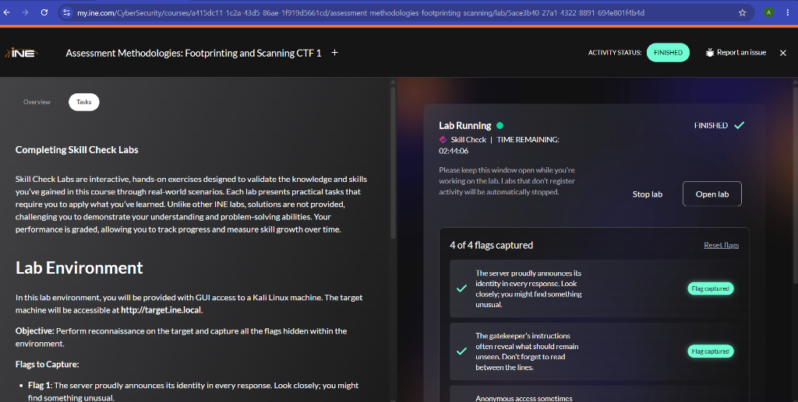
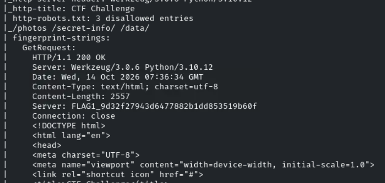
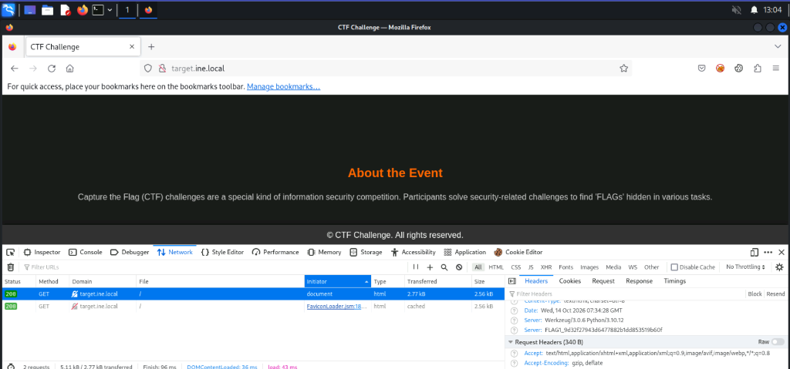
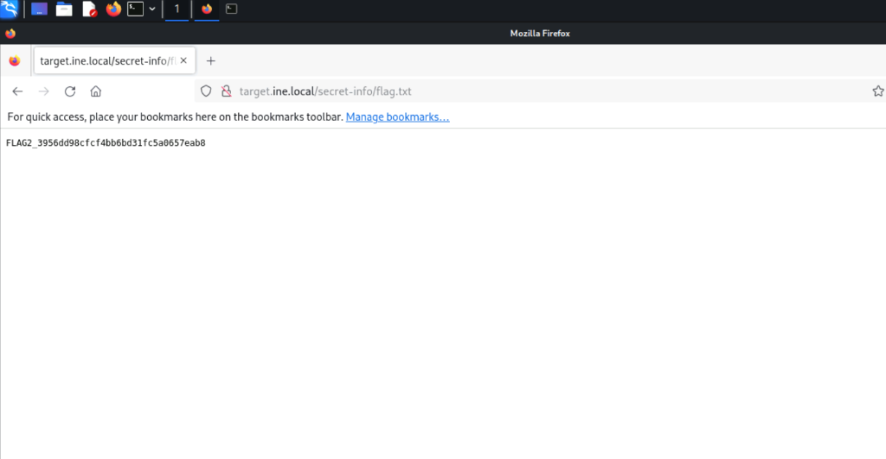
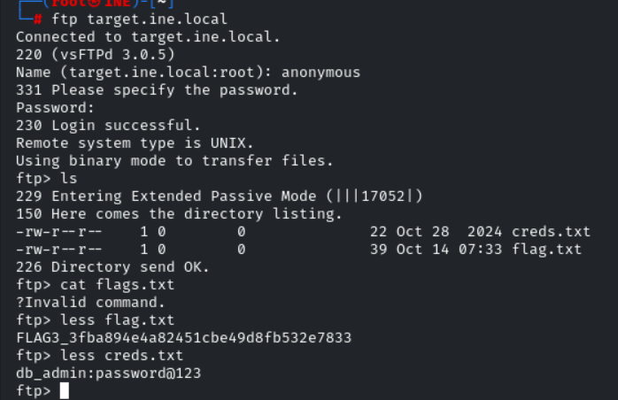
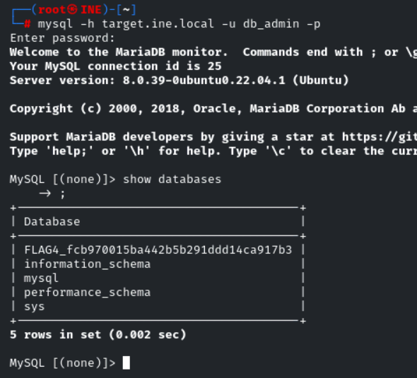

# 🔍 INE Lab: Assessment Methodologies — Footprinting and Scanning CTF 1

**Platform:** INE Security  
**Course / Certification:** eJPT (Junior Penetration Tester)  
**Category:** Assessment Methodologies: Footprinting & Scanning / Host & Networking Auditing  
**Target:** `http://target.ine.local` (`192.173.174.3`)  
**Difficulty:** Easy  
**Status:** ✅ Completed (4 of 4 Flags Captured)  
**Date Completed:** 2026-10-14  
**Author:** adiiiii-ti  

---

## 📝 Objective / Summary

The objective of this Skill Check lab is to perform comprehensive host and network reconnaissance against the target environment at `target.ine.local`. By systematically scanning open ports, analyzing banner information, inspecting HTTP response headers, discovering hidden paths via search engine gatekeepers (`robots.txt`), leveraging insecure anonymous FTP access, and querying remote database services, all **4 hidden flags** are discovered and captured.



---

## 🛠️ Tools Used

- **Nmap** (`7.94SVN`) — TCP port discovery, service version detection (`-sV`), and default NSE script execution (`-sC`).
- **DIRB** (`v2.22`) — Web content scanner for locating hidden endpoints and configuration files.
- **FTP Client** (`vsFTPd 3.0.5`) — Interactive client for anonymous file retrieval.
- **MySQL / MariaDB Client** (`8.0.39`) — Direct remote database connection and schema enumeration.
- **Mozilla Firefox & DevTools** — Manual web inspection and HTTP response header analysis.

---

## 🏁 Flags Quick Summary

| Flag | Value | Challenge Hint / Method | Location |
| :--- | :--- | :--- | :--- |
| **FLAG 1** | `FLAG1_9d32f27943d6477882b1dd853519b60f` | *"The server proudly announces its identity in every response."* | HTTP `Server` response header |
| **FLAG 2** | `FLAG2_3956dd98cfcf4bb6bd31fc5a0657eab8` | *"The gatekeeper's instructions often reveal what should remain unseen."* | `http://target.ine.local/secret-info/flag.txt` (`robots.txt`) |
| **FLAG 3** | `FLAG3_3fba894e4a82451cbe49d8fb532e7833` | *"Anonymous access sometimes..."* | vsFTPd Port 21 Anonymous login (`flag.txt`) |
| **FLAG 4** | `FLAG4_fcb970015ba442b5b291ddd14ca917b3` | Stolen credentials pivot | MySQL Port 3306 Database Name (`SHOW DATABASES;`) |

---

## 🔍 Phase 1: Port Scanning & Service Fingerprinting

We executed an Nmap service detection and default script scan against `target.ine.local`.

> **Note on Nmap Syntax:** Passing a URL scheme like `http://target.ine.local` causes an error: `Unable to split netmask from target expression: "http://target.ine.local"`. Nmap accepts raw hostnames or IP addresses.

```bash
nmap -sV -sC target.ine.local
```

### Nmap Scan Output:
```text
Starting Nmap 7.94SVN ( https://nmap.org ) at 2026-10-14 13:06 IST
Nmap scan report for target.ine.local (192.173.174.3)
Host is up (0.000024s latency).
Not shown: 993 closed tcp ports (reset)
PORT     STATE SERVICE  VERSION
21/tcp   open  ftp      vsftpd 3.0.5
| ftp-anon: Anonymous FTP login allowed (FTP code 230)
| -rw-r--r--    1 0        0              22 Oct 28  2024 creds.txt
|_-rw-r--r--    1 0        0              39 Oct 14 07:33 flag.txt
22/tcp   open  ssh      OpenSSH 8.9p1 Ubuntu 3ubuntu0.10 (Ubuntu Linux; protocol 2.0)
25/tcp   open  smtp     Postfix smtpd
80/tcp   open  http     Werkzeug/3.0.6 Python/3.10.12
|_http-server-header: Werkzeug/3.0.6 Python/3.10.12
|_http-title: CTF Challenge
| http-robots.txt: 3 disallowed entries 
|_/photos /secret-info/ /data/
| fingerprint-strings: 
|   GetRequest, HTTPOptions: 
|     HTTP/1.1 200 OK
|     Server: Werkzeug/3.0.6 Python/3.10.12
|     Server: FLAG1_9d32f27943d6477882b1dd853519b60f
143/tcp  open  imap     Dovecot imapd (Ubuntu)
993/tcp  open  ssl/imap Dovecot imapd (Ubuntu)
3306/tcp open  mysql    MySQL 8.0.39-0ubuntu0.22.04.1
```

### Key Reconnaissance Findings:
1. **Port 21 (FTP):** `vsftpd 3.0.5` allows **anonymous FTP login**, exposing `creds.txt` and `flag.txt`.
2. **Port 80 (HTTP):** Python `Werkzeug 3.0.6` web server with a custom `Server` header leaking Flag 1, plus `robots.txt` disallowing `/secret-info/`.
3. **Port 3306 (MySQL):** Accessible externally.

---

## 🚩 Flag 1: HTTP Response Server Header

### INE Hint:
> *"The server proudly announces its identity in every response. Look closely; you might find something unusual."*

### Discovery & Verification:
During the initial service scan, Nmap’s HTTP fingerprint parser captured a custom HTTP response header:

```http
HTTP/1.1 200 OK
Server: Werkzeug/3.0.6 Python/3.10.12
Server: FLAG1_9d32f27943d6477882b1dd853519b60f
```



To verify directly in the browser, we opened **Firefox Developer Tools** (`F12`), navigated to the **Network** tab, refreshed `http://target.ine.local`, and inspected the **Response Headers**:

```http
Server: Werkzeug/3.0.6 Python/3.10.12
Server: FLAG1_9d32f27943d6477882b1dd853519b60f
```



**Flag 1:** `FLAG1_9d32f27943d6477882b1dd853519b60f`

> **Key Takeaway:** HTTP response headers often reveal exact software versions and backend architectures. Hardening standards require masking or removing sensitive response banners in production.

---

## 🚩 Flag 2: Reading the Gatekeeper (`robots.txt`)

### INE Hint:
> *"The gatekeeper's instructions often reveal what should remain unseen. Don't forget to read between the lines."*

### Discovery & Access:
Running DIRB and reviewing Nmap's `http-robots.txt` output showed 3 disallowed entries:

```bash
dirb http://target.ine.local
```

Disallowed directories found:
- `/_photos`
- `/secret-info/`
- `/data/`

The path `/secret-info/` stood out immediately. Navigating to `http://target.ine.local/secret-info/flag.txt` in the browser displayed the flag in plaintext:

```text
FLAG2_3956dd98cfcf4bb6bd31fc5a0657eab8
```



**Flag 2:** `FLAG2_3956dd98cfcf4bb6bd31fc5a0657eab8`

> **Key Takeaway:** `robots.txt` is purely an advisory file intended for web crawlers. Never rely on `robots.txt` for security or access control; any path listed inside it becomes an immediate target for attackers.

---

## 🚩 Flag 3: Anonymous FTP Login & Credential Harvesting

### INE Hint:
> *"Anonymous access sometimes..."*

### Discovery & Exploitation:
Nmap confirmed `ftp-anon: Anonymous FTP login allowed (FTP code 230)`. We initiated an interactive FTP session to `target.ine.local`:

```bash
ftp target.ine.local
```
- **Username:** `anonymous`
- **Password:** *(press Enter / blank)*

```text
Connected to target.ine.local.
220 (vsFTPd 3.0.5)
Name (target.ine.local:root): anonymous
331 Please specify the password.
Password: 
230 Login successful.
Remote system type is UNIX.
Using binary mode to transfer files.
ftp> ls
229 Entering Extended Passive Mode (|||17052|)
150 Here comes the directory listing.
-rw-r--r--    1 0        0              22 Oct 28  2024 creds.txt
-rw-r--r--    1 0        0              39 Oct 14 07:33 flag.txt
226 Directory send OK.
```

Reading the files:
```text
ftp> less flag.txt
FLAG3_3fba894e4a82451cbe49d8fb532e7833

ftp> less creds.txt
db_admin:password@123
```



**Flag 3:** `FLAG3_3fba894e4a82451cbe49d8fb532e7833`  
**Harvested Credentials:** `db_admin:password@123`

> **Key Takeaway:** FTP anonymous access is a critical misconfiguration when sensitive files or credentials reside in the FTP root. Plaintext credential storage in accessible directories enables lateral movement and service pivoting.

---

## 🚩 Flag 4: Remote Database Access via Stolen Credentials

### Discovery & Lateral Movement:
From our initial Nmap scan, Port **3306 (MySQL)** was open and reachable. Using the credentials recovered from FTP (`db_admin:password@123`), we connected to the remote MySQL database:

> **Command Note:** When supplying a password to the `mysql` CLI, running `-p password@123` with a space causes MySQL to interpret `password@123` as the target database name. The correct syntax is either `-p<password>` without space, or simply `-p` to enter it interactively.

```bash
mysql -h target.ine.local -u db_admin -p
# Enter password: password@123
```

Once connected, we listed the databases on the server:

```sql
MySQL [(none)]> show databases;
```

### Database Output:
```text
+-----------------------------------------+
| Database                                |
+-----------------------------------------+
| FLAG4_fcb970015ba442b5b291ddd14ca917b3 |
| information_schema                      |
| mysql                                   |
| performance_schema                      |
| sys                                     |
+-----------------------------------------+
5 rows in set (0.002 sec)
```



**Flag 4:** `FLAG4_fcb970015ba442b5b291ddd14ca917b3`

> **Key Takeaway:** Database services should never be exposed to the public internet unless protected by strict IP whitelisting or a VPN tunnel. Reusing default/weak credentials across services allows an attacker to escalate access across different infrastructure layers.

---

## 🧠 Key Learnings & Takeaways

1. **Header Hygiene:** Web application servers should suppress verbose server headers to avoid unnecessary information disclosure.
2. **Robots.txt is Not Access Control:** Sensitive endpoints must be protected with proper authentication schemes rather than simply hiding them in `robots.txt`.
3. **Disable Anonymous FTP:** Disable anonymous FTP logins (`anonymous_enable=NO` in `vsftpd.conf`) unless explicitly intended for public distribution.
4. **Credential Management:** Avoid leaving sensitive credentials in plaintext configuration or text files.
5. **Database Exposure:** Bind database engines to `localhost` (`127.0.0.1`) and enforce strong, randomized password policies.
