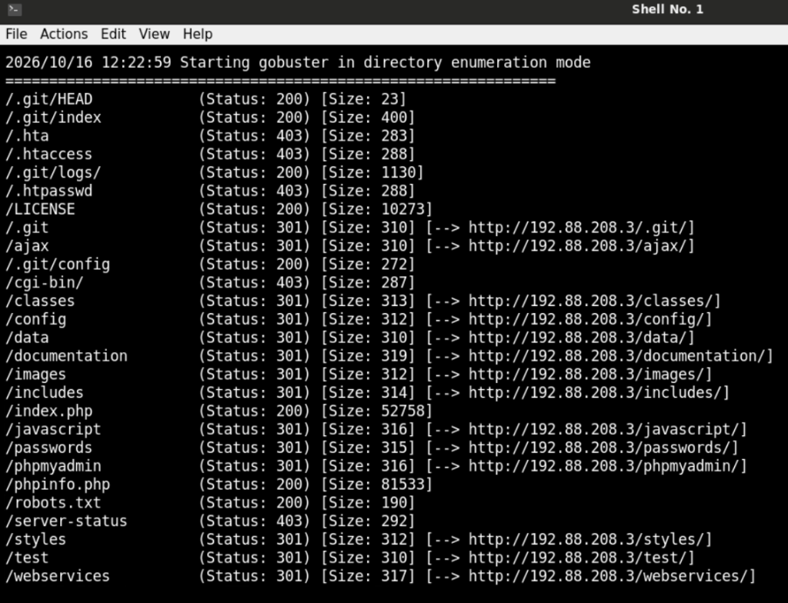
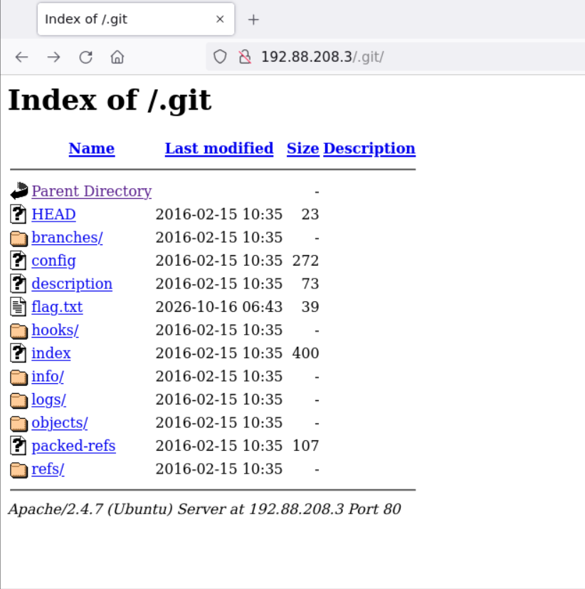
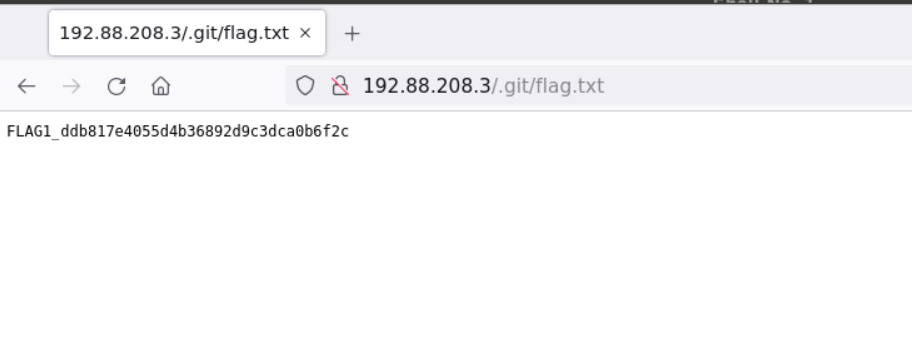
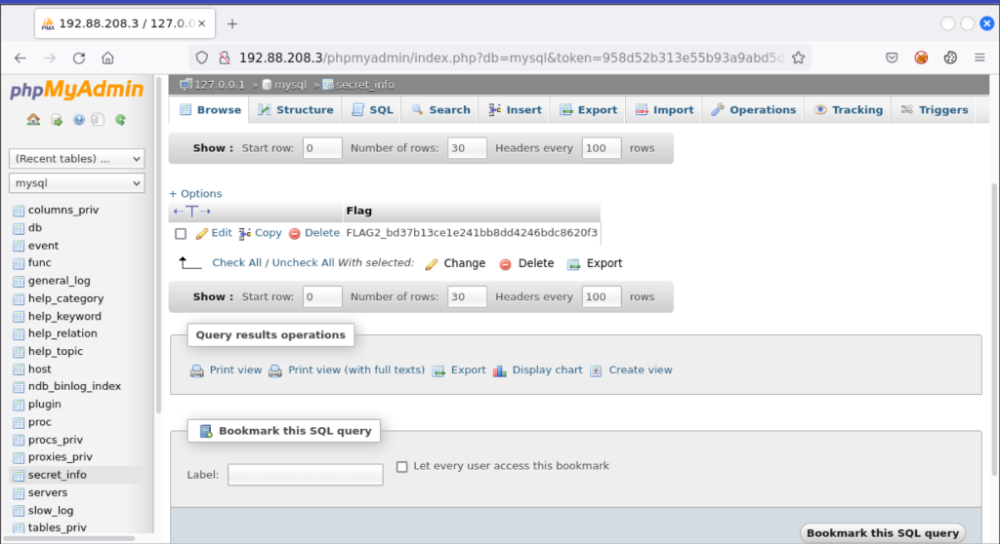
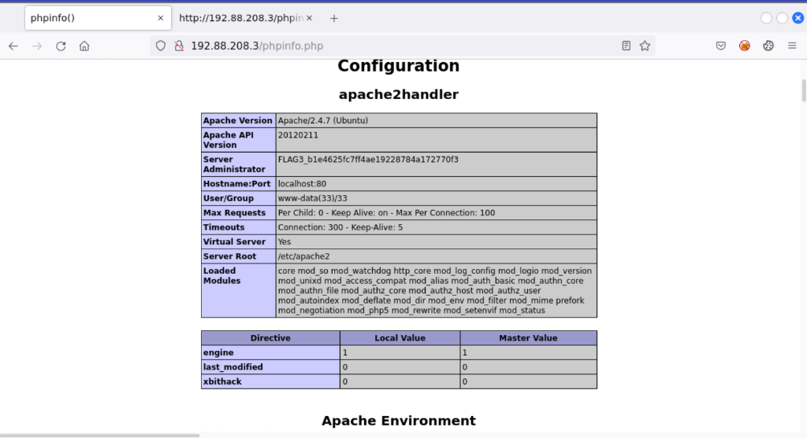
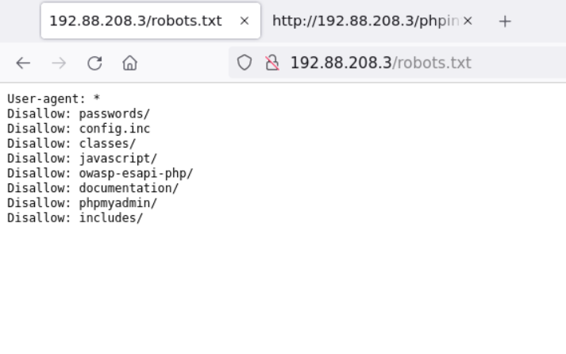
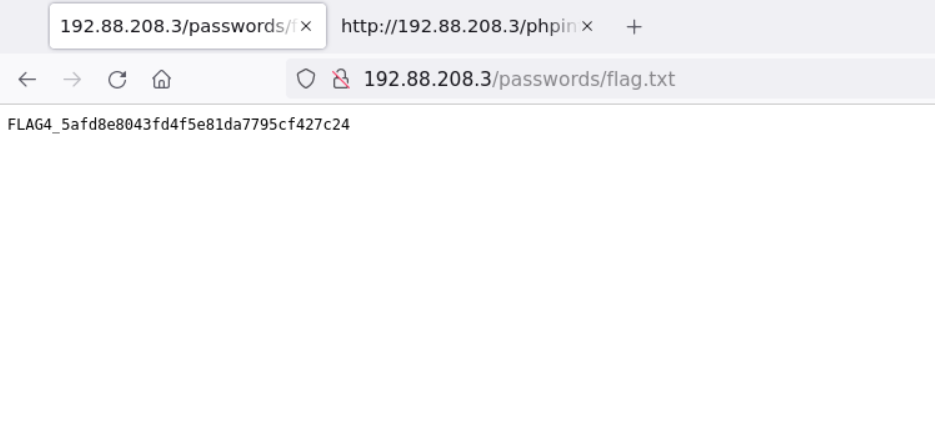

# 🔍 INE Lab: Assessment Methodologies — Web Application Footprinting & Directory Enumeration

**Platform:** INE Security  
**Course / Certification:** eJPT (Junior Penetration Tester)  
**Category:** Assessment Methodologies / Web Application Scanning & Enumeration  
**Target:** `http://192.88.208.3` (`target.ine.local`)  
**Difficulty:** Easy  
**Status:** ✅ Completed (4 of 4 Flags Captured)  
**Date Completed:** 2026-10-16  
**Author:** adiiiii-ti  

---

## 📝 Objective / Summary

The objective of this lab is to perform comprehensive web application footprinting and content discovery against an Ubuntu LAMP stack running on `192.88.208.3`. By leveraging Nmap NSE scanning, Gobuster directory fuzzing, examining search engine crawlers (`robots.txt`), investigating exposed version control repositories (`/.git/`), auditing administrative database frontends (phpMyAdmin), and inspecting diagnostic pages (`phpinfo.php`), we successfully locate and capture all **4 hidden flags**.

---

## 🛠️ Tools Used

- **Nmap** (`7.92`) — Port scanning, service version detection (`-sV`), and web discovery scripts (`http-robots.txt`, `http-git`).
- **Gobuster** (`v3.1.0`) — High-speed directory and file brute-forcing with SecLists wordlists.
- **SecLists** (`/usr/share/seclists/Discovery/Web-Content/common.txt`) — Wordlist for web content discovery.
- **Mozilla Firefox** — Manual web browsing, directory browsing, and database inspection.

---

## 🏁 Flags Quick Summary

| Flag | Value | Discovery Vector / Location |
| :--- | :--- | :--- |
| **FLAG 1** | `FLAG1_ddb817e4055d4b36892d9c3dca0b6f2c` | Exposed `.git` repository (`http://192.88.208.3/.git/flag.txt`) |
| **FLAG 2** | `FLAG2_bd37b13ce1e241bb8dd4246bdc8620f3` | Unauthenticated phpMyAdmin (`mysql.secret_info` table) |
| **FLAG 3** | `FLAG3_b1e4625fc7ff4ae19228784a172770f3` | Diagnostic `phpinfo.php` page (`Server Administrator` directive) |
| **FLAG 4** | `FLAG4_5afd8e8043fd4f5e81da7795cf427c24` | `robots.txt` path leakage (`http://192.88.208.3/passwords/flag.txt`) |

---

## 🔍 Phase 1: Port Scanning & Initial Reconnaissance

We began by scanning `target.ine.local` (`192.88.208.3`) with Nmap using version detection (`-sV`) and default scripts (`-sC`):

```bash
nmap -sC -sV target.ine.local
```

### Scan Output:
```text
Starting Nmap 7.92 ( https://nmap.org ) at 2026-10-16 12:16 IST
Nmap scan report for target.ine.local (192.88.208.3)
Host is up (0.000023s latency).
Not shown: 998 closed tcp ports (reset)
PORT     STATE SERVICE VERSION
80/tcp   open  http    Apache httpd 2.4.7 ((Ubuntu))
| http-robots.txt: 8 disallowed entries 
| passwords/ config.inc classes/ javascript/ 
|_owasp-esapi-php/ documentation/ phpmyadmin/ includes/
|_http-title: Site doesn't have a title (text/html).
| http-git: 
|   192.88.208.3:80/.git/
|     Git repository found!
|     Repository description: Unnamed repository; edit this file 'description' to name the...
|     Remotes:
|_      https://github.com/fermayo/hello-world-lamp.git
|_http-server-header: Apache/2.4.7 (Ubuntu)
| http-cookie-flags: 
|   /: 
|     PHPSESSID: 
|_      httponly flag not set
3306/tcp open  mysql   MySQL 5.5.47-0ubuntu0.14.04.1
| mysql-info: 
|   Protocol: 10
|   Version: 5.5.47-0ubuntu0.14.04.1
|   Thread ID: 9
|_  Auth Plugin Name: mysql_native_password
```

### Key Reconnaissance Findings:
1. **Port 80/TCP:** Apache 2.4.7 running on Ubuntu.
2. **`robots.txt` Leakage:** Nmap identified 8 disallowed directories/files (`passwords/`, `phpmyadmin/`, `config.inc`, etc.).
3. **Exposed Git Repository (`/.git/`):** Nmap’s `http-git` script immediately detected a live Git repo under the web root.
4. **Port 3306/TCP:** MySQL 5.5.47 running on the backend.

---

## 🔎 Phase 2: Web Directory Brute-Forcing with Gobuster

To ensure thorough path discovery beyond `robots.txt`, we fuzzed the web server using **Gobuster** with SecLists:

```bash
gobuster dir -u http://192.88.208.3:80/ -w /usr/share/seclists/Discovery/Web-Content/common.txt
```

### Gobuster Results:
```text
/.git/HEAD            (Status: 200) [Size: 23]
/.git/index           (Status: 200) [Size: 400]
/.git/logs/           (Status: 200) [Size: 1130]
/.git                 (Status: 301) [Size: 310] [--> http://192.88.208.3/.git/]
/.git/config          (Status: 200) [Size: 272]
/classes              (Status: 301) [Size: 313] [--> http://192.88.208.3/classes/]
/documentation        (Status: 301) [Size: 319] [--> http://192.88.208.3/documentation/]
/includes             (Status: 301) [Size: 314] [--> http://192.88.208.3/includes/]
/passwords            (Status: 301) [Size: 315] [--> http://192.88.208.3/passwords/]
/phpmyadmin           (Status: 301) [Size: 316] [--> http://192.88.208.3/phpmyadmin/]
/phpinfo.php          (Status: 200) [Size: 81533]
/robots.txt           (Status: 200) [Size: 190]
```



---

## 🚩 Flag 1: Exposed `.git` Repository & Directory Indexing

### Discovery:
Both Nmap (`http-git`) and Gobuster revealed that the `.git` directory was deployed directly inside the web document root (`/var/www/html/.git/`).

Navigating to `http://192.88.208.3/.git/` in the browser exposed the directory indexing view:



Inside the directory listing, `flag.txt` was visible. Opening `http://192.88.208.3/.git/flag.txt`:

```text
FLAG1_ddb817e4055d4b36892d9c3dca0b6f2c
```



**Flag 1:** `FLAG1_ddb817e4055d4b36892d9c3dca0b6f2c`

> **Key Takeaway:** Leaving `.git` directories accessible allows attackers to download complete source code, previous commits, credentials, and hardcoded secrets using tools like `git-dumper`. Production deployments should always exclude version control directories or deny access via web server configuration (`RedirectMatch 404 /\.git`).

---

## 🚩 Flag 2: Unauthenticated phpMyAdmin Database Enumeration

### Discovery:
`robots.txt` and Gobuster flagged `/phpmyadmin/`. Navigating to `http://192.88.208.3/phpmyadmin/` granted direct authenticated access without requiring credentials.

### Database Query:
1. In the left navigation tree, select the internal **`mysql`** system database.
2. Under `mysql`, a non-standard custom table named **`secret_info`** was present.
3. Browsing the table executed:
   ```sql
   SELECT * FROM `secret_info`
   ```

### Output:
```text
FLAG2_bd37b13ce1e241bb8dd4246bdc8620f3
```



**Flag 2:** `FLAG2_bd37b13ce1e241bb8dd4246bdc8620f3`

> **Key Takeaway:** phpMyAdmin instances should never be exposed to external or untrusted networks without robust authentication and network-level filtering. Allowing automatic login or default blank root passwords leaves the entire database engine compromised.

---

## 🚩 Flag 3: Information Leakage in `phpinfo.php`

### Discovery:
Gobuster returned an HTTP 200 OK for `/phpinfo.php`. Opening `http://192.88.208.3/phpinfo.php` displayed the full diagnostic output generated by PHP's `phpinfo()` function.

### Inspecting Server Directives:
Under the **Configuration > apache2handler** table:
- **Apache Version:** `Apache/2.4.7 (Ubuntu)`
- **Apache API Version:** `20120211`
- **Server Administrator:** `FLAG3_b1e4625fc7ff4ae19228784a172770f3`



**Flag 3:** `FLAG3_b1e4625fc7ff4ae19228784a172770f3`

> **Key Takeaway:** `phpinfo()` provides extensive internal intelligence, including PHP version, compile flags, extensions, server paths, and environment variables. Never deploy `phpinfo.php` scripts to production environments.

---

## 🚩 Flag 4: Gatekeeper Path Leakage (`robots.txt` -> `/passwords/`)

### Discovery:
Reviewing `http://192.88.208.3/robots.txt` in the browser:

```text
User-agent: *
Disallow: passwords/
Disallow: config.inc
Disallow: classes/
Disallow: javascript/
Disallow: owasp-esapi-php/
Disallow: documentation/
Disallow: phpmyadmin/
Disallow: includes/
```



The `Disallow: passwords/` directive immediately pointed to a sensitive directory.

### Accessing the Flag:
Navigating to `http://192.88.208.3/passwords/flag.txt`:

```text
FLAG4_5afd8e8043fd4f5e81da7795cf427c24
```



**Flag 4:** `FLAG4_5afd8e8043fd4f5e81da7795cf427c24`

> **Key Takeaway:** `robots.txt` is an index exclusion standard, not a security boundary. Disallowing sensitive directories without access controls acts as a directory roadmap for penetration testers and attackers.

---

## 🧠 Key Learnings & Takeaways

1. **Protect Version Control Assets:** Never copy `.git/` repositories into public web root directories (`/var/www/html/`). Configure web servers to return HTTP 403 or 404 for any `/.git/` requests.
2. **Restrict Administrative Panels:** Isolate phpMyAdmin behind localhost, require multi-factor authentication, or bind strictly to a management VPN.
3. **Remove Diagnostic Files:** Remove temporary test files like `phpinfo.php`, `test.php`, and database test scripts prior to release.
4. **Disable Directory Browsing:** Ensure `Options -Indexes` is set globally in `apache2.conf` to stop directory listing.
5. **Secure robots.txt:** Only include publicly accessible non-sensitive paths in `robots.txt`.
