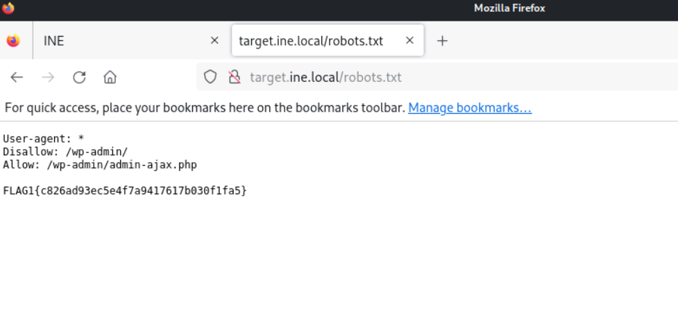
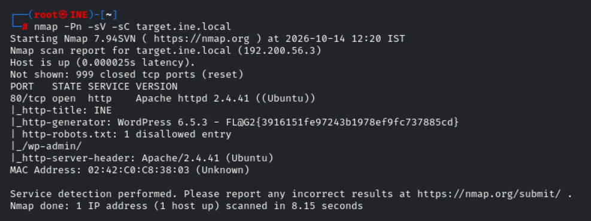
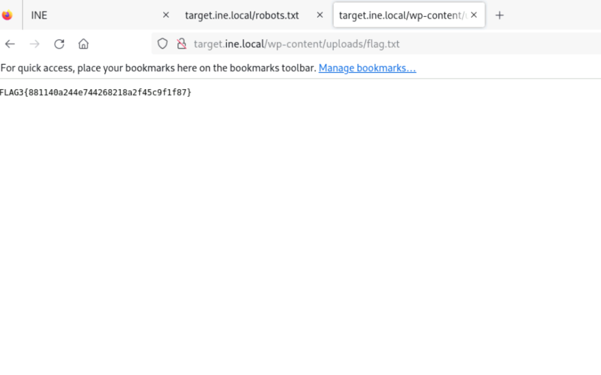
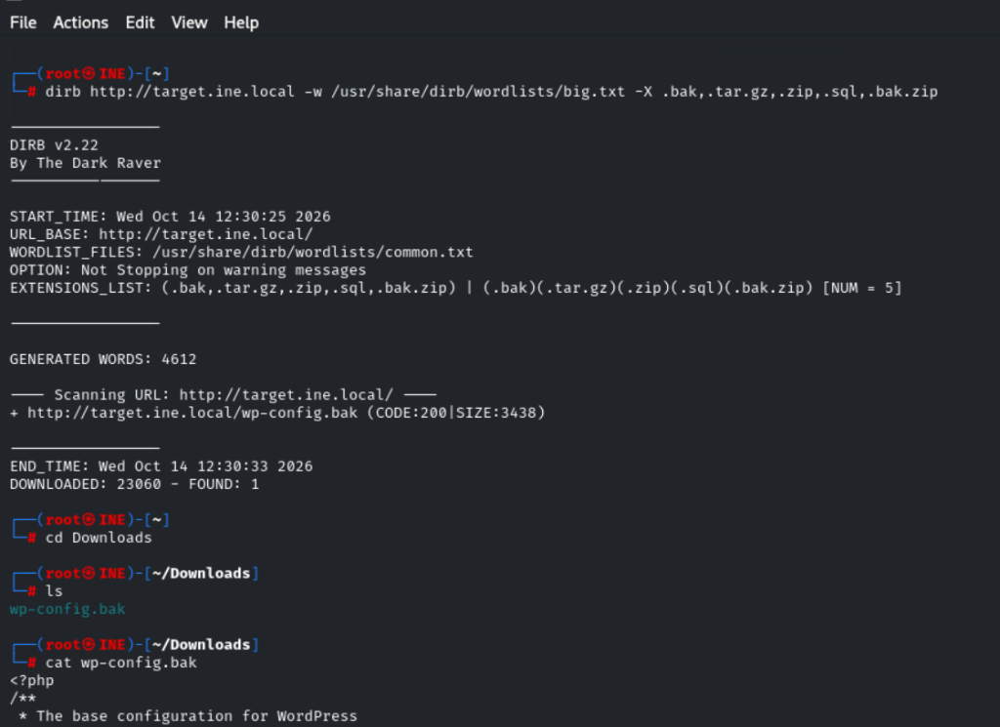
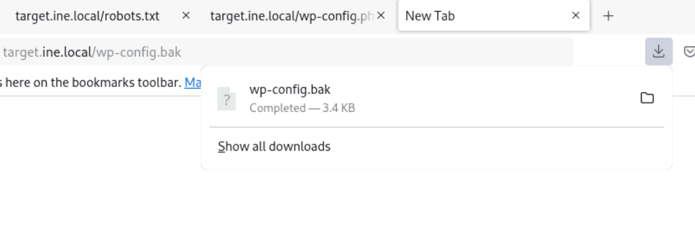
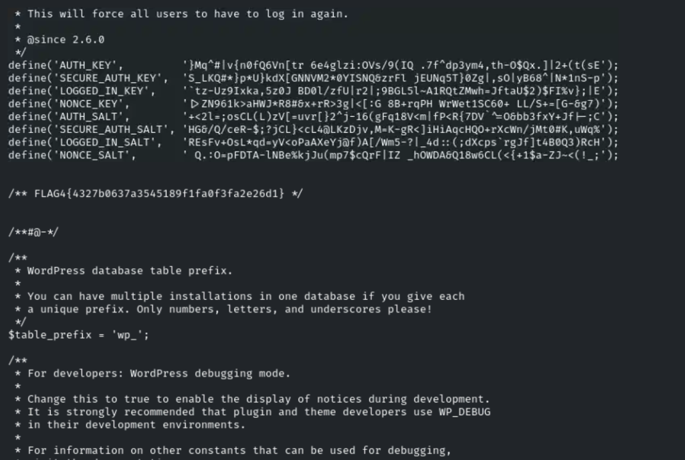
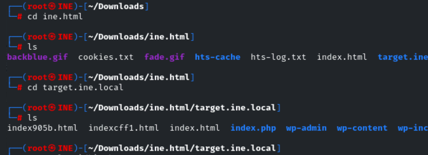
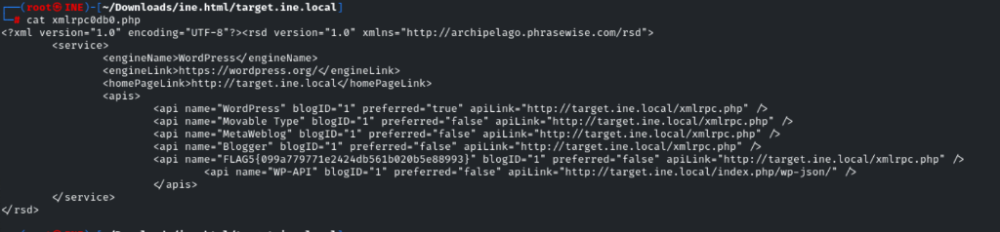

# 🔍 INE Lab: WordPress Enumeration Walkthrough

**Platform:** INE Security  
**Course / Certification:** eJPT (Junior Penetration Tester)  
**Category:** Assessment Methodologies / Web Application Enumeration  
**Target:** `http://target.ine.local` (`192.200.56.3`)  
**Difficulty:** Easy  
**Date Completed:** 2026-10-14  
**Author:** adiiiii-ti  

---

## 📝 Objective / Summary

The objective of this lab is to perform comprehensive information gathering and web application enumeration against a target running **WordPress 6.5.3**. Through methodical enumeration—ranging from service fingerprinting, inspecting misconfigured metadata, discovering listable directories, fuzzing for forgotten backup files, and offline site mirroring—we locate and recover all **5 hidden flags**.

---

## 🛠️ Tools Used

- **Nmap** (`7.94SVN`) — Host discovery, port scanning, service version detection, and default NSE scripts.
- **DIRB** (`v2.22`) — Web content scanner for directory enumeration and file extension fuzzing.
- **HTTrack** (`v3.49-5`) — Offline browser utility and web site mirroring copier.
- **Mozilla Firefox** — Manual web inspection and file verification.
- **Linux Core Utilities** — `cat`, `ls`, `cd`, file inspection.

---

## 🏁 Flags Quick Summary

| Flag | Value | Location / Method |
| :--- | :--- | :--- |
| **FLAG 1** | `FLAG1{c826ad93ec5e4f7a9417617b030f1fa5}` | `http://target.ine.local/robots.txt` |
| **FLAG 2** | `FL@G2{3916151fe97243b1978ef9fc737885cd}` | `nmap` NSE `http-generator` meta tag |
| **FLAG 3** | `FLAG3{881140a244e744268218a2f45c9f1f87}` | `http://target.ine.local/wp-content/uploads/flag.txt` |
| **FLAG 4** | `FLAG4{4327b0637a3545189f1fa0f3fa2e26d1}` | `http://target.ine.local/wp-config.bak` (Auth Salt Keys) |
| **FLAG 5** | `FLAG5{099a779771e2424db561b020b5e88993}` | `xmlrpc0db0.php` (HTTrack Mirrored RSD API list) |

---

## 🔍 Phase 1: Reconnaissance & Port Scanning

We began by running an Nmap script and version scan against the target.

> **Note on Syntax:** Providing `http://target.ine.local` directly to Nmap fails because Nmap expects a hostname or IP without the URI scheme (`http://`). Supplying `target.ine.local` resolved correctly to `192.200.56.3`.

```bash
nmap -Pn -sV -sC target.ine.local
```

### Scan Output:
```text
Starting Nmap 7.94SVN ( https://nmap.org ) at 2026-10-14 12:20 IST
Nmap scan report for target.ine.local (192.200.56.3)
Host is up (0.000025s latency).
Not shown: 999 closed tcp ports (reset)
PORT   STATE SERVICE VERSION
80/tcp open  http    Apache httpd 2.4.41 ((Ubuntu))
|_http-title: INE
|_http-generator: WordPress 6.5.3 - FL@G2{3916151fe97243b1978ef9fc737885cd}
| http-robots.txt: 1 disallowed entry 
|_/wp-admin/
|_http-server-header: Apache/2.4.41 (Ubuntu)
MAC Address: 02:42:C0:C8:38:03 (Unknown)

Service detection performed. Please report any incorrect results at https://nmap.org/submit/ .
Nmap done: 1 IP address (1 host up) scanned in 8.15 seconds
```

### Findings:
1. **Port 80/TCP:** Open, running **Apache httpd 2.4.41** on Ubuntu.
2. **Web Application:** **WordPress 6.5.3**.
3. **Robots file detected:** `/robots.txt` contains 1 disallowed entry (`/wp-admin/`).
4. **🚩 Instant Flag Discovery (FLAG 2):** The Nmap script `http-generator` grabbed the HTML `<meta name="generator">` tag, revealing **Flag 2** directly!

---

## 🚩 Flag 1: Information Leakage in `robots.txt`

The initial Nmap scan confirmed the presence of `/robots.txt`. Navigating directly to `http://target.ine.local/robots.txt` in the browser revealed the robots configuration and Flag 1 in plaintext:

```text
User-agent: *
Disallow: /wp-admin/
Allow: /wp-admin/admin-ajax.php

FLAG1{c826ad93ec5e4f7a9417617b030f1fa5}
```



> **Key Takeaway:** Developers and administrators often use `robots.txt` to tell search engines which paths to avoid indexing, but attackers read `robots.txt` as a map of interesting directories or sometimes find sensitive information left behind accidentally.

---

## 🚩 Flag 2: CMS Generator Meta Tag

During service fingerprinting, Nmap's default script engine (`-sC`) queried the root page and parsed the meta generator header:

```text
|_http-generator: WordPress 6.5.3 - FL@G2{3916151fe97243b1978ef9fc737885cd}
```



**Flag 2:** `FL@G2{3916151fe97243b1978ef9fc737885cd}`

> **Key Takeaway:** The `<meta name="generator" content="...">` tag informs the world about the exact software and version running on the site. Hardening WordPress best practices recommend disabling this tag (`remove_action('wp_head', 'wp_generator');`) to hinder automated version detection.

---

## 🚩 Flag 3: Listable Directories (`/wp-content/uploads/`)

Next, we performed directory fuzzing using **DIRB**:

```bash
dirb http://target.ine.local/
```

### DIRB Output Highlights:
```text
---- Scanning URL: http://target.ine.local/ ----
+ http://target.ine.local/index.php (CODE:301|SIZE:0)
+ http://target.ine.local/robots.txt (CODE:200|SIZE:108)
+ http://target.ine.local/server-status (CODE:403|SIZE:281)
==> DIRECTORY: http://target.ine.local/wp-admin/
==> DIRECTORY: http://target.ine.local/wp-content/
==> DIRECTORY: http://target.ine.local/wp-includes/
+ http://target.ine.local/xmlrpc.php (CODE:405|SIZE:42)

---- Entering directory: http://target.ine.local/wp-includes/ ----
(!) WARNING: Directory IS LISTABLE. No need to scan it.

---- Entering directory: http://target.ine.local/wp-content/uploads/ ----
(!) WARNING: Directory IS LISTABLE. No need to scan it.
```

DIRB alerted us with:
```
(!) WARNING: Directory IS LISTABLE. No need to scan it.
```
This indicated that Apache's `Options +Indexes` setting was enabled, allowing directory indexing for `/wp-content/uploads/`.

Browsing directly to `http://target.ine.local/wp-content/uploads/flag.txt`:

```text
FLAG3{881140a244e744268218a2f45c9f1f87}
```



> **Key Takeaway:** Directory browsing should always be disabled (`Options -Indexes`) across web servers, especially inside upload and asset folders where arbitrary files or forgotten flags can be directly read.

---

## 🚩 Flag 4: Sensitive Backup File Disclosure (`wp-config.bak`)

In WordPress environments, `wp-config.php` contains database credentials and secret authentication salts. When web administrators edit or back up files, they often create copies like `wp-config.php.bak`, `wp-config.bak`, or `wp-config.old`. 

Crucially, **web servers do not execute `.bak` files through the PHP engine**; instead, they serve them as plain text downloads!

We configured DIRB to fuzz for common backup extensions using the `-X` flag:

```bash
dirb http://target.ine.local -w /usr/share/dirb/wordlists/big.txt -X .bak,.tar.gz,.zip,.sql,.bak.zip
```

### DIRB Findings:
```text
---- Scanning URL: http://target.ine.local/ ----
+ http://target.ine.local/wp-config.bak (CODE:200|SIZE:3438)
```



The file was downloaded from `http://target.ine.local/wp-config.bak`:



Inspecting the contents of `wp-config.bak`:

```bash
cd Downloads
ls
cat wp-config.bak
```

### File Contents:
```php
<?php
/**
 * The base configuration for WordPress
 * ...
define( 'DB_NAME', 'test' );
define( 'DB_USER', 'test' );
define( 'DB_PASSWORD', 'test' );
define( 'DB_HOST', 'localhost' );
...
define('AUTH_KEY',         '}Mq^#|v{n0fQ6Vn[tr 6e4glzi:OVs/9(IQ .7f^dp3ym4,th-O$Qx.]|2+(t(sE');
define('SECURE_AUTH_KEY',  'S_LKQ#*}p*U}kdX[GNNVM2*0YISNQ&zrFl jEUNq5T}0Zg|,sO|yB68^|N*1nS-p');
define('LOGGED_IN_KEY',    '`tz-Uz9Ixka,5z0J BD0l/zfU|r2|;9BGL5l~A1RQtZMwh=JftaU$2)$FI%v};|E');
define('NONCE_KEY',        '|>ZN961k>aHWJ*R8#&x+rR>3g|<[:G 8B+rqPH WrWet1SC60+ LL/S+=[G-&g7)');
define('AUTH_SALT',        '+<2l=;osCL(L)zV[=uvr[}2^j-16(gFq18V<m|fP<R{7DV`^=O&bb3fxY+Jf|-;C');
define('SECURE_AUTH_SALT', 'HG&/Q/ceR-$;?jCL}<cL4@LKzDjv,M=K-gR<]iHiAqcHQO+rXcWn/jMt0#K,uWq%');
define('LOGGED_IN_SALT',   'REsFv+OsL*qd=yV<oPaAXeYj@f)A[/Wm5-?|_4d::(;dXcps`rgJf]t4B0Q3)RcH');
define('NONCE_SALT',       ' Q.:O=pFDTA-lNBe%kjJu(mp7$cQrF|IZ _hOWDA&Q18w6CL(<{+1$a-ZJ~<(!_;');

/** FLAG4{4327b0637a3545189f1fa0f3fa2e26d1} */
```



**Flag 4:** `FLAG4{4327b0637a3545189f1fa0f3fa2e26d1}`

> **Key Takeaway:** Backup file enumeration is a fundamental step in web pentesting. Never store uncompiled backup files (`.bak`, `.swp`, `.old`) under the web root.

---

## 🚩 Flag 5: Website Mirroring & RSD XML-RPC Endpoint (`xmlrpc0db0.php`)

To perform an exhaustive client-side audit of all assets, links, and API references, we utilized **HTTrack** to mirror the site locally:

```bash
httrack http://target.ine.local -O ine.html
```

HTTrack downloaded the complete website structure into `~/Downloads/ine.html/target.ine.local`.

```bash
cd ine.html
ls
cd target.ine.local
ls
```

### Directory Contents:
```text
index905b.html  indexcff1.html  index.html  index.php  wp-admin  wp-content  wp-includes  wp-login56d7.html  wp-loginc2b6.html  wp-login.html  xmlrpc0db0.php
```



Notice the file named `xmlrpc0db0.php`. In WordPress, querying `xmlrpc.php?rsd` produces a Really Simple Discovery (RSD) XML document describing the blog's available remote publishing APIs.

Inspecting `xmlrpc0db0.php`:

```bash
cat xmlrpc0db0.php
```

### File Output:
```xml
<?xml version="1.0" encoding="UTF-8"?><rsd version="1.0" xmlns="http://archipelago.phrasewise.com/rsd">
        <service>
                <engineName>WordPress</engineName>
                <engineLink>https://wordpress.org/</engineLink>
                <homePageLink>http://target.ine.local</homePageLink>
                <apis>
                        <api name="WordPress" blogID="1" preferred="true" apiLink="http://target.ine.local/xmlrpc.php" />
                        <api name="Movable Type" blogID="1" preferred="false" apiLink="http://target.ine.local/xmlrpc.php" />
                        <api name="MetaWeblog" blogID="1" preferred="false" apiLink="http://target.ine.local/xmlrpc.php" />
                        <api name="Blogger" blogID="1" preferred="false" apiLink="http://target.ine.local/xmlrpc.php" />
                        <api name="FLAG5{099a779771e2424db561b020b5e88993}" blogID="1" preferred="false" apiLink="http://target.ine.local/xmlrpc.php" />
                        <api name="WP-API" blogID="1" preferred="false" apiLink="http://target.ine.local/index.php/wp-json/" />
                </apis>
        </service>
</rsd>
```



**Flag 5:** `FLAG5{099a779771e2424db561b020b5e88993}`

> **Key Takeaway:** Mirroring websites with offline tools like HTTrack allows you to inspect all static assets, hidden script references, and API manifests without generating repeated requests against the target server.

---

## 🧠 Key Learnings & Remediation Summary

1. **Information Leakage in `robots.txt`:**
   - *Risk:* Exposes unlinked administrative paths and endpoints.
   - *Fix:* Use proper authentication and access control on administrative endpoints rather than relying on `robots.txt` obscurity.

2. **CMS Version Disclosure:**
   - *Risk:* Allows attackers to map exact CVEs and vulnerabilities to installed versions.
   - *Fix:* Remove generator meta tags in theme/plugin configurations.

3. **Insecure Directory Indexing:**
   - *Risk:* Attackers can browse directories (`wp-content/uploads/`) and uncover uploaded files and flags.
   - *Fix:* Set `Options -Indexes` in the Apache virtual host or `.htaccess` configuration.

4. **Forgotten Backup Files (`.bak`):**
   - *Risk:* Plaintext database passwords, secret keys, and salt tokens are downloaded directly.
   - *Fix:* Never save backups under the web root. Configure web server rules to deny requests to extensions like `.bak`, `.old`, `.swp`, `.sql`.

5. **Exposed XML-RPC and RSD Endpoints:**
   - *Risk:* XML-RPC can be leveraged for brute force amplification and SSRF attacks; RSD endpoints reveal internal API routes.
   - *Fix:* Disable `xmlrpc.php` if remote publishing APIs are not required.
